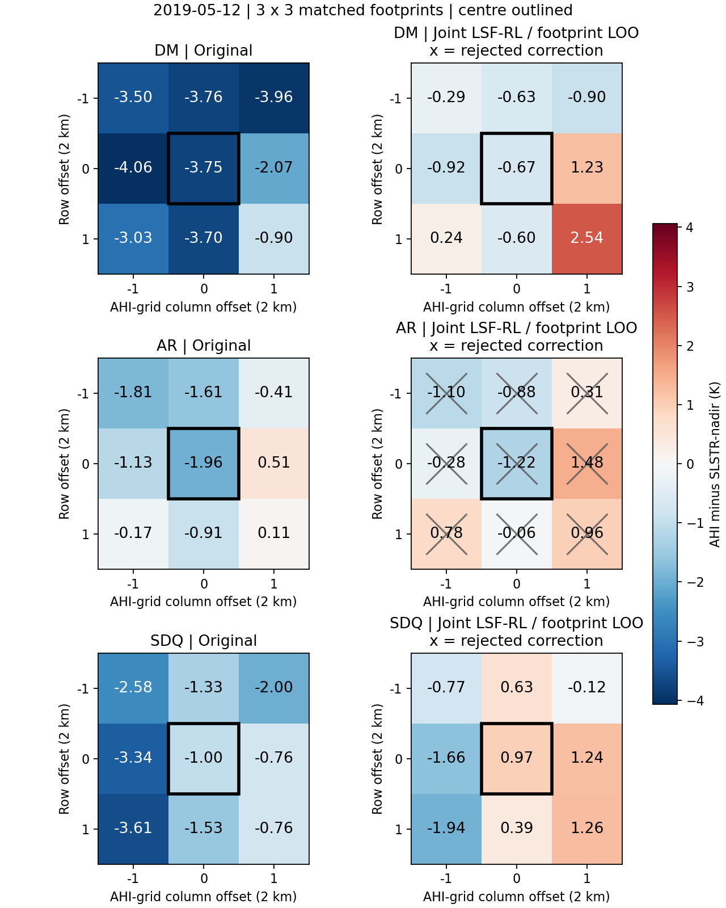

# 三站点 3×3 联合核驱动角度归一化

日期 2019-05-12；S3B 双视角 + AHI。参考方向为天底，保留各观测太阳几何。

**本地归档格网：SLSTR 1 km，AHI 2 km。3×3按AHI格网定义，约6×6 km；每方向对应6×6个SLSTR原生格网。** 每个2 km足迹包含4个SLSTR子像元，形成两个SLSTR方向温度加一个AHI温度；9个足迹最多27个粗尺度观测，不把AHI重复计数。

整窗共用LSF与RL两个角度系数（k=1固定），逐足迹背景温度由差分消去。在SLSTR原生子像元上施加角度修正后，再做10.85 μm等效辐亮度聚合；优化直接计算这一非线性聚合。既有LST不重复大气校正。

**AHI参与标定，所以不能再将AHI当作独立传感器验证。** 以下按整足迹留一法：每轮留出一个像元的全部3个方向，用其余最多8组拟合。邻近像元存在空间相关，9折不是9次独立实验。

## 配准与样本

|站点|原定窗口|SLSTR有效足迹|三方向完整足迹|AHI时间差/分钟|
|---|---:|---:|---:|---:|
|大满|9|9|9|4.0|
|阿柔|9|9|9|4.0|
|四道桥|9|9|9|3.0|

## 留出像元的差异（不是拟合残差）

|站点|配对数|AHI–SLSTR原始RMSE/K|联合核校正后RMSE/K|通过幅度门槛的配对数|
|---|---:|---:|---:|---:|
|大满|9/9|3.343|1.104|9|
|阿柔|9/9|1.169|0.905|0|
|四道桥|9/9|2.138|1.141|9|

## 站点中心：只用周围像元标定

|站点|SLSTR-nadir原始/K|SLSTR-oblique原始/K|AHI原始/K|SLSTR-nadir归一化/K|SLSTR-oblique归一化/K|AHI归一化/K|质量通过|
|---|---:|---:|---:|---:|---:|---:|---|
|大满|296.025|292.459|292.275|299.717|299.958|299.048|True|
|阿柔|297.279|294.675|295.320|306.205|307.859|304.984|False|
|四道桥|300.719|298.368|299.717|303.585|304.073|304.554|True|

**注意：质量未通过的norm值仅用于诊断，不能作为有效归一化温度。**
本次全部留一结果未通过门槛的站点：阿柔；其诊断RMSE下降也不能算有效产品改善。

## 边界

- 花寨子替换为阿柔后，原2019-10-30阿柔无完整AHI质量合格配对。按2019-05-01至10-31日期升序、同日S3A再S3B检查，选择首个三站各9组完整质量合格配对的日期2019-05-12 S3B；未使用拟合结果或残差选日，质量阈值不变。
- 3×3不按NDVI裁掉邻居，云/温度/时间/格网筛选保留。
- 输入为已投影归档，格网对齐不等于原生传感器PSF完全相同。SLSTR cloud=0和AHI tcc/1000≤0.2都是沿用的归档筛选；AHI后者为云量代理，不是原生云检测。AHI方向用140.7°E名义轨道推算。
- 温度/原生子像元修正≤10 K、归一化温度220–365 K、角度矩阵条件数≤100。norm_*保留诊断值，usable_norm_*只保留通过门槛的结果。没有按观测残差删点。
- 三个方向使用相同1 K误差假设决定拟合权重；这是情景权重，不是传感器独立误差标定。
- AHI进入拟合后，传感器光谱/反演偏差可能被角度系数吸收；拟合或留一一致性改善不等于已分离纯角度效应，亦不等于地面精度提高。
- models.json区分all_window_fit与leave_one_footprint_out。前者每站一组全窗口系数；后者逐折独立拟合，仅用于验证。station_results.csv保留中心留出结果。

