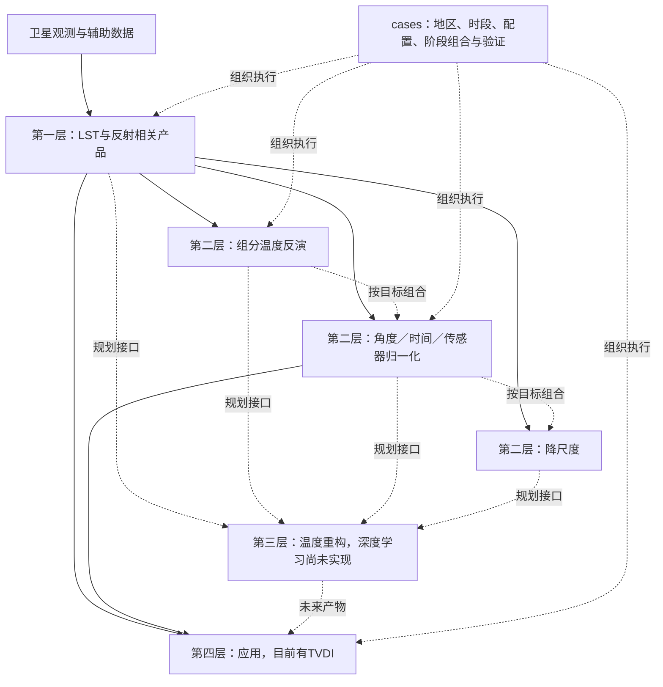

# LS4T 反演与优化方法手册：函数级盘点

盘点日期：2026-10-24。对象为 **`C:/work/ls4t` 当前工作树，包括未提交代码**；不是仅依据 Git HEAD，也不代表外部生产目录或已发布产品版本。HEAD 为 `9c17aa2ada8e5da7ca902b02ae6f3fc66cb34d90`，每个被扫描 Python 文件的 SHA-256 另存于函数索引 JSON。

同日功能补充：新增15个可组合核项、12个预设、固定形状WLS/有界形状参数minimize、单/双谐波ATC和留出比较案例。完整新接口见[核组合与ATC](C:/work/ls4t/docs/KERNELS_ATC.md)及本手册第五部分；函数索引已刷新。前四份分册描述原方法的具体数值行为，新接口不替换旧公式。

后续补充[TsHARP降尺度](C:/work/ls4t/docs/TSHARP.md)：数组/GeoTIFF入口用`method="tsharp"`选择，配套独立JSON和多源离线示例；详细说明见第六部分。

**组织原则：`base/` 承载可复用方法原版，`cases/` 保存针对传感器、地区、时段和实验目的的独立源码组合。** 组合允许把函数直接复制到案例执行脚本，不要求只调用 base。四层描述的是功能关系；初始盘点没有移动目录或修改科学算法，后续核组合/ATC增量见第五部分。新增三份[自包含参考组装](C:/work/ls4t/base/templates/references/README.md)，可复制到仓库外运行；旧案例和 base 批次兼容入口尚未整体迁移。

## 阅读入口

本手册随后合并四份详细清单及新增核组合/ATC接口；可以从这里直接打开分册或函数索引。

| 文档 | 主要内容 |
|---|---|
| [卫星产品层](C:/work/ls4t/docs/method_inventory/satellite.md) | 分裂窗公式、发射率、七类传感器入口、读写/几何、反射因子、NDVI及实际能力边界 |
| [组分反演与核优化](C:/work/ls4t/docs/method_inventory/components.md) | OLS/ridge、空间窗口、SLSQP、二次曲面、MAP、辐射物理、各角度核及逐项目标函数 |
| [归一化与合成](C:/work/ls4t/docs/method_inventory/normalization_and_compositing.md) | 角度、时间、传感器、空间归一化、降尺度、融合、合成、QA与产品契约 |
| [案例方法与缺口](C:/work/ls4t/docs/method_inventory/cases_and_gaps.md) | MSG/SLSTR/AATSR案例专有算法、组合流程、重复实现、LAI/建筑辅助方法与应用层 |
| [新增核组合与ATC](C:/work/ls4t/docs/KERNELS_ATC.md) | 核注册、自由组合、线性/形状参数拟合、单/双谐波ATC、日期与留出比较 |
| [新增TsHARP](C:/work/ls4t/docs/TSHARP.md) | NDVI聚合与覆盖率转换顺序、温度均值闭合、配置及离线案例 |
| [全量函数索引](C:/work/ls4t/docs/method_inventory/function_catalog.md) | 每个函数/方法的源文件行号、签名、说明、静态调用名及测试中的同名引用 |
| [机器可读索引](C:/work/ls4t/docs/method_inventory/function_catalog.json) | 文件哈希、完整定义信息、重复函数体分组；可用于后续迁移核对 |

每项核心方法尽可能写明：**函数 → 输入及单位/形状 → 输出 → 公式/目标函数 → 求解方法 → 参数与约束 → 失败处理 → 实际调用位置 → 测试证据和限制**。一般下载、绘图、路径处理、文档生成等工程助手保留在全量索引，不按独立反演方法计数。

## 一、四层如何承接现有代码



这些箭头表达允许的组合关系，不代表所有函数已用同一数据契约打通。组分反演通常依赖原观测几何及与之对应的有效权重；若先把温度归一到参考角度，权重仍沿用原角度，会改变反演问题。具体案例必须明确产品变量、时间、角度、空间支持、单位和质量标志，再决定顺序。

| 概念层 | 当前主要位置 | 当前实现状态 |
|---|---|---|
| 第一层：卫星产品 | `base/lst.py`、`base/{aatsr,slstr,msg,modis,viirs,ahi,aster}`及案例提取脚本 | 有双通道分裂窗LST及读写/预处理；反射相关功能包括读取、反射因子换算、NDVI，尚未确认完整公共地表反射率大气校正链 |
| 第二层：反演、归一化与尺度处理 | `base/lsct.py`、`base/lsct_window.py`、`base/fitting.py`、`base/kernel.py`、`base/rt/`、`base/normalization/`、`base/composite/`、案例内求解函数 | 方法最丰富，但公共核心、历史兼容函数和案例专有实现并存 |
| 第三层：温度重构 | 尚无独立公共模块 | 有DTC曲线拟合；未发现深度学习温度重构的训练/推断实现。SLSTR reconstruct为几何对齐，北京LAI reconstruction为LAI补全 |
| 第四层：应用 | `base/applications/tvdi.py` | TVDI计算和批处理已存在；干湿边需输入。未发现火点、FRP、燃烧面积或火险模型实现 |
| 案例组合 | `cases/`、少量`tests/examples/` | 真实案例、实验、方法比较和工程脚本共存；9个登记案例不等于只有9种流程或9种方法 |

## 二、真正的反演与优化方法族

以下按计算问题分组，不把传感器包装、窗口大小、并行版本和复制函数分别算作新算法。精确默认值、公式及参数顺序见后续函数条目。

| 方法族 | 关键函数/对象 | 实际计算 | 主要位置与边界 |
|---|---|---|---|
| 双通道LST反演 | `SplitWindowModel.retrieve`、`retrieve_dual_channel_lst` | 八特征广义分裂窗；按水汽分箱、按观测角插值系数 | `base/lst.py`；七传感器共享核心，不是七套独立物理算法 |
| LAI到方向覆盖率、混合发射率 | `vegetation_fraction_from_lai`、`effective_emissivity` | 指数间隙概率、土壤/植被及散射混合 | 属反演输入构造；公共默认与部分旧案例不同 |
| 单像元多角多组分 | `retrieve_components` | 辐射域按观测标准差加权OLS，或固定λ的ridge | 先检查条件数，后求解；正值/温区为事后过滤，不是有界LS |
| 局部常数空间窗口 | `retrieve_components_window` | 窗口内多像元多方向共享组分辐射 | 增加方程数；仍依赖局部同组分温度假设 |
| 向量化二/三元窗口LS | `solve_3x3_least_squares`、`solve_5x5_three_components`、`solve_2x2_system_5x5`等 | 窗口累计正规方程、解析式或批量线性求解 | MSG案例内多份；大小、计数、行列式阈值、共同掩膜存在差异 |
| 正则线性回归 | `fitting_unknown_linear_sklearn` | RidgeCV、Lasso、BayesianRidge分支 | 模型选择与返回形式见函数；不能统一称为三组分Bayes反演 |
| 物理约束窗口优化 | `fitting_Nangle_Mcomponent_window` | 距离加权残差平方和，SLSQP；辐射上下界和差值/包络约束 | `base/lsct_window.py`；部分温差用辐射差近似；未检查优化success |
| 二次空间曲面 | `fitting_Nangle_Mcomponent_window_quadratic` | 每组分6个二维二次辐射系数，中心常数项转温度 | 旧公共函数存在SciPy `lstsq(rcond=...)`兼容风险；对照示例的NumPy版本应分开看 |
| 分阶段组分分解 | MSG `retrieve`、`msg_lsct_iter`及约束实验 | 阳照与合并项、残差阴影/植被、先验联合调整等组合 | 生产三变体核心相同；不同实验不能只凭two_stage命名视作等价 |
| 外部先验Tikhonov | `solve_joint_vectorized_with_prior` | `||Ax-y||² + λ||x-x_prior||²` | MSG案例；求解后阴影裁剪不等于联合约束最优解 |
| 高斯MAP与顺序约束 | SLSTR `slstr_lsct3_bayes_scene.scene`及其辅助函数 | 辐射似然、相关温度先验、温差软先验、两步Gauss–Newton和局部约束投影 | 真实计算仍在case；无MCMC或完整后验样本；AATSR同名Bayes变体需单独核查 |
| 角度核与方向拟合 | `kernel_*`、`model_*`、`cost_*`、`fitting_kernel_R_min/RL_min` | LSF、TLSF/VLSF、Thapke、Vin、LiDense/Sparse、Ross、RL、Solar、RPV及组合 | 核、前向模型、目标函数、优化器是不同角色；报告逐项写出目标，不凭名称等同文献标准模型 |
| DTC与时角联合拟合 | `model_DTC/cost_DTC`、`model_DTCRL/cost_DTCRL`、`model_DTCLSFRL/cost_DTCLSFRL`、`cost_KDTC_*` | 日变化余弦与方向项联合估计 | 历史DTC周期参数化不同于新24h余弦归一化；也不是DL温度填洞 |
| 三参数角度归一化 | `angular_basis`、`fit_directional_coefficients`、`normalize_directional` | 匹配参考差值的加权标定，再按参考核减观测核修正 | 新公共实现；要求同地点同时刻的可比参考样本 |
| 可配置核组合 | `KernelTerm`、`KernelModel`、`fit_kernel_model` | 15个核项、12个预设及自由组合；固定形状WLS或外层形状参数minimize、内层WLS | `normalization/kernels.py`；沿用旧核公式，显式保存核/系数顺序，处理失秩和Li参数共同缩放不可辨识 |
| 年温度周期ATC | `annual_phase`、`fit_annual_cycle`、`ATCFit.predict/normalize` | 单/双谐波WLS，预测季节曲线或保留观测异常的季节归一化 | `normalization/annual.py`；支持公历闰年，检查季节覆盖，不代表天气过程或真实云下温度重构 |
| 日变化时间归一化 | `diurnal_anomaly`、`fit_diurnal_cycle`、`normalize_local_solar_time` | 24h谐波拟合，转到目标当地太阳时 | 一个拟合调用对应一组样本；不自动按像元分组、不自动补缺测 |
| 传感器一致化 | `SensorHarmonization.apply` | 仿射温度校正及误差传播 | 参数由调用者提供，没有自动交叉传感器标定器 |
| 协变量降尺度 | `downscale_temperature` | 粗尺度回归→细尺度预测→补粗尺度残差→父像元均值闭合 | 整数嵌套网格、细尺度共同有效域；闭合温度均值，不是Planck辐射守恒 |
| TsHARP降尺度 | `tsharp_cover_fraction`、`downscale_tsharp` | 聚合NDVI→覆盖率转换→粗尺度OLS→细预测→面积均值残差回补 | `method="tsharp"`，单NDVI，标准固定0/1端元和0.625指数；不含局部回归/场景端元估计 |
| 重网格/空间聚合 | `aggregate_to_grid`、`project_observation`、`mosaic_*` | 加权聚合、投影分箱、选优拼接 | 不因输出更细就成为物理降尺度；拼接选优不同于多源统计融合 |
| 多源融合 | `fuse_l3n` | 逆方差初值、创新阈值筛选、逆方差融合 | 需一致profile/网格；误差模型未显式处理来源间相关误差 |
| 时间/月合成 | `temporal_composite`、`monthly_paired`及案例月合成 | 逆方差合成、共同掩膜算术月均、逐日等权等不同实现 | 不能统一称为同一种“月合成”；逐文件、逐时次、逐日的权重语义不同 |
| 干旱指标 | `tvdi`、`tvdi_years` | `TVDI=(T-Twet)/(Tdry-Twet)`并裁剪 | 已有应用计算；干湿边系数不自动反演，不代表已完成干旱验证 |

物理支撑函数也已逐项列出：Planck/逆Planck、间隙与热点概率、散射角、有效发射率、`Hom`前向类、空间权重、初值和约束构造。它们是反演可复用组件，不单独冒充温度反演算法。

## 三、cases 应承载的组合及目前实际归属

| 案例/组合 | 当前可见的主要链条 | 仍在案例内的计算 |
|---|---|---|
| MSG双圆盘组分反演 | 同时双视角LST+LAI+几何→权重→窗口/分阶段组分解→QA→时次/月合成→参考配对 | 多种窗口解、约束、先验联合解与生产`retrieve`；compatible/declared/hybrid主要区别在几何策略 |
| SLSTR两组分场景 | 双视角LST与权重→5×5局部LS→组分温度 | `scene`直接选择窗口样本并调用`lstsq`，不是已完全委托统一公共入口 |
| SLSTR三组分Ridge | 热点权重→3×3窗口正则回归→组分温度 | 窗口构造、拟合和过滤 |
| SLSTR三组分MAP | 双视角→温度/辐射先验→两步MAP近似→顺序约束→物理筛选 | 先验、Gauss–Newton、约束投影等主要计算 |
| AATSR多种研究脚本 | 双角度→LS/Ridge/约束/二次曲面或先验变体→站点评价 | 部分算法分支、未完成函数和维度问题仍保留；不能整体标“成熟Bayes链” |
| 多源归一化示例 | 输入LST栅格→角度→时间→协变量降尺度（按case配置选择阶段） | 以公共函数为主，case负责参数、路径和输出；有离线合成示例，无新增真实区精度结论 |
| 温度时间/月合成 | LST/组分共同有效筛选→分时次/日/月统计 | SLSTR五温度月产品有特定逐日覆盖/等权规则；不同于统一逆方差合成 |
| MSG/AATSR受控方法比较 | 同一输入/有效域→多个求解器→约束消融/闭合/参考配对 | 为比较适配而写的数值实现和AST提取，不应作为生产公共库直接依赖 |
| 北京LAI/建筑 | EVI→经验LAI→谐波补全；建筑几何→覆盖率/结构统计 | 辅助地表变量计算；不归入温度DL重构或干旱/火灾应用 |

未来把case中的稳定计算下沉到公共库时，应保留具体方法标识、参数、组分顺序及回归证据；同名函数、相同函数体或相同输出波段数，都不足以证明整个案例数值等价。本轮只是定位这些边界，没有进行迁移。

## 四、盘点发现的具体缺口与使用限制

1. **地表反射率能力边界。** 反射波段读取、反射因子换算和NDVI已存在；完整地表反射率大气校正公共链尚未确认。第一层可以预留SR产品入口，但当前不能统一宣称LST/SR均已具备完整反演。
2. **温度重构与火灾仍是规划层。** 活动源码中未发现torch/tensorflow/keras训练推断链，也未发现火点/FRP/火险实现。DTC拟合、LAI补全、SLSTR几何重构各有用途，应按真实变量命名。
3. **算法副本与接口分散。** AST有170组相同函数体，包含为独立案例而有意保留的副本；人工核对的MSG生产三变体核心也相同。通用统计只比较函数体、保留体内文档字符串，忽略签名默认值；它是来源查对线索，不是全流程等价证明，也不要求删除案例副本。分册中的特定MSG对照另外去除了首层文档字符串。
4. **公共与旧案例默认参数不一致。** FVC、散射系数、热点、λ、窗口和有效掩膜都存在不同配置；整理时不能用公共默认参数静默替换生产设置。
5. **历史函数存在源码可见问题。** 旧二次曲面函数的SciPy关键字、`sample_hom_Emis2`调用缺失方法、`Hom.run`波长传递、`model_VinLiDense`系数下标、RPV实际公式、重名`cost_kernel_RLE_dif`覆盖、AATSR三组分Bayes维度等，均在对应条目指向代码。这些是静态审阅结论，本轮未逐项运行复现或修复。
6. **新归一化尚非完整统一产品链。** 角度/时间/降尺度栅格有阶段历史记录及网格检查，但不自动生成统一L3N误差产品；年目录包装与新栅格入口也不完全等价。融合profile回读对非默认参考条件的保留、空间聚合的误差语义，在分册中单列。
7. **评价统计需要审阅筛选规则。** 例如旧`cal_rmse_r2`先过滤绝对差≥9的样本，且R²返回形式有问题；不能把其数值直接当成未筛选全样本精度。内部辐射闭合、历史golden值和独立地面验证也必须分开。

## 五、范围与本轮验证记录

- 独立参考及存储边界补充后的AST解析：**297个Python文件、1,535个定义**；`base`539（含参考副本）、`cases`959、`tests/examples`37。按类型为普通函数1,355、类方法74、嵌套函数106；解析失败0。这个数字包含工具函数、包装器和复制定义，不是1,535种科学算法。初始盘点为291文件/1,431定义；核/ATC与TsHARP补充后为294文件/1,458定义。
- 扫描范围：`base/**/*.py`、`cases/**/*.py`、`tests/examples/**/*.py`。排除目录名`_archive`、`outputs`、`logs`、`runs`、`data`、`__pycache__`、`.case-state`、`.git`。排除历史归档有助于描述当前代码，不意味着归档内没有其它方法。
- 科学方法由分册逐段解释；全量索引补齐工程/数据处理定义。静态调用集合可能包含嵌套函数调用，测试同名引用可能只是字符串或其它同名对象；均不等于运行调用图、精确覆盖率或每个函数已逐行科学验证。
- **初始盘点全库测试：176 passed，3 skipped，用时14.24s。** `test_africa_download.py:14`因缺少shapely跳过；`test_beijing_building_structure.py:7`及`test_beijing_lai_8day.py:8`因缺少pyproj跳过。新增核组合/ATC的执行验证另见第五部分。
- **案例结构检查：9个登记案例通过。** 只验证登记结构，不执行科学处理，也不覆盖所有未登记的案例脚本。
- 没有下载原始产品、重跑区域反演、训练模型或重新计算独立地面精度；报告不新增RMSE/Bias优劣结论。

执行环境和命令（工作目录`C:/work/ls4t`）：

```powershell
& C:/work/miniconda/Scripts/conda.exe run -n python311 --no-capture-output python -B -m pytest -p no:cacheprovider -o addopts= -q -ra
& C:/work/miniconda/Scripts/conda.exe run -n python311 --no-capture-output python -B base/templates/audit_cases.py
```

索引可重建；详细分册是人工审阅记录，源码变更后须重新核对公式和参数，不会由AST自动更新：

```powershell
python docs/method_inventory/build_inventory.py
python docs/method_inventory/build_report.py
```

以下为四份分册与新增接口说明的完整内容。

---

## 第一部分：卫星产品层

盘点日期：2026-10-24；对象：`C:/work/ls4t` 当前工作树。本文依据函数体及测试体阅读，不依据函数名推定能力；下面的“测试证据”解释测试定义及其实际断言。本轮全库测试执行结果见总报告的验证记录；未重新运行区域科学实验或独立地面精度评价。

### 1. 层级与计数边界

- 已存在一个公共 **八特征广义分裂窗 LST 核心**，AATSR、SLSTR、MSG、MODIS、VIIRS、AHI、ASTER 的公共 `retrieve_*_lst` 是传感器数据映射入口，不能计为七个独立反演算法。
- AATSR 的 EPR N1、SLSTR 的 SEN3 NetCDF、MSG 的 Satpy native 读取在公共层有实现。MODIS、VIIRS、AHI、ASTER 公共 `read_native_product` 实际读取预处理好的 NPZ/GeoTIFF，不等于已经实现原始任务 HDF/NetCDF/HSD 的解析和定标。
- `slstr_reconstruct` 是几何、云与热红外网格对齐，保留原亮温；它属于卫星观测准备，不能放进“DL 温度重建”方法清单。
- 已读代码中可确认红光/近红外读取、辐亮度到反射因子换算、NDVI；未确认独立的地表反射率大气校正反演公共 API。不能把这些功能标成完整 Surface Reflectance 产品生产链。
- `cases` 内还保留实际公式、系数选择和编码；公共入口存在不代表所有案例已经调用它，也不代表公共默认参数与案例数值等价。

状态用语：**公共核心**＝无文件遍历的计算；**公共入口**＝可调用的读写/任务接口；**包装器**＝委托公共实现；**案例实现**＝公式或流程仍由案例持有；**兼容/历史**＝保留旧接口或旧单位语义。上述状态描述代码归属，不代替观测验证等级。

### 2. LST 计算核心及校准参数

| 函数/类与源码 | 输入、输出 | 实际计算及边界 | 状态与证据 |
|---|---|---|---|
| [`SplitWindowModel(view_zenith_nodes_deg, water_vapour_edges, coefficients, valid_temperature_range_k=(220,365))`](C:/work/ls4t/base/lst.py:23)；`retrieve(bt1_k, bt2_k, emissivity1, emissivity2, water_vapour, view_zenith_deg, *, cloud_mask=None)` | 输入可广播标量/数组；BT 为 K，角度为度，发射率无量纲；水汽单位必须与系数分箱一致，传感器入口为 cm。系数形状 `(Nv, Nw-1, 8)`。输出 `SplitWindowResult(temperature_k, quality_flag)`，形状为广播结果 | 水汽分箱；相邻 VZA 节点线性插值系数，再与八特征点乘。非有限/非正 BT、发射率不在 `(0,1]`、云、校准域外变 NaN 并置位；结果超温度范围变 NaN。VZA 最末节点允许，水汽最末边界不允许；不外推 | 公共核心。[八特征合成测试](C:/work/ls4t/tests/test_retrieval.py:10)只设置均温系数为 1；[校准域测试](C:/work/ls4t/tests/test_retrieval.py:26)、[网格约束](C:/work/ls4t/tests/test_retrieval.py:34) |
| [`vegetation_fraction_from_lai(lai, view_zenith_deg, projection_g=0.5)`](C:/work/ls4t/base/lst.py:127) | LAI 无量纲，度；可广播；输出方向植被覆盖比例 `[0,1]` | `f=1-exp(-G*LAI/cos(vza))`；要求 LAI≥0、`abs(vza)<89`、cos>0；否则 NaN | 公共核心；供 `retrieve_dual_channel_lst` 调用，未在上述测试文件发现单独覆盖全部边界的直接测试 |
| [`effective_emissivity(soil_emissivity, vegetation_emissivity, vegetation_fraction, *, scattering_factor=0.75, maximum=0.995)`](C:/work/ls4t/base/lst.py:145) | 三组可广播无量纲量；输出混合发射率 | `e=es*(1-f)+ev*f+(1-es)*ev*F*(1-f)`，限制最大 0.995；es、ev 必须在 `(0,1]`，f 在 `[0,1]` | 公共核心；F 是输入常数，不从卫星反演；不是地表反射率计算 |
| [`DualChannelObservation(...)`](C:/work/ls4t/base/lst.py:174) | BT1/2、土壤和植被各两通道发射率、LAI、水汽、VZA、可选云 | 统一内存字段载体；不负责原始产品缩放、空间配准或自动估算辅助参数 | 公共数据契约 |
| [`retrieve_dual_channel_lst(observation, model, *, scattering_factor=0.75)`](C:/work/ls4t/base/lst.py:189) | 统一观测与 `SplitWindowModel` → `SplitWindowResult` | 顺序调用方向 FVC、两个有效发射率、分裂窗；没有训练或系数拟合 | 公共核心组合；七传感器公共入口共同调用 |
| [`legacy_split_window_model(coefficient_table, view_zenith_nodes_deg, water_vapour_edges, *, coefficient_columns=slice(-8,None), valid_temperature_range_k=(220,365))`](C:/work/ls4t/base/calibration.py:13) | 二维旧系数表；要求截取后形状 `(Nv*(Nw-1),8)` → 模型 | 按 VZA-major 顺序 reshape；只转换既有系数，不估计系数 | 兼容适配；[round-trip](C:/work/ls4t/tests/test_calibration.py:8) |
| [`save_split_window_model(path, model, *, sensor, version)`](C:/work/ls4t/base/calibration.py:39)；[`load_split_window_model(path)`](C:/work/ls4t/base/calibration.py:71) | 模型↔非 pickle NPZ；schema、sensor、version、温度范围 | 原子写入；加载检查 schema、恢复模型。加载结果不保留 sensor/version 字段到 `SplitWindowModel`，调用链未核对系数文件的 sensor 与输入 sensor 是否一致 | 公共参数 IO；版本化存储不等于系数科学有效性验证 |
| [`import_legacy_coefficients(table_path, output_path, *, version)`](C:/work/ls4t/base/slstr/slstr_lst.py:42) | SLSTR 文本表→版本化 NPZ | 取列 `2:10`；VZA `[0,3,14.9,38.6,44.5,51.2,58,65,70,75,80]`；水汽边界 cm `[0,1.25,2.25,3.25,4.25,5.25,100]` | SLSTR 参数转换包装器，不是新增 LST 算法 |

八特征精确定义：令 `M=(BT1+BT2)/2`、`D=(BT1-BT2)/2`、`e=(e1+e2)/2`、`de=e1-e2`，则

```text
x = [1, M, (1-e)/e*M, de/e²*M, D, (1-e)/e*D, de/e²*D, (BT1-BT2)²]
LST = sum(c_i(VZA, water_bin) * x_i)
```

这条链需要已提供的土壤/植被发射率、LAI、水汽和有效系数；不能声称由双通道 BT 单独同时反演温度、发射率和大气状态。

### 3. 辐射与温度单位工具

| 函数与源码 | 输入→输出 | 公式、限制与状态 |
|---|---|---|
| [`planck_radiance(wavelength_um, temperature_k)`](C:/work/ls4t/base/radiometry.py:15) | 正波长 μm；K 标量/数组 → 光谱辐亮度 `W m⁻² sr⁻¹ μm⁻¹` | `C1/[λ⁵*expm1(C2/(λT))]`，C1=1.191042972e8、C2=1.438776877e4；T≤0→NaN；公共核心 |
| [`inverse_planck(wavelength_um, radiance)`](C:/work/ls4t/base/radiometry.py:27) | μm、上述光谱辐亮度→K | `C2/[λ*log1p(C1/(Lλ⁵))]`；L≤0→NaN；公共核心；[互逆测试](C:/work/ls4t/tests/test_physics.py:6) |
| [`decode_temperature(raw, *, scale, offset=0, fill_value=None, source_unit='K')`](C:/work/ls4t/base/radiometry.py:39) | 编码数组→float64 K 数组 | `raw*scale+offset`；显式摄氏度加273.15；原始 fill→NaN；不猜单位；[测试](C:/work/ls4t/tests/test_physics.py:12)。这是解码，不是 LST 反演或时空归一化 |
| [`planck(wavelength, Ts)`](C:/work/ls4t/base/radiometry.py:77)；[`inv_planck(wavelength, rad)`](C:/work/ls4t/base/radiometry.py:100) | 旧温度/辐射接口 | `planck` 自动把数值<100解释成摄氏度并加273.15，常数也与新接口略不同；`inv_planck`返回 K。兼容/历史，不能与显式单位接口混写而不记录差异 |

上述 Planck 是单波长转换，没有实现传感器光谱响应函数积分；亮温、地表温度和反射率是不同物理量。

### 4. AATSR：原始 N1 到公共 LST

公共数据 `AatsrDataProduct` 包含二维同形 `bt11_k/bt12_k`、VZA、经纬度、云；`view∈{nadir,forward}`；六辅助字段须全部有或全部无。来源见 [类定义](C:/work/ls4t/base/aatsr/aatsr_data.py:52)。

| 函数与源码 | 关键输入→输出与真实职责 | 限制/状态 |
|---|---|---|
| [`unzip_gzip(input_path, output_path, overwrite=False)`](C:/work/ls4t/base/aatsr/aatsr_data.py:117) | gzip→原始文件 Path | 文件准备，无反演 |
| [`read_native_product(input_path, view='nadir')`](C:/work/ls4t/base/aatsr/aatsr_data.py:130) | EPR N1→`AatsrDataProduct`；读 `btemp_*_1100/1200`、`view_elev_*`、经纬度、云旗标 | VZA=`90-elevation`；云=`flag!=0`，不是逐位精选云分类；经纬度必须已和 BT 同形，不自动重建。时间从文件名取第一个时间，start=end。需要 EPR；公共原始读取实现 |
| [`add_lst_auxiliary(item, auxiliary_file)`](C:/work/ls4t/base/aatsr/aatsr_data.py:170) | NPZ 中 `soil_emissivity_11/12`、`vegetation_emissivity_11/12`、`lai`、`tcwv_cm`广播到观测二维形状 | 附加现成辅助场；不包含辅助数据反演或重投影 |
| [`write_data_product(path,item)`](C:/work/ls4t/base/aatsr/aatsr_data.py:184)、[`read_data_product(path)`](C:/work/ls4t/base/aatsr/aatsr_data.py:208) | `ls4t.aatsr-data/v1` NPZ 与对象互转 | 保留源、角度、时间与可选辅助字段；读取校验 schema |
| [`aatsr_unzip(indir_zip,outdir_raw,years,months,days,overwrite)`](C:/work/ls4t/base/aatsr/aatsr_data.py:231)、[`aatsr_extract(indir_raw,outdir_extract,years,months,days,views,overwrite)`](C:/work/ls4t/base/aatsr/aatsr_data.py:267) | 以上全部参数默认 None；按年月日处理；提取产出每景/每视角 NPZ | 公共批处理入口；cases 负责执行路径 |
| [`retrieve_aatsr_lst(item, coefficient_file=None)`](C:/work/ls4t/base/aatsr/aatsr_lst.py:37) | 完整 AATSR 观测→公共 `SplitWindowResult` | 仅字段映射与公共核心调用；nadir/forward 不构成新分裂窗公式 |
| [`produce_aatsr_lst(input_path,output_path,coefficient_file=None,auxiliary_file=None,grid_id=None,algorithm_version=None,uncertainty_k=None)`](C:/work/ls4t/base/aatsr/aatsr_lst.py:57) | DATA+系数+辅助→L2LST 温度产品 NPZ；变量 lst、经纬度、QC、uncertainty | 必须有时间；默认不确定度1 K为用户参数填满，未从残差传播估计 |
| [`aatsr_lst(indir_data,outdir_lst,coefficient_file,auxiliary_file,years,months,days,overwrite)`](C:/work/ls4t/base/aatsr/aatsr_lst.py:111) | 参数均默认 None；按年月日、递归 NPZ 调用 `produce_aatsr_lst` | 批处理包装器 |

案例仍有 [cases/aatsr/aatsr_lst.py](C:/work/ls4t/cases/aatsr/aatsr_lst.py:15)：`cal_fvc_from_lai(thetav,lai)`实现方向 FVC；后续顶层脚本重复八特征分裂窗，输出 `lstN/lstO` 的 uint16、比例0.01。读取了 day/night 两张表，已读 nadir/forward 计算段取 `coeffs_day`，不能仅凭存在 night 文件认定两条昼夜路由均运行。案例读取函数 [`aatsr_read_obs(infile_obs)`](C:/work/ls4t/cases/aatsr/util_aatsr.py:174) 实际返回四组 BT/100，虽 docstring 写“红、近红外”，也不能据该注释认定为光学读取。

### 5. SLSTR：提取、几何对齐、LST 与产品 IO

| 函数与源码 | 输入→输出/计算 | 边界与状态 |
|---|---|---|
| [`unpack_archive(archive, output_directory)`](C:/work/ls4t/base/slstr/slstr_data.py:172) | ZIP→SEN3 Path | 带 archive 路径安全检查；[父路径测试](C:/work/ls4t/tests/test_slstr_products.py:38)、[盘符相对路径测试](C:/work/ls4t/tests/test_slstr_products.py:46)；文件准备 |
| [`extract_native_product(product_directory, *, view='nadir')`](C:/work/ls4t/base/slstr/slstr_data.py:241) | SEN3 目录→`SlstrExtractedProduct`；view nadir/oblique；S8/S9 BT(K)、原经纬度、tie-point VZA(度)、原 cloud | 从 `in/io` 热红外、`tn/to` 几何读取；保持各原始网格，BT8/9要求同形；公共原生提取 |
| [`reconstruct_product(item)`](C:/work/ls4t/base/slstr/slstr_data.py:289) | extracted→`SlstrDataProduct` | 把 VZA、经纬度、cloud最近邻resize到BT8形状；cloud非零为云；BT8/9保留。没有时序输入、学习权重或缺测温度估计；[4×4合成形状测试](C:/work/ls4t/tests/test_flat_structure.py:188) |
| [`read_native_product(product_directory, *, view='nadir')`](C:/work/ls4t/base/slstr/slstr_data.py:310) | `reconstruct_product(extract_native_product(...))` | 单景兼容组合包装器 |
| [`write_extracted_product(path,item)`](C:/work/ls4t/base/slstr/slstr_data.py:564)、[`read_extracted_product(path)`](C:/work/ls4t/base/slstr/slstr_data.py:589) | 每视角目录，各原生字段单独 GeoTIFF | 使不同分辨率网格暂不混为一个多波段文件；读取无规范 metadata 时从目录/景名推导 view/time |
| [`write_auxiliary_product(path,fields)`](C:/work/ls4t/base/slstr/slstr_data.py:437)、[`read_auxiliary_product(path,shape=None)`](C:/work/ls4t/base/slstr/slstr_data.py:450)、[`add_lst_auxiliary(item,auxiliary_file)`](C:/work/ls4t/base/slstr/slstr_data.py:316) | 六字段 `soil_emissivity_s8/s9`、`vegetation_emissivity_s8/s9`、lai、tcwv_cm；命名波段 TIFF或逐字段目录→dict/完整DATA | 读辅助时校验 shape；只附加现成已配准场，记录 auxiliary_source |
| [`write_data_product(path,item,*,reference_path=None)`](C:/work/ls4t/base/slstr/slstr_data.py:639)、[`read_data_product(path)`](C:/work/ls4t/base/slstr/slstr_data.py:680) | 统一二维 DATA↔命名波段 GeoTIFF | schema检查，保留单位、源、视角、时间、辅助来源；DATA是观测产品，不是LST |
| [`write_lst_product(path,product,*,reference_path=None)`](C:/work/ls4t/base/slstr/slstr_data.py:716)、[`read_lst_product(path)`](C:/work/ls4t/base/slstr/slstr_data.py:744) | 温度产品↔TIFF，`variable__*`、quality_flag、`uncertainty__*` | 温度产品schema与DATA分开；公共 IO |
| [`describe_data_product(item)`](C:/work/ls4t/base/slstr/slstr_data.py:777) | 对象→source/view/shape/time/辅助状态 dict | 状态查看，无新物理计算 |
| [`retrieve_slstr_lst(item,coefficient_file=None)`](C:/work/ls4t/base/slstr/slstr_lst.py:60) | 完整 DATA→公共分裂窗结果 | S8/S9及辅助字段映射；共同核心包装器 |
| [`produce_slstr_lst(input_path,output_path,coefficient_file=None,auxiliary_file=None,*,grid_id,algorithm_version,uncertainty_k,start_time=None,end_time=None)`](C:/work/ls4t/base/slstr/slstr_lst.py:83) | DATA→L2LST TIFF | 提供/补充时间、来源、QC；不确定度要求正数但为常量字段。 [合成 299 K 产品链测试](C:/work/ls4t/tests/test_slstr_products.py:54)，依赖 GDAL 时可能 skip，不是实测精度验证 |

公共批处理接口（均为文件编排，不新增方法）：

- [`slstr_unzip(indir_zip,outdir_raw,years,overwrite,start_index)`](C:/work/ls4t/base/slstr/slstr_unzip.py:28)；[`slstr_extract(indir_raw,outdir_extract,years,views,overwrite)`](C:/work/ls4t/base/slstr/slstr_extract.py:23)，默认参数均 None。
- [`slstr_reconstruct(indir_extract=None,outdir_reconstruct=None,years=None,overwrite=None)`](C:/work/ls4t/base/slstr/slstr_reconstruct.py:22)：扫描 `bt8.tif` 所在提取目录，调用前述几何对齐，输出 DATA TIFF。
- [`slstr_lst(indir_data=None,outdir_lst=None,coefficient_file=None,auxiliary_file=None,years=None,grid_id=None,algorithm_version=None,uncertainty_k=None,overwrite=None,input_year_template=None)`](C:/work/ls4t/base/slstr/slstr_lst.py:144)：默认 `{year}/reconstruct`→`{year}/lst`。
- `slstr_data.py` 末尾的同名 `slstr_unzip/extract/reconstruct/project/merge` 是转调阶段模块的兼容入口，不应重复计数。

实际 [cases/slstr/slstr_lst_scene.py](C:/work/ls4t/cases/slstr/slstr_lst_scene.py:198) 顶层场景计算使用 `f=1-exp(-0.825*LAI*0.5)`、`F=0.05`，与公共核心默认方向FVC、`F=0.75`不同。它还包含 BT/VZA/经纬度 /100 解码、土地类型掩膜、栅格抽样及 `LST*100` uint16输出；不能将公共入口存在视作该生产脚本已统一。

### 6. MSG/SEVIRI：公共入口与案例昼夜实现

| 函数与源码 | 输入→输出/实际计算 | 限制与状态 |
|---|---|---|
| [`read_native_product(input_path,static_file=None)`](C:/work/ls4t/base/msg/msg_data.py:113) | Satpy `seviri_l1b_native`、`fill_disk=True`，IR_108/120以brightness_temperature读入→`MsgDataProduct` | `bt8/bt9`名字虽无`_k`，内容是K；静态TIFF必须给经纬度和VZA。cloud从静态文件取，缺省全False；没有内建动态云检测。时间由文件名取，start=end |
| [`add_lst_auxiliary(item,auxiliary_file)`](C:/work/ls4t/base/msg/msg_data.py:150)、[`write_auxiliary_product(path,fields)`](C:/work/ls4t/base/msg/msg_data.py:166) | 六辅助字段GeoTIFF；108/120土壤和植被发射率、lai、tcwv_cm | 广播到同形；schema检查；现成辅助场 IO |
| [`write_data_product(path,item,*,reference_path=None)`](C:/work/ls4t/base/msg/msg_data.py:177)、[`read_data_product(path)`](C:/work/ls4t/base/msg/msg_data.py:213) | DATA↔命名波段TIFF | 规范化 bt108/bt120等别名；二维同形检查 |
| [`msg_extract(indir_raw,outdir_data,static_file,years,months,days,overwrite)`](C:/work/ls4t/base/msg/msg_data.py:242) | 参数均默认None；按日期从`.nat`产生`.tif` | 公共批处理 |
| [`retrieve_msg_lst(item,coefficient_file=None)`](C:/work/ls4t/base/msg/msg_lst.py:35) | 完整 DATA→公共分裂窗结果 | 单系数文件；此入口没有自动昼夜判别 |
| [`produce_msg_lst(input_path,output_path,coefficient_file=None,auxiliary_file=None,grid_id=None,algorithm_version=None,uncertainty_k=None)`](C:/work/ls4t/base/msg/msg_lst.py:55) | DATA→L2LST TIFF，lst/lat/lon/QC/常量uncertainty | 默认1 K为配置；不是由算法估计的不确定度 |
| [`msg_lst(indir_data,outdir_lst,coefficient_file,auxiliary_file,years,months,days,overwrite)`](C:/work/ls4t/base/msg/msg_lst.py:107) | 参数均默认None；年月日遍历 | 公共包装器 |

独立保留的案例函数（仍是同一八特征家族的配置变体，不能和公共入口默认为数值等价）：

| 案例函数与源码 | 输入→输出与算法 | 证据/边界 |
|---|---|---|
| [`retrieve_lst(bt108,bt120,view_zenith,tcwv_cm,soil_emissivity108,soil_emissivity120,vegetation_emissivity108,vegetation_emissivity120,lai,land_mask,day_mask,coefficients_day,coefficients_night)`](C:/work/ls4t/cases/msg/msg_lst_fit.py:213) | 同形二维观测+掩膜+两张 `(66,8)`系数表→float32 K；`f=1-exp(-0.825*LAI*0.5)`、散射0.05；逐像元由day_mask选表，水汽分箱+VZA系数插值；220–365K外NaN | 案例实现；VZA右端点80不包含，与公共模型最末节点策略不同；参数没有cloud_mask；[昼夜选择合成测试](C:/work/ls4t/tests/test_msg_case_dependencies.py:185) |
| [`load_coefficients(path)`](C:/work/ls4t/cases/msg/msg_lst_fit.py:133) | 文本8列或截取2:10→系数矩阵 | 检查形状，非拟合 |
| [`load_lai(path)`](C:/work/ls4t/cases/msg/msg_lst_fit.py:142) | HDF5 LAI→无量纲场 | 按 SCALING_FACTOR 除，MISSING_VALUE→NaN，范围0–10 |
| [`load_tcwv_slice(root,timestamp)`](C:/work/ls4t/cases/msg/msg_lst_fit.py:158) | 日HDF5的小时data→cm场 | `_FillValue`屏蔽；raw×scale_factor/10；非整点时邻小时线性插值含跨日；[缩放测试](C:/work/ls4t/tests/test_msg_case_dependencies.py:169) |
| [`solar_day_mask(timestamp,latitude,longitude)`](C:/work/ls4t/cases/msg/msg_lst_fit.py:183) | UTC时间、度制经纬度→bool日夜场 | 根据年内日、时角、赤纬估算cos太阳天顶角>0；用于系数路由，不是云判别 |
| [`read_native_brightness_temperatures(path)`](C:/work/ls4t/cases/msg/msg_lst_fit.py:317)、[`read_brightness_temperatures(path,input_format)`](C:/work/ls4t/cases/msg/msg_lst_fit.py:333) | native/既有TIFF读取通道BT | input_format为native/geotiff/auto；TIFF使用bt8/bt9配对且除100解码，非LST反演 |

### 7. MODIS、VIIRS、AHI、ASTER：四套名称、一个共用实现

| 传感器 | 数据定义/通道 | 直接LST入口 | 当前实际能力 |
|---|---|---|---|
| MODIS | [`ModisDataProduct`、SPEC](C:/work/ls4t/base/modis/modis_data.py:17)；31/32；准备键bt31_k/bt32_k | [`retrieve_modis_lst(item,coefficient_file=None)`](C:/work/ls4t/base/modis/modis_lst.py:11) | prepared数组→公共分裂窗；不等同于官方MODIS LST算法/产品读取 |
| VIIRS | [`ViirsDataProduct`、SPEC](C:/work/ls4t/base/viirs/viirs_data.py:17)；M15/M16；bt_m15_k/bt_m16_k，也接受bt15_k/bt16_k | [`retrieve_viirs_lst(item,coefficient_file=None)`](C:/work/ls4t/base/viirs/viirs_lst.py:7) | 相同核心，尚不能以此声称原始VIIRS granule链已验证 |
| AHI | [`AhiDataProduct`、SPEC](C:/work/ls4t/base/ahi/ahi_data.py:17)；14/15；bt14_k/bt15_k | [`retrieve_ahi_lst(item,coefficient_file=None)`](C:/work/ls4t/base/ahi/ahi_lst.py:7) | 相同核心；不是HSD原始解包读取器 |
| ASTER | [`AsterDataProduct`、SPEC](C:/work/ls4t/base/aster/aster_data.py:17)；13/14；bt13_k/bt14_k | [`retrieve_aster_lst(item,coefficient_file=None)`](C:/work/ls4t/base/aster/aster_lst.py:7) | 配置式双通道分裂窗；本模块没有多通道TES温度发射率分离算法 |

四个包共同提供以下函数，均转调 `base.dual_thermal`，其中 `s`依次取`modis/viirs/ahi/aster`，名称展开后即实际函数名：

| 实际接口族 | 关键参数/输出 | 共用函数体 |
|---|---|---|
| `read_native_product(path)` | 只接收已解码K的准备NPZ/TIFF→对应Product；存在键别名、传感器检查，必须带start/end；缺cloud则全False | [`read_prepared_product(path,spec,product_type)`](C:/work/ls4t/base/dual_thermal.py:144) |
| `read_data_product(path)`、`write_data_product(path,item)` | 标准DATA对象↔NPZ或命名波段TIFF；二维同形，BT有限值须在100–500K | [`read_data_product(path,spec,product_type)`](C:/work/ls4t/base/dual_thermal.py:256)、[`write_data_product(path,item,spec)`](C:/work/ls4t/base/dual_thermal.py:196)、[validate](C:/work/ls4t/base/dual_thermal.py:93) |
| `add_lst_auxiliary(item,auxiliary_file)` | soil/vegetation_emissivity_1/2、lai、tcwv_cm；标量可广播；输出完整对象 | [`add_lst_auxiliary`](C:/work/ls4t/base/dual_thermal.py:293) |
| `modis_extract/viirs_extract/ahi_extract/aster_extract(indir_raw=None,outdir_data=None,years=None,months=None,days=None,overwrite=None)` | 日期目录prepared输入→DATA | [`extract_sensor_products(spec,product_type,*,...)`](C:/work/ls4t/base/dual_thermal.py:319) |
| `produce_modis_lst/produce_viirs_lst/produce_ahi_lst/produce_aster_lst(input_path=None,output_path=None,coefficient_file=None,auxiliary_file=None,grid_id=None,algorithm_version=None,uncertainty_k=None)` | DATA→L2LST产品；默认uncertainty=1K | [`produce_sensor_lst(input_path,output_path,spec,product_type,coefficient_file,auxiliary_file,grid_id=None,algorithm_version=None,uncertainty_k=None)`](C:/work/ls4t/base/dual_thermal.py:502) |
| `modis_lst/viirs_lst/ahi_lst/aster_lst(indir_data=None,outdir_lst=None,coefficient_file=None,auxiliary_file=None,years=None,months=None,days=None,grid_id=None,algorithm_version=None,uncertainty_k=None,overwrite=None)` | 日期目录遍历、单景产出 | [`retrieve_sensor_years(spec,product_type,*,...)`](C:/work/ls4t/base/dual_thermal.py:559) |
| `retrieve_*_lst` | 检查传感器/辅助字段并映射公共观测→分裂窗 | [`retrieve_sensor_lst(item,spec,coefficient_file)`](C:/work/ls4t/base/dual_thermal.py:476) |

直接测试：[四传感器prepared 2×3合成往返](C:/work/ls4t/tests/test_dual_thermal_sensors.py:46)、[错sensor拒绝](C:/work/ls4t/tests/test_dual_thermal_sensors.py:87)、[MODIS日期提取](C:/work/ls4t/tests/test_dual_thermal_sensors.py:126)、[MODIS小角度拼接](C:/work/ls4t/tests/test_dual_thermal_sensors.py:161)、[MODIS合成均温299K](C:/work/ls4t/tests/test_dual_thermal_sensors.py:173)。这些测试不能证明四传感器原始定标、系数适用性或真实LST精度。

### 8. 投影、拼接、区域产品：属于准备与产品组织

| 函数与源码 | 接口/运算 | 适用边界 |
|---|---|---|
| [`project_product(item,target_grid_file,projection_chunk_size=None,cloud_fraction_threshold=None)`](C:/work/ls4t/base/slstr/slstr_project.py:90) | SLSTR经纬度→目标CRS→目标像元索引；对BT、角度、经纬度、辅助场分别聚合；cloud比例>阈值或无样本为云 | 默认chunk=100000、cloud阈值0；不是物理下推，也不是DL超分辨；目标格网需显式提供 |
| [`project_aatsr_product(...)`](C:/work/ls4t/base/aatsr/aatsr_project.py:22)、[`project_msg_product(...)`](C:/work/ls4t/base/msg/msg_project.py:22)、[`project_modis_product(...)`](C:/work/ls4t/base/modis/modis_project.py:9)、`project_viirs_product/project_ahi_product/project_aster_product` | 同签名 `(item,target_grid_file=None,projection_chunk_size=None,cloud_fraction_threshold=None)`；转调`base.spatial.project_observation` | 公共投影包装；不独立计数 |
| `aatsr_project/msg_project` | `(indir_data,outdir_project,target_grid_file,years,months,days,projection_chunk_size,cloud_fraction_threshold,overwrite)`默认None | 日期目录处理 |
| `modis_project/viirs_project/ahi_project/aster_project` | 对应参数首项为`indir_extract`；转调 [`project_sensor_products`](C:/work/ls4t/base/dual_thermal.py:360) | 输入实际上是已标准化观测，不能直接传原始任务文件 |
| [`slstr_merge(indir_project=None,outdir_merge=None,years=None,overwrite=None)`](C:/work/ls4t/base/slstr/slstr_merge.py:29) | 按日期+view分组，`_merge_products`→`mosaic_observations(primary_field='bt8_k')` | 日内同视角拼接；案例仍应控制过境分组；[低VZA选择测试](C:/work/ls4t/tests/test_slstr_products.py:100) |
| [`aatsr_data_region/aatsr_result_region`](C:/work/ls4t/base/aatsr/aatsr_region.py:42)、[`slstr_data_region/slstr_result_region`](C:/work/ls4t/base/slstr/slstr_region.py:44)、[`msg_data_region/msg_result_region`](C:/work/ls4t/base/msg/msg_region.py:41) | 均`(input_paths=None,output_path=None,bounds=None)`；DATA先拼/裁再反演，或RESULT先反演再拼/裁；bounds西南东北 | 输入必须已同格网；不能混无关视角/时段。结果路径还可容纳组件温度，但拼接本身不是LSCT算法 |
| `modis_merge/viirs_merge/ahi_merge/aster_merge`，各`*_data_region/*_result_region` | 同样三参数；分别调用[`merge_sensor_data`](C:/work/ls4t/base/dual_thermal.py:444)/[`merge_sensor_results`](C:/work/ls4t/base/dual_thermal.py:459)；`combine_data_products(input_paths,spec,product_type,bounds=None)`在[428行](C:/work/ls4t/base/dual_thermal.py:428) | 共用机械操作；结果拼接核对sensor，按需裁剪 |

[tests/test_spatial_modes.py](C:/work/ls4t/tests/test_spatial_modes.py:57)存在观测晴空/小VZA优选、缺VZA拒绝、结果小不确定度优选及裁剪测试。它们验证选择与空间操作，不验证分裂窗实测误差。

### 9. 反射率相关功能：真实存在的范围

| 位置/函数 | 读入与输出 | 能力归属与不得推定的内容 |
|---|---|---|
| [cases/aatsr/aatsr_data.py 可见光读取段](C:/work/ls4t/cases/aatsr/aatsr_data.py:156) | EPR `reflec_nadir_0670/0870`、`reflec_fward_0670/0870`；源码注明已是百分数反射因子 | 案例内L1波段读取；该段无气溶胶/水汽/路径辐射大气校正，不能据`reflec`认定地表反射率 |
| [`aatsr_read_sites_obs(infile,ifNDVI=1)`](C:/work/ls4t/cases/aatsr/util_aatsr.py:80) | HDF5 nirN/nirF/redN/redF；ifNDVI=1返回两视角 `(NIR-red)/(NIR+red)`；否则四光学数组 | NDVI裁到[-1,1]，任一输入0置NaN；尽管读取并计算云掩膜，该函数返回NDVI时未使用云掩膜。案例读数/指数工具 |
| [`aatsr_read_NDVI(infile_obs)`](C:/work/ls4t/cases/aatsr/util_aatsr.py:154) | 四光学数组先/10再比值；返回ndviN/ndviF | 同比例缩放在比值中抵消；NDVI不等于大气校正后的反射率产品 |
| [cases/slstr/slstr_data_scene.py](C:/work/ls4t/cases/slstr/slstr_data_scene.py:363) | S2/S3 radiance、solar_irradiance；`refl=π*radiance/solar_irradiance[0]`，resize，×10000、clip、uint16→red/nir TIFF；oblique有相应段 | 现存辐亮度归一化反射因子；已读公式没有太阳天顶角余弦项，也无地表大气校正；仅按代码公式登记，不能标为完整TOA标准校正或SR反演 |
| [cases/msg/msg_extract_euro.py](C:/work/ls4t/cases/msg/msg_extract_euro.py:150)、[msg_extract_iodc.py](C:/work/ls4t/cases/msg/msg_extract_iodc.py:151) | Satpy `calibration='reflectance'`加载VIS006/VIS008/IR_016；输出红/近红外×100 uint16；EURO段按7<hour<19运行 | 原始辐射定标/光学提取；没有后续SR大气校正函数；时段筛选不能代替逐像元日照判别 |
| [base/rt/scatter.py](C:/work/ls4t/base/rt/scatter.py:19)参数`refl_soil/refl_leaf` | 反射参数被前向辐射传输使用 | 不是由卫星观测反演地表反射率；属于前向模型依赖，不能当成卫星SR产品方法 |

对公共 `base` 及非归档 `cases` 的反射关键词检索，再读取以上命中函数体后，未确认独立 `retrieve_surface_reflectance`、可运行的大气校正参数反演或通用SR产品schema。归档中存在其他反射关键词、下载脚本不改变此判定；本清单不声称对仓库外实现做了排除。建议在既定四层分类中把SR保留为“产品方向，现有子能力为光学读取/反射因子/NDVI”，而不是填报一个已经完成的反演方法。

### 10. 跨层关联与证据强度

- 卫星层公共链：原始/准备观测→DATA→辅助发射率/LAI/水汽→公共分裂窗→L2LST；投影、裁剪、拼接可按场景/区域顺序编排。
- LSCT是细化层，`base/*/*_lsct.py`入口应在细化清单展开；不能因同属传感器目录而把组件分解记成独立的单像元LST算法。
- `tests/test_msg_evo_sample.py`的真实月样本验证是已有LST输入的组件解算与邻域最小二乘一致性，不是这里的分裂窗从L1反演LST的地面验证。同理SLSTR EVO组件案例不能自动证明所有公共读取器和系数对真实场景有效。
- 当前明确证据分为：源码实现；合成数值/IO测试；案例中实际调用/重复公式。本文未提供独立地面LST对照精度、SR地面验证、传感器系数跨场景泛化结论。
- 本轮仅盘点；没有迁移函数、统一默认散射参数、变更编码、替换案例系数或运行生产任务。

---

## 第二部分：组分反演、物理模型与核优化

本清单读取 2026-10-24 工作树现有源码，包括未提交修改；只说明实际实现，不改变算法。`H,W` 为行列，`n` 为观测数，`m` 为组分数，`s` 为窗口边长。`A` 是有效发射率矩阵，`y` 是观测辐射，`x` 是待求组分黑体辐射；通常 `y=A x`，最后才用逆 Planck 得到 K。物理权重并非一般意义上和为 1 的面积比例。除最后另列的执行验证外，本文“异常/风险/会导致”的证据等级均为**源码可见风险**，不是在真实生产数据上复现的失败。

### 1. 方法边界与实际调用路径

|现有实现|实际估计问题|边界/先验的性质|
|---|---|---|
|`retrieve_components`|观测标准差加权 OLS，或固定 λ 的零中心 ridge|无界求解；正辐射、200–380 K 是求解后剔除，非 bounded least squares|
|`retrieve_components_window`|窗口内所有像元/角度共享同一 `m` 维辐射|常数窗口，不是温度二次曲面，也不自动使用距离权重|
|`lsct_window.fitting_Nangle_Mcomponent_window`|距离加权 SSE，SLSQP|辐射上下界、辐射差近似温差、观测包络不等式；没有检查优化成功|
|`fitting_Nangle_Mcomponent_window_quadratic`|每组分 6 个二维二次系数的线性 LS|实际拟合辐射二次曲面，输出中心常数项；当前存在调用关键字不兼容问题|
|`fitting_unknown_linear_sklearn`|RidgeCV/Lasso/BayesianRidge|只有 BayesianRidge 估计 Gaussian 权重/噪声精度；不等于区域三组分 MAP|
|MSG `solve_joint_vectorized_with_prior`|`||Ax-y||²+λ||x-x_prior||²`|外部先验中心的 Tikhonov；求解后裁剪阴影土壤，不是完整不等式优化|
|SLSTR `slstr_lsct3_bayes_scene.scene`|Gaussian 辐射似然+相关温度先验线性化+土壤/植被温差软先验|两步 Gauss–Newton MAP 近似与局部二次顺序约束投影；无 MCMC/后验样本输出|

在本次检索的非归档 `base/`、`cases/`、`tests/` Python 中未找到 `scipy.optimize.lsq_linear` 调用。不能把上述 OLS 的事后范围过滤描述成有界线性最小二乘。

可复用接口路径是 `sensor.retrieve_*_lsct → retrieve_components[_window] → inverse_planck → TemperatureProduct`。旧区域路径是 `LAI/角度/发射率 → effective_weights、εB(LST) → 常数/二次窗口/分阶段/MAP → inverse Planck → 产品文件`。二者需要分别保留名称和统计含义。

### 2. 通用反演接口

#### 2.1 `ComponentRetrievalResult`

[定义](C:/work/ls4t/base/lsct.py:18)：冻结 dataclass，字段 `temperature_k`、`radiance` 为 `(...,m)`，`residual_rms`、`condition_number`、`quality_flag` 为空间形状 `(...)`。冻结的是字段绑定，不保证数组元素不可变。没有组分后验协方差/温度标准差字段。

#### 2.2 `retrieve_components(observed_radiance, effective_weights, wavelength_um, *, observation_uncertainty=None, ridge=0, max_condition_number=1e6, valid_temperature_range_k=(200,380))`

[实现](C:/work/ls4t/base/lsct.py:26)。输入 `y:(...,n)`、`A:(...,n,m)`；两者空间及观测维必须相同，全局 `n>=m`，λ 不可负。σ 可广播到 `y`，缺省全 1，表示**辐射标准差**，不是 K 标准差。

逐像元删除 `y` 非有限、任一组分权重非有限、σ 非有限或 σ≤0 的观测；有效数 `<m` 标 `INPUT_INVALID|RETRIEVAL_FAILED`。令 `Ã=A/σ`、`ỹ=y/σ`，先算 `cond(Ã)`；非有限或 `>1e6` 标 `ILL_CONDITIONED|RETRIEVAL_FAILED`。这一检查在 ridge 之前，因此 ridge 不会救回已判奇异的矩阵。

λ=0 调 `np.linalg.lstsq(Ã,ỹ,rcond=None)`；λ>0 解 `(ÃᵀÃ+λI)x=Ãᵀỹ`，目标 `Σ((Ax-y)/σ)²+λΣx²`。`LinAlgError` 标失败；任一 `x<=0` 标 `OUT_OF_RANGE|RETRIEVAL_FAILED`。成功后记录的是**未加权、原辐射单位** `sqrt(mean((Ax-y)²))`，不是求解目标值或 K-RMSE。

逆 Planck 后任一组分非有限或超温区，整像元温度、辐射置 NaN，另加 `OUT_OF_RANGE`；该步骤本身不加 `RETRIEVAL_FAILED`，且已计算的残差/条件数可保留。没有非负权重、发射率总和、同地物同时间、太阳天顶角或组分顺序验证；这些由输入构造者保证。

#### 2.3 `retrieve_components_window(..., *, window_size=5, observation_uncertainty=None, ridge=0, max_condition_number=1e6, valid_temperature_range_k=(200,380))`

[实现](C:/work/ls4t/base/lsct.py:115)。严格接收 `y:(H,W,n)`、`A:(H,W,n,m)`；s 必须正奇数。边界以 NaN 补齐，逐中心把 `s×s×n` 行展平后交给上述函数；结果仍为 `H×W×m`。因此 `n<m` 可由空间上变化的权重补足秩，前提是窗口中组分辐射局部常量。边缘可以用不完整窗口反演；中心观测本身无效也可由邻域给出结果。没有最少有效像元比例、中心必须有效、空间相似性判断；只有内层有效观测数和条件数门槛。条件数、残差针对整个窗口。

#### 2.4 传感器准备文件适配

三个 `retrieve_*_lsct(input_path, output_path, wavelength_um=None, component_names=None, window_size=None, ridge=None, max_condition_number=None, grid_id=None, algorithm_version=None)` 都返回 `None`，写 L2LSCT 产品。默认 λ=0、10.8 μm、s=5、`('soil','vegetation')`、最大条件数 1e6。只有输入为三维 y、四维 A 且 `n<m` 时才走窗口；否则逐像元解，**不会因为设置 s=5 就对二组分两角度进行窗口反演**。组分名长度必须匹配 m；纬经度必须成对出现。它们不自行把 LST 转辐射，不估计 LAI，也不构造权重。

|函数|读取、写出与批处理|
|---|---|
|[`retrieve_slstr_lsct`](C:/work/ls4t/base/slstr/slstr_lsct.py:35)|`read_lsct_input` 读取准备好的输入；`write_lst_product` 写各组分温度、残差、条件数、可选经纬度与 QA；时间 metadata 用 `.get`|
|[`slstr_lsct(indir_lsct_input=None,outdir_lsct=None,years=None,overwrite=None)`](C:/work/ls4t/base/slstr/slstr_lsct.py:119)|必须提供 roots/years；遍历 `{year}/lsct_input/**/*.tif`，写 `{year}/lsct/..._lsct.tif`；存在且不 overwrite 则跳过|
|[`retrieve_aatsr_lsct`](C:/work/ls4t/base/aatsr/aatsr_lsct.py:36)|`np.load(...allow_pickle=False)` 读 NPZ、JSON metadata；`write_product` 写；metadata 的 start/end 必须存在|
|[`aatsr_lsct(indir_lsct_input=None,outdir_lsct=None,years=None,months=None,days=None,overwrite=None)`](C:/work/ls4t/base/aatsr/aatsr_lsct.py:115)|按年/月/日目录递归 NPZ，默认月 1–12、日 1–31，缺目录跳过，输出 `_lsct.npz`|
|[`retrieve_msg_lsct`](C:/work/ls4t/base/msg/msg_lsct.py:36)|NPZ 读准备的时空观测，`write_temperature_product` 写 GeoTIFF；通用求解仍假设同一 x，未在接口内引入 DTC|
|[`msg_lsct(indir_lsct_input=None,outdir_lsct=None,years=None,months=None,days=None,overwrite=None)`](C:/work/ls4t/base/msg/msg_lsct.py:118)|与 AATSR 相同日期遍历，写 `_lsct.tif`；无各场景异常收集、自动回退或重试|

### 3. 旧线性与约束窗口函数

#### 3.1 点拟合及回归器

- [`fitting_Nangle_Mcomponent_point(w,b,n,m,method='ridge')`](C:/work/ls4t/base/lsct.py:504)：`w:(n,m)`、`b:(n,)`，返回 `m` 维组分辐射；文档把 b 称“亮温”但函数没有 Planck 转换，物理反演调用必须传辐射。形状不符打印并返回整数 -1，未做 NaN/秩/温区/正值检查。支持 `ls/ridge/lasso/bayesianridge`，其他字符串会导致 p 未赋值。
- [`fitting_unknown_linear_ls(y,A)`](C:/work/ls4t/base/fitting.py:12)：直接 `scipy.linalg.lstsq(A,y)[0]`，返回系数，不返回 rank/singular values/residual。
- [`fitting_unknown_linear_sklearn(y,A,method='ridge')`](C:/work/ls4t/base/fitting.py:23)：`RidgeCV(alphas=[0.01],fit_intercept=False)` 实际只有一个候选 λ，不能宣传为广泛超参数搜索；目标 `||Ax-y||²+0.01||x||²`。Lasso 是 `Lasso(alpha=.01,fit_intercept=False)`，目标 `||Ax-y||²/(2N)+.01||x||₁`。`BayesianRidge(fit_intercept=False)` 由 sklearn 估计噪声/权重精度，但只返回 `.coef_`，没有返回 `.sigma_` 或预测不确定性。没有标准化、物理边界或成功状态；未知 method 返回初值标量 1.0。

#### 3.2 空间权重与初值/边界

[`set_weights(window_size)`](C:/work/ls4t/base/lsct.py:432) 及 [同名副本](C:/work/ls4t/base/lsct_window.py:104)：中心 `s//2`，距离 d≤s 时 `q=(1-(d/s)²)²`，否则 0；返回 `(s,s)`，未归一化。s 是**完整窗口边长**而不是半径，所以一般角点仍有正权重。

[`set_x0_bnds_Nangle_Mcomponent(lst,n,m,ws=None,wl=10.8)`](C:/work/ls4t/base/lsct.py:446) 用中心（若 ws 给出）或点的各角 LST：`T̄=nanmean(LST)`、`b=Bλ(LST)`。n 未实际参与计算。下表 bounds 是 K 偏移先经 Planck 转换；初值中的 +5/+10 等则直接加在**辐射**上，不能读成温度差。未 clip 初值。

|实现/组分数|辐射初值 x0|各组分 bounds 对 T̄ 的 K 偏移|
|---|---|---|
|base.lsct，m=2|`[max(b)+5,min(b)-3]`|`[-10,+40]；[-10,+10]`|
|base.lsct，m=3|`[max(b)+10,min(b)-5,mean(b)]`|`[-10,+40]；[-30,+30]；[-10,+20]`|
|base.lsct，m=4|`[max(b)+10,min(b)-5,mean(b),min(b)-5]`|`[-10,+40]；[-30,+30]；[-20,+20]；[-30,+30]`|
|[base.lsct_window 同名函数](C:/work/ls4t/base/lsct_window.py:118)，m=2|同上 m=2|第二组分改 `[-30,+30]`|
|base.lsct_window，m=3|第一初值 `max(b)+15`，其他同上|第三组分改 `[-20,+20]`|
|base.lsct_window，m=4|同上 m=4|同上 m=4|

[`set_x0_bnds_Nangle_Mcomponent_night`](C:/work/ls4t/base/lsct.py:475) 签名相同：m=2 初值 `[max(b),min(b)]`，m=3 加 `mean(b)`，所有 bounds 都 `T̄±10 K`；m=4 初值无加减偏移，但 bounds 仍与日间 m=4 相同，并非四组分统一夜间 ±10 K。所有这些函数只处理 m=2/3/4，其他 m 未定义返回量。

#### 3.3 温差与观测包络约束

[`constraint_func_Nangle_2component(x,lst,d,ws=None,wl=10.8)`](C:/work/ls4t/base/lsct.py:377)、[`constraint_func_Nangle_3component(x,lst,d12,d23,ws=None,wl=10.8)`](C:/work/ls4t/base/lsct.py:402) 在 [lsct_window:49](C:/work/ls4t/base/lsct_window.py:49)、[lsct_window:74](C:/work/ls4t/base/lsct_window.py:74) 各有副本。

返回长度 4/6 的 SLSQP `g(x)>=0` 向量：`max(x)-max(B(LST))`、`min(B(LST))-min(x)` 保证组分辐射包住中心观测黑体辐射；随后对相邻组分差 `x0-x1`、三组分再加 `x1-x2` 设置上下限。差限实际为 `B_wl(T̄+d/2)-B_10.8(T̄-d/2)`：两项波长不一致的硬编码会影响 wl≠10.8；这是以 T̄ 为参考的辐射差近似，不是精确 `B⁻¹(x_i)-B⁻¹(x_j)` 约束。max/min 包络构成非光滑且可能多分支的可行域。

#### 3.4 优化包装、常数窗口与二次窗口

- [`fitting_unknown_nonlinear_min(fun,y,A,xn,x0,bnds,method='Powell',constraints=None,**kwargs)`](C:/work/ls4t/base/lsct_window.py:145)：调用 `minimize(fun,x0,args=(y,A,xn,*kwargs.values()),method=method,bounds=bnds,constraints=constraints)`。kwargs 按插入顺序变为位置参数，并非按名传给目标。只返回 `res.x`，不检查 `success/status/message`，不返回目标值、迭代数或约束残差。改 method 为不支持约束的方法会改变能力，接口没有防护。
- [`fitting_Nangle_Mcomponent_window(w,b,n,m,mask,weight,constraints,x0,bounds,window_size=5,method='SLSQP')`](C:/work/ls4t/base/lsct_window.py:174)：`w:(s,s,n,m)`、`b/mask:(s,s,n)`、`weight:(s,s)`。展平并重复每像元空间权重 n 次，按 bool mask 取行，少于 `2m` 条观测返回全 NaN。求 `Σq_i(A_i x-y_i)²`，返回 `(m,)` 辐射。形状错误返回 -1；mask 外 NaN 不参与，mask 内 NaN 不另筛除。虽然调用非线性优化器，其观测前向模型仍是线性的；非线性来自约束表达式。
- [`inv_lsct2_window(n,m,ws,wl,w,b,mask,lst)`](C:/work/ls4t/base/lsct_window.py:230)：只扫描距边界 `ws//2` 以内中心，中心全部 n 个 mask 必须有效，采用上项求解、空间权重和差范围 `[-5,30] K`。输出 `(H,W,m)` K。初值/边界调用没有传 wl，故使用 10.8 μm 默认，约束与最后逆 Planck 才传 wl。
- [`inv_lsct3_window(...)`](C:/work/ls4t/base/lsct_window.py:261)：同流程，`T_sun-T_shade` 范围 `[5,40]`、`T_shade-T_veg` 范围 `[-15,15] K` 的辐射近似。二者结果辐射数组初始零，未扫描边缘经旧 inverse Planck 得到 0 K（伴随除零），不是 NaN。没有 QA/条件数；未强制 m 必须等于函数名中的 2/3。二函数在 base.lsct:14 重导出。
- [`fitting_Nangle_Mcomponent_window_quadratic(w,b,n,m,mask,weight,window_size=5)`](C:/work/ls4t/base/lsct.py:528)：空间基 `z=[1,u,v,uv,u²,v²]`，设计列 `A_(j,k)=w_j z_k`，共 `6m` 未知数；至少 `6m` 有效观测，每像元基重复 n 次匹配角度展平次序。拟合后取各组分第 0 项 `(m,)` 作为中心辐射，**weight 参数没有实际使用**。当前 `lstsq` 来自 scipy.linalg，调用却传 `rcond=None`（NumPy 的参数名），被宽泛 except 捕获并返回 NaN；这是源码可定位的兼容性风险，不是已验证可运行的二次解。s 未检查奇数，偶数会与 `[-radius,+radius]` 网格长度不匹配。

### 4. LAI—组分权重—辐射构造

|函数、输入/输出|实际公式/用途/限制|
|---|---|
|[`cal_fvc_from_lai(thetav,lai)`](C:/work/ls4t/base/lsct.py:247)|`fvc=1-exp(-0.5 LAI/cos(vza))`，角度 degree，clip 到 [0,1]；通过下标赋值 clip，标量输入兼容性弱；无日夜/无效角度处理|
|[`cal_rad_from_lst(lst,wl,lai,vza,emisS,emisV)`](C:/work/ls4t/base/lsct.py:227)|`f=1-gap(lai,vza)`，`y=Bλ(LST)[f εv+(1-f)εs+C]`，`C=(1-εs)εv·0.75·(1-f)`。是地表有效辐射构造，不是 TOA 大气正演；F=.75 与区域案例 F=.05 不同|
|[`cal_rad_from_lst_fvc(lst,wl,fvc,emisS,emisV)`](C:/work/ls4t/base/lsct.py:340)|同式但直接用 fvc；未 clip fvc/ε 或检查范围；返回广播形状辐射|
|[`cal_psoil_hom(lai,sza)`](C:/work/ls4t/base/lsct.py:358)|返回 `exp(-.5 LAI/cos(sza))`，作为光照土壤占总土壤比例；一维 sza 强行 reshape(1,1)，仅长度 1 能成功，不是任意一维矢量接口；单点 squeeze|
|[`sample_hom_Emis(lai,hspot,wavelength,emissivity_soil,emissivity_leaf,vza,sza,raa)`](C:/work/ls4t/base/lsct.py:201)|创建 Hom、设结构/光学/角度、`run_emis()`；输出顺序光照土壤、阴影土壤、光照叶、阴影叶；执行后会把 `raa==180` 的传入 vza 原地乘 -1，调用者数组可被改写|
|[`sample_hom_Emis2(...)`](C:/work/ls4t/base/lsct.py:214)|同样流程，但调用 `Hom.run_emis2()`；当前 Hom 没定义该方法，因此此路径会 AttributeError，不能算可用二组分权重实现|
|[`cal_effective_emissivity_hom(lai,hspot,wl,emisS,emisV,vza,sza,vaa,saa,n,m,CI=1)`](C:/work/ls4t/base/lsct.py:257)|点输入输出 `(n,m)`，区域 LAI `(H,W)` 输出 `(H,W,n,m)`；先计算四组分，m=2 合并两土壤/两叶，m=3 保留光照/阴影土壤并合并叶，m=4 保留全部。sza≥90 被原地设 89.9；CI 参数从未传入物理模型。区域 m=2 使用前述缺失 run_emis2 路径；区域 emissivity 的二维数组与 `emissivity_direct` 展平广播约定也需单独验证。m 非 2/3/4 返回初始化全零；缺少显式参数验证|

#### 4.1 均质冠层基础物理函数

角度默认为 degree，LAI/CI/G/发射率均无量纲；没有通用输入域校验。四组分顺序固定为 `[soil_sunlit,soil_shaded,leaf_sunlit,leaf_shaded]`。

- [`gap_probability_hom_analytical(lai,xza,CI=1,G=.5)`](C:/work/ls4t/base/rt/gap.py:10)：`Pgap=exp(-LAI·G·CI/cos(xza))`，返回广播形状。负 LAI、越过 90° 或余弦近零可能造成非物理/溢出。
- [`gap_probability_hom_hemisphere_analytical(lai,CI=1)`](C:/work/ls4t/base/rt/gap.py:23)：`exp(-.825 LAI·CI)`；半球透过率经验参数化，不是数值半球积分。
- [`hotspot_layer(lai,hspot,vza,sza,vsa,CIs=1,CIv=1,G=.5)`](C:/work/ls4t/base/rt/hotspot.py:11)：`kv=G/cos(v)`、`ks=G/cos(s)`，几何距离平方 `δ=sec²s+sec²v-2 cosξ/(cos s cos v)`；`d=hspot/(2/(kv+ks))`，`α=sqrt(δ)/d`，重叠因子 `w=(1-exp(-α))/α`，`Pss=exp[-LAI(CIs ks+CIv kv-sqrt(CIs ks CIv kv)w)]`。数组 δ<1e-4 用 w=1；标量恰好热点没有 α=0 极限保护。δ 只在该函数中先截到非负。返回光照且可见土壤比例。
- [`hotspot_analytical(lai,hspot,vza,sza,vsa,CIi=1,CIv=1,G=.5)`](C:/work/ls4t/base/rt/hotspot.py:64)：两层经验近似光照且可见叶比例。由 gap_v/gap_s 和 `index=.83-.04 floor(LAI/.5)` 求上层高度：`bv_u=1-(1-bv)index`、`hv=-log(bv_u)cos(v)/(G LAI)`，太阳方向类似，`h_u=sqrt(hv hi)`。最终 `1-exp(-G LAI h_u CIv/cos v)+[1-exp(-G sqrt(CIv CIi/(cos v cos s))w LAI(1-h_u))]·Pgap_upper`。上下层热点 w 都用完整高度 H=1；不是显式逐叶追踪。未保护 LAI=0、超大 LAI index 变负、δ 微负平方根。
- [`hotspot_vegetation_volume(lai,sza,CI=1,G=.5)`](C:/work/ls4t/base/rt/hotspot.py:162)：整体光照叶比例 `V=(1-exp(-G LAI CI/cos s)) cos s/(G LAI CI)`，无 LAI→0 极限处理。
- [`proportion_bidirectional_hom_one(lai,hspot,vza,sza,vsa)`](C:/work/ls4t/base/rt/proportion.py:11)：`Ps=gap(v)`、`Pv=1-Ps`、Pss/Pvs 调上述两个 hotspot，返回 `Pss, Ps-Pss, Pvs, Pv-Pvs` 元组；未自行截负值或归一化。
- [`multiple_scattering_analytical_sunlit(lai,vza,sza,refl_soil,refl_leaf)`](C:/work/ls4t/base/rt/scatter.py:12)：令 `b=gap(v)`、`M=exp(-.825 LAI)`、V 为光照叶体比例。总叶散射贡献 `S=[b(1-M)ρs+(1-α)(1-bM)(1-b)ρl](1-ρl)`，输出 `(S·V,S·(1-V))`。α 按 `int(vza/10)` 查十元素表 `[.2885375,.2885375,.2964427,.3003953,.3083004,.3201581,.3399209,.3715415,.4189723,1]`，没有插值或 index clip，负 vza 会用负下标，≥100°可越界。
- [`emissivity_direct(Pcom,Ecom)`](C:/work/ls4t/base/rt/emissivity.py:11)：各组分 `P_j ε_j`，返回组分贡献与总和。`np.size(Pcom)==4` 分支迭代，其余分支先把负 P 设零、NaN 转零，随后 `Pcom.reshape(4,-1)*Ecom.reshape(-1,1)`；该形状假设适合四个标量发射率，不保证空间变化 ε 数组广播正确，且把缺测改为零可能掩盖无效输入。
- [`emissivity_scatter_analytical(lai,emis_l,emis_s,vza,sza)`](C:/work/ls4t/base/rt/emissivity.py:38)：ρ=1-ε，调用散射函数，只给光照/阴影叶添加 S；土壤两项为零；返回四组分数组 `(4,... )` 和总和，仅处理 vza.ndim=1/2。
- [`radiance_direct(Ecom,Rcom)`](C:/work/ls4t/base/rt/radiance.py:10)、[`radiance_scatter(Ecom,Rcom)`](C:/work/ls4t/base/rt/radiance.py:30)：相同实现 `Σ_j Ecom[j,:]Rcom[j]`，按 `np.size(Rcom)` 作为组分数。适合四个标量辐射加角度轴；不是任意 `(4,H,W)` 组分辐射张量的通用 einsum。

#### 4.2 `Hom` 前向类与 Planck 兼容函数

[`Hom`](C:/work/ls4t/base/rt/hom.py:15) 默认 LAI=1、hspot=.2、G=.5、波长 10.5、叶/土壤 ε=.985/.955、光照土壤/叶 303 K、阴影土壤/叶 300 K；这些是类属性。`clumping_index`、叶倾角等属性未实际传至上述函数。

|方法|输入、计算和返回|
|---|---|
|[`set_structure(leaf_area_index,hspot)`](C:/work/ls4t/base/rt/hom.py:41)|只赋 LAI/hspot，无检验，返回 None|
|[`set_thermal(temperature_soil_sunlit,temperature_soil_shaded,temperature_leaf_sunlit,temperature_leaf_shaded)`](C:/work/ls4t/base/rt/hom.py:45)|把四温度转 ndarray 存储，返回 None|
|[`set_optical(wavelength,emissivity_soil,emissivity_leaf)`](C:/work/ls4t/base/rt/hom.py:51)|存波长及发射率，无一致性验证|
|[`set_angle(view_zenith_angle,solar_zenith_angle,relative_azimuth_angle)`](C:/work/ls4t/base/rt/hom.py:57)|按 ndarray.size 更新 number_angle，标量通过 resize 扩展；不自动 broadcast 不同长度 ndarray；number_angle 只增不减|
|[`run_emis(ifradiance=0)`](C:/work/ls4t/base/rt/hom.py:77)|四组分比例→direct ε→scatter ε→相加，再 `nan_to_num`；ifradiance 未用，输出有效发射率而非温度|
|[`run(ifradiance=0)`](C:/work/ls4t/base/rt/hom.py:101)|四温度→黑体辐射→direct/scatter 相加存 self.radiance；ifradiance=1 返回辐射，其他返回逆 Planck 温度。**正向调用 `planck(Tcom)` 使用 physicsF 默认 10.8，逆向却用 self.wavelength 默认 10.5**，设其它波长也未修正正向；需记作现有不一致|

[`physicsF.planck(Ts,wavelength=10.8)`](C:/work/ls4t/base/rt/physicsF.py:10) 与 [`physicsF.inv_planck(rad,wavelength=10.8)`](C:/work/ls4t/base/rt/physicsF.py:25) 参数顺序和 `base.radiometry.planck(wavelength,Ts)` 相反。常数 `c1=11910.439340652`、`c2=14388.291040407`，`B=c1·10000/[λ⁵(exp(c2/(λT))-1)]`；λ μm、T K、辐射数值对应 W m⁻² sr⁻¹ μm⁻¹。正向把 T<100 猜作摄氏度并加 273.15，ndarray 会被原地改写；负/零辐射逆向不安全。

[`lsct_window.planck(wavelength,Ts)`](C:/work/ls4t/base/lsct_window.py:16) 和 [`inv_planck(wavelength,rad)`](C:/work/ls4t/base/lsct_window.py:35) 使用同一旧常数但**没有摄氏度自动转换**，尽管 docstring 声称可摄氏度。新 `radiometry.planck_radiance`/`inverse_planck` 用 `C1=1.191042972e8`、`C2=1.438776877e4`、严格 K、expm1/log1p；[来源](C:/work/ls4t/base/radiometry.py:11)。不同常数体系和自动摄氏度逻辑不能混用作精确 round-trip 标准。

### 5. 活跃案例中的额外反演方法

#### 5.1 SLSTR 双角度常数窗口与三组分 ridge

[`lsct2_scene(scene,year,lat,lon,lai0,out_file)`](C:/work/ls4t/cases/slstr/slstr_lsct2_scene_parallel.py:287) 是区域批处理实际数值入口，返回 written/skipped/no_valid 等状态字符串。LAI÷1000，角度/LST÷100，fvc 使用 `1-exp(-.825 LAI·.5)` 形成像元发射率；定向 fvc 用 `1-exp(-.5 LAI/cos v)`。散射近似 F=.05 加到植被权重，像元 ε 上限 .995；y=`εBλ(LST)`。5×5 两视角共最多 50 行，中心及邻域 cloud/land/LAI/thermal 掩码后，只保留 `.1<soil effective ε<.9` 且超过 5 条观测，直接 scipy lstsq 两个常数辐射，再逆 Planck。没有 cond、非负约束或 200–380 K 过滤，未计算位置保持零。输出 band 顺序 soil、vegetation；[求解行](C:/work/ls4t/cases/slstr/slstr_lsct2_scene_parallel.py:425)。它与 sensor API 自动分支策略不同。

[`fitting_with_ridge(bb,ww)`](C:/work/ls4t/cases/slstr/slstr_lsct3_scene.py:28) 使用 `Ridge(alpha=.01,fit_intercept=False).fit(ww.T,bb.T)`，返回 coef，ww 按 `(3,N)` 存储。没有 Bayesian 后验或边界。

#### 5.2 SLSTR 三组分区域 MAP

[`scene(year,scene_name)`](C:/work/ls4t/cases/slstr/slstr_lsct3_bayes_scene.py:210) 是主数值/文件函数；辅助 [`derivative(T)`](C:/work/ls4t/cases/slstr/slstr_lsct3_bayes_scene.py:79) 用 Planck 中心差分，[`box_sum(a)`](C:/work/ls4t/cases/slstr/slstr_lsct3_bayes_scene.py:83) 做 5×5 uniform_filter 累加。输出四张图 soil mixture、vegetation、sunlit soil、shaded soil；并写方法、输入签名、有效像元/顺序约束激活计数。

设 x 顺序光照土壤、阴影土壤、植被。权重为 `A=[εs·Pss, εs·(Psoil-Pss), εv·fvc_directional]`，hspot=.25；y 仍乘含 F=.05 的像元 ε，但 A 没有把该 C 显式加到叶权重，不能默认严格 RT 闭合。通过 day/solar、cloud=0、0≤vza<80、.05<LAI≤10、200≤LST≤360、ε>0、A≥-1e-6 筛行。中心两视角均有效且各视角 5×5 至少 8 个有效样本，去掉两像元边框。

Gaussian 部分：`μ=[B(300)]×3`，温度先验标准差 `[50,50,10] K`、任意两个分量相关系数 .25；以 `d300=dB/dT|300` 把温度协方差换为辐射 `C0=d300² C_T`。似然 σ²=`max((10·dB/dT|center mean LST)²,1e-10)`，同一中心窗口共享。先解 `Q=AᵀA/σ²+C0⁻¹`、`h=Aᵀy/σ²+C0⁻¹μ`、`x=Q⁻¹h`。

再令 oblique 光照土壤占比 `p=clip(Pss/Psoil,0,1)`，`g(x)=B⁻¹(px0+(1-p)x1)-B⁻¹(x2)`，添加 `[(g(x)-9)/10]²` 软先验。固定做两次线性化：`J=[p/B'(Tsoil),(1-p)/B'(Tsoil),-1/B'(Tveg)]`，`Q'=Q+JᵀJ/100`、`h'=h+Jᵀ(9-g+Jx)/100`。仅计算 g/J 时把 x clip 到 B(200)–B(400)，并非每轮有界最优化。

若最后 x0<x1，把参数限制为 x=Cz，C 两个土壤行相同，解 `(CᵀQ'C)z=Cᵀh'`，是**当前局部二次目标**的等温土壤边界投影。最后全组分有限且 200–400 K 才保留。批量 solve 异常可使整批跳过；投影求解异常被 pass，不提供单像元收敛证明；两次迭代没有收敛阈值或实际目标下降检查。没有输出后验协方差、credible interval 或采样；“Bayes”应准确称相关 Gaussian 先验的 MAP/Laplace 风格近似。

土壤产品是 `B⁻¹(p x0+(1-p)x1)`，不是两温度算术平均，也不是光照土壤温度；[核心](C:/work/ls4t/cases/slstr/slstr_lsct3_bayes_scene.py:298)。

#### 5.3 MSG 向量化常数窗口、两阶段和先验平差

主文件 [msg_lsct_iter.py](C:/work/ls4t/cases/msg/msg_lsct_iter.py:81) 保有以下函数；`experiments/` 中有数值近似或重复版本，列出差异而不把重名当不同科学方法。以下输出都为 `(H,W)` 分量辐射 tuple，不是 K。

|函数/来源|实际方法、门槛及限制|
|---|---|
|[`solve_5x5_three_components(rad_euro,rad_iodc,w)`](C:/work/ls4t/cases/msg/msg_lsct_iter.py:81)|w `(H,W,6)`，每视角三个权重。构造正规方程六个独立 Gram 元与三 RHS，用 `uniform_filter(size=5,mode='nearest')×25` 求和，`abs(det)>1e-6` 且有效像元>10、中心不缺测时批量 solve；任一分量≤0，三者置 NaN|
|[`solve_2x2_system_5x5(rad1,rad2,w_a1,w_b1,w_a2,w_b2,size=5)`](C:/work/ls4t/cases/msg/msg_lsct_iter.py:160)|同样窗口 Gram，2×2 用 Cramer 显式解；`abs(det)<1e-8`、有效像元 `<.4 size²`、中心无效剔除；负辐射分别置 NaN。size 可变，函数名不代表总是 5×5|
|[`solve_constrained_vectorized1(rad_e,rad_i,w2,w3,w5,w6,bs1_fixed,dif=.5)`](C:/work/ls4t/cases/msg/msg_lsct_iter.py:225)|先解 5×5 阴影土壤/植被；若 bs2>固定光照土壤，把 bs2 固定并按**中心双视角**单未知 LS 重算 bv。dif 未用；窗口目标和边界中心目标不一致|
|[`solve_constrained_vectorized2(...,dif=.5)`](C:/work/ls4t/cases/msg/msg_lsct_iter.py:247)|只限制 `abs(bs2-bv)<=dif`，dif 为辐射差，不是 K。违约时枚举 bs2=bv±dif 两条边界中心 LS，选中心 SSE 较小者；bs1_fixed 未参与这一约束。边界公式 `bv=Σ(w_s+w_v)(rad∓w_s dif)/[Σ(w_s+w_v)²+1e-9]`|
|[`solve_joint_vectorized_with_prior(rad_e,rad_i,w,x_prior,lmbda=.5)`](C:/work/ls4t/cases/msg/msg_lsct_iter.py:290)|逐像元 2 行、3 个分量，解 `(AᵀA+λI)x=Aᵀy+λx_prior`，手工伴随矩阵/行列式；返回前 `bs2=min(bs2,bs1)`。没有奇异/λ 正值/有限输入/温区检查；裁剪后不重新拟合 bv，也不保证约束目标最优|
|[`solve_constrained_vectorized(...)`](C:/work/ls4t/cases/msg/experiments/msg_lsct_3c_constrained.py:14)|额外同时限制 bs2≤bs1_fixed 与 abs(bs2-bv)≤dif。候选包含无约束解及三条边界解，按中心 SSE/可行性比较；未显式枚举边界交点，若全部候选不合格仍可能保留原违约解，不能视为一般精确 QP|
|[`solve_3x3_least_squares(rad_euro,rad_iodc,w)`](C:/work/ls4t/cases/msg/experiments/msg_lsct_2c_window.py:44)|w `(H,W,4)`，2×2 Gram 显式解，3×3 nearest 求和、有效数≥3、abs(det)≥1e-8；返回变量名 `(bv_rad,bs_rad)` 实际分别对应第 0/1 系数列，必须以输入列顺序定物理含义|
|[`solve_5x5_least_squares_robust(...)`](C:/work/ls4t/cases/msg/experiments/msg_lsct_2c_window.py:106)|5×5、有效数≥5、abs(det)≥1e-8、非正辐射置 NaN；实际返回 `(bs_rad,bv_rad)`，源码尾部注释反称植被/土壤，需以运算为准。robust 只指过滤，不是 Huber/M估计|
|[`solve_3x3_three_components(...)`](C:/work/ls4t/cases/msg/experiments/msg_lsct_3c_window.py:130)|3×3、有效数≥4、abs(det)>1e-7，辐射各组分要求 0<x≤30；没有正值约束优化，属于事后拒绝|

`solve_5x5_three_components` 的重复位置：[3c_window:51](C:/work/ls4t/cases/msg/experiments/msg_lsct_3c_window.py:51)、[two_stage:51](C:/work/ls4t/cases/msg/experiments/msg_lsct_3c_two_stage.py:51)、[diagnostics:69](C:/work/ls4t/cases/msg/experiments/msg_lsct_3c_diagnostics.py:69)、[constrained:250](C:/work/ls4t/cases/msg/experiments/msg_lsct_3c_constrained.py:250)。`solve_2x2_system_5x5` 对应 [two_stage:132](C:/work/ls4t/cases/msg/experiments/msg_lsct_3c_two_stage.py:132)、[diagnostics:148](C:/work/ls4t/cases/msg/experiments/msg_lsct_3c_diagnostics.py:148)、[constrained:329](C:/work/ls4t/cases/msg/experiments/msg_lsct_3c_constrained.py:329)。`solve_constrained_vectorized1/2` 对应 [diagnostics:213](C:/work/ls4t/cases/msg/experiments/msg_lsct_3c_diagnostics.py:213)、[diagnostics:235](C:/work/ls4t/cases/msg/experiments/msg_lsct_3c_diagnostics.py:235)、[constrained:97](C:/work/ls4t/cases/msg/experiments/msg_lsct_3c_constrained.py:97)、[constrained:119](C:/work/ls4t/cases/msg/experiments/msg_lsct_3c_constrained.py:119)。先验平差还有 [diagnostics:278](C:/work/ls4t/cases/msg/experiments/msg_lsct_3c_diagnostics.py:278) 和 [constrained:395](C:/work/ls4t/cases/msg/experiments/msg_lsct_3c_constrained.py:395)，后者批量 solve/输入 mask 与主文件手工解不是逐行等同。

上述旧窗口代码的 NaN 策略不是严格整行屏蔽：先分别把乘积 NaN 转零，有效计数常只检查部分权重，Gram 中可能仍保留缺辐射观测的贡献；nearest 边界会重复边缘像元。正常方程还会平方条件数；行列式绝对阈值不等于 condition number 门槛。旧堆栈 `np.linalg.solve(A_stack[mask],B_stack[mask])` 的 RHS 形状需要关注 NumPy 2 批处理语义。

MSG 主调用 [570 行起](C:/work/ls4t/cases/msg/msg_lsct_iter.py:570)：先在 size=3 窗口分离光照土壤与“阴影土壤+植被”；固定光照土壤、对残差用 `vectorized2`，再裁剪阴影≤光照、过热植被退为阴影值；以三者为先验做联合 λ 平差。土壤混合权重使用太阳方向 gap，而 SLSTR MAP 用 oblique 可见土壤光照占比，两种 soil mixture 定义不同。最后联合筛 250–350 K 与 LAI≥.05。该路线不是一次联合三组分无约束解，也不是显式物理能量平衡模型。

MSG 本地 [`hotspot_layer`](C:/work/ls4t/cases/msg/msg_lsct_iter.py:26) 返回 `(双向gap,单向gap)`，与 base 同名只返回单个值不同；采用距离平方 clip 非负和 α<1e-5 极限。[`calculate_scattering_angle(sza,saa,vza,vaa)`](C:/work/ls4t/cases/msg/msg_lsct_iter.py:51) 用球面余弦及 clip[-1,1] 返回 degree；是几何夹角辅助，不执行反演。实验 constrained/diagnostics 中有同样本地辅助函数及 Planck 副本，应避免仅按同名替换。

#### 5.4 受控 MSG/AATSR 方法对照辅助函数

[tests/examples/msg_aatsr_comparison.py](C:/work/ls4t/tests/examples/msg_aatsr_comparison.py:34) 中 `planck(t)` 固定现代 10.5 μm；`least_squares(a,b,ridge=0)` 要求行数足、满秩、cond≤1e6 后 OLS/ridge。`quadratic(w,y,good)` 建 12 列二组分辐射二次曲面，返回中心 `(2,)` 和 `(5,5,2)` 面。`posterior(a,b,prior)` 解 `(AᵀA/.05+diag(.5,1))x=Aᵀb/.05+diag(.5,1)prior`，是给定辐射噪声方差/先验精度的点 MAP。

[`constrained(a,b,center_lst,spatial_weights,delta_constraint=True)`](C:/work/ls4t/tests/examples/msg_aatsr_comparison.py:60) 复现 legacy 辐射包络与近似温差，但两个 Planck 都用 10.5 μm，bounds 采用 base.lsct 的较窄版本；warm-soil 和 LS 两初值，经 clip 后 SLSQP（解析 SSE 梯度、ftol=1e-9、maxiter=150），要求 `success` 且所有 g≥-1e-6，取可行解最小 SSE，否则 NaN。`delta_constraint=False` 仍保留 box 和包络，不是无约束 LS。

[`solve_window(y,w,center_lst,method,exclude_center=False)`](C:/work/ls4t/tests/examples/msg_aatsr_comparison.py:106) 要求至少 10 个双视角完整像元，分发 ls2/ls3/ridge2、SLSQP、二次曲面与点后验。`map_constant2` 用邻域常数解为 prior；`map_quadratic2` 用曲面中 4.5<辐射<20 的双视角完整位置经固定 5×5 权重加权平均；`map_exclude_center2` 去掉中心求 prior，最终仍使用中心观测形成 posterior。这里“exclude center”不表示最终估计不含中心。它们是受控对照实现，不能自动代替生产算法。

### 6. 角度核与核模型

这些函数输出无量纲核，或者随系数单位变化的模拟量；不自行做 Planck 转换、不识别 K 与辐射。`vza/sza/raa` 采用 degree；多数 Li/Ross/Solar/RPV 函数对 raa>180 原地折返，标量与 ndarray 的兼容性不同。无统一 finite/domain 检查；组合函数的 isotropic 项是 `ones(np.size(vza))`，通常按一维角度数组使用，不是保持任意二维输入形状。

#### 6.1 单核

|函数|公式与实现特征|
|---|---|
|[`kernel_Vin(vza)`](C:/work/ls4t/base/kernel.py:12)|`1-cos(v)`|
|[`kernel_RLf(vza,sza,raa)`](C:/work/ls4t/base/kernel.py:129)|`sqrt(tan²v+tan²s-2 tanv tans cosraa)`；不 clip 根号，传入 radian 会被再次当 degree 转换|
|[`kernel_Solar(vza,sza,raa)`](C:/work/ls4t/base/kernel.py:105)|`sin(abs(v)) sin(s) cos(s) cos(raa) cos(s-abs(v))`|
|[`kernel_LSF_analytical(vza)`](C:/work/ls4t/base/kernel.py:144)|令 c=cosv，`.069c²-.215c+1.176`|
|[`kernel_LSF(vza)`](C:/work/ls4t/base/kernel.py:156)|`(1+2c)/(sqrt(.96)+2·.96c)-.25c/(1+2c)+.15(1-exp(-.75/c))`；`.96c` 不是 `sqrt(.96)c`|
|[`kernel_TLSF(vza,w=.10)`](C:/work/ls4t/base/kernel.py:169)|`(1+2c)/(sqrt(1-w)+2sqrt(1-w)c)-.25c/(1+2c)`|
|[`kernel_VLSF(vza,w=.15)`](C:/work/ls4t/base/kernel.py:182)|公式与 TLSF 相同，仅默认 w 不同；不是另一个求解器|
|[`kernel_Thapke(vza,w=.10,K=1)`](C:/work/ls4t/base/kernel.py:195)|令 r=sqrt(1-w)、f=2cosv/K，返回 `r(1+f)/(1+fr)`|
|[`kernel_LiDense(vza,sza,raa,h=2,r=1,b=1)`](C:/work/ls4t/base/kernel.py:22)|先 `v'=atan((b/r)tanv)`，s 同理；令 ξ 为夹角、D²=tan²v'+tan²s'-2tanv'tans'cosraa，`cos t=(h/b)sqrt(D²+(tanv'tans'sinraa)²)/(secv'+secs')`，`O=(t-sint cost)(secv'+secs')/π`；返回 `(1+cosξ)secv'secs'/(secv'+secs'-O)-2`。D²截非负，cos t 超 ±1 才改到 ±.999|
|[`kernel_LiSparse(...)`](C:/work/ls4t/base/kernel.py:63)|同变换/重叠 O，返回 `O-secv'-secs'+.5(1+cosξ)secv'secs'`|
|[`kernel_RossThick(vza,sza,raa)`](C:/work/ls4t/base/kernel.py:209)|`[(π/2-ξ)cosξ+sinξ]/(cosv+coss)-π/4`；arccos 输入未 clip|
|[`kernel_RossThin(...)`](C:/work/ls4t/base/kernel.py:233)|同分子除 `(cosv coss)`，再减 π/2|

#### 6.2 组合核及显式预测函数

下列组合签名均 `(vza,sza,raa)`，输出 tuple 而非自动堆叠设计矩阵：

|组合函数|输出顺序|
|---|---|
|[`kernel_LSFLiDense`](C:/work/ls4t/base/kernel.py:257)|LSF、LiDense、1|
|[`kernel_LSFLiDenseRossThick`](C:/work/ls4t/base/kernel.py:272)|LSF、LiDense、RossThick、1|
|[`kernel_LSFLiSparse`](C:/work/ls4t/base/kernel.py:288)|LSF、LiSparse、1|
|[`kernel_RossThickLiSparse`](C:/work/ls4t/base/kernel.py:303)|RossThick、LiSparse、1|
|[`kernel_RossThickLiDense`](C:/work/ls4t/base/kernel.py:319)|RossThick、LiDense、1|
|[`kernel_VinLiDense`](C:/work/ls4t/base/kernel.py:335)|Vin、LiDense、1|
|[`kernel_VinLiSparse`](C:/work/ls4t/base/kernel.py:351)|Vin、LiSparse、1|
|[`kernel_LSFRL`](C:/work/ls4t/base/kernel.py:367)|**1、LSF、RLf**；顺序与其它组合不同|
|[`kernel_VinSolar`](C:/work/ls4t/base/kernel.py:382)|Vin、Solar、1|

预测函数签名通常 `(coeffs,vza,sza,raa)`，输出逐角模拟量。`model_VinSolar` [927](C:/work/ls4t/base/kernel.py:927)、`model_VinLiSparse` [936](C:/work/ls4t/base/kernel.py:936)、`model_LSFLiDense` [945](C:/work/ls4t/base/kernel.py:945)、`model_LSFLiSparse` [964](C:/work/ls4t/base/kernel.py:964)、`model_RossThickLiSparse` [1001](C:/work/ls4t/base/kernel.py:1001)、`model_RossThickLiDense` [1010](C:/work/ls4t/base/kernel.py:1010) 均按对应三核 `aK1+bK2+c`。例外：[`model_VinLiDense`](C:/work/ls4t/base/kernel.py:918) 取 `c=coeffs[3]`，跳过下标 2，三元素输入会越界。

[`model_LSFLiDenseRossThick`](C:/work/ls4t/base/kernel.py:954) 是 `aLSF+bLiDense+c+dRossThick`，系数顺序与四核 tuple 不直接一致。[`model_LSFR`](C:/work/ls4t/base/kernel.py:973)、[`model_RossThickR`](C:/work/ls4t/base/kernel.py:987)、[`model_VinR`](C:/work/ls4t/base/kernel.py:1019) 为 `aKvol+b exp(-k RLf)+c`，coeffs=`[a,b,c,k]`，各自 Kvol 为 LSF/RossThick/Vin。[`model_Vin(x,vza,coeffa)`](C:/work/ls4t/base/kernel.py:910) 则直接 `x·(1+coeffa·Vin)`，x 是参考量，非参数数组。

[`model_RPV(coeffs,sza,vza,raa)`](C:/work/ls4t/base/kernel.py:1033) 与 [`cost_RPV(x,obs,sza,vza,raa)`](C:/work/ls4t/base/kernel.py:838) 用 `[obs0,k,phi]` 构造 `obs0·M·F·R`：`M=cos(v)^(k-1) cos(s)^(k-1)/(cos(v)+cos(s))^(1-k)`；`F=(1-phi²)/(1+phi²-2phi cos(π-g))`；`R=1+(1-obs0)/(1+G)`。**实际** `g=acos(cosv coss+sin(raa) sins cosraa)`、`G=tan²v+tan²s-2tanv tans`，前者使用 sinraa 而非 sinv，后者没有 cosraa；这是按现有代码记录，不能默认等于标准 RPV。cost 返回 SSE，且还把负 raa 加 360；model 不做这一负角处理。

#### 6.3 核优化包装器与所有目标函数

[`fitting_kernel_R_min(fun,y,kvol,fhs,x0,bnds,method='Powell')`](C:/work/ls4t/base/kernel.py:872) 以 args=`(y,kvol,fhs)` 调 minimize；[`fitting_kernel_RL_min(fun,y,kvol,fhs,fn,x0,bnds,method='Powell')`](C:/work/ls4t/base/kernel.py:891) 多传 fn。两者 bounds/x0 全由调用者决定，不提供默认物理上下界，无缺测屏蔽、权重、约束接口或 success 检查，只返回 res.x。

下面逐函数给出实际优化参数和前向/残差表达式。Python 表达式保持源运算和常数，`np` 表示 NumPy；输入数组须可广播，输出目标是标量。函数名 `dif/ab/k/EB` 不能替代公式定义；没有自行校验输入或限制参数。`fhs/f1/f2/fn` 是已准备的角度距离，`kvol/phi/lsf/ref/rad` 均来自调用者，`rad` 这个参数名不保证物理辐射单位。

##### `cost_kernel_VolR(x, y, kvol, fhs)`

[源码](C:/work/ls4t/base/kernel.py:397)；下列 x 下标映射就是被估计的系数，非 x 赋值或形参是固定输入。

```python
a = x[0]
b = x[1]
c = x[2]
k = x[3]
kR = np.exp(-k * fhs)
mea = y
mod = a * kvol + b * kR + c
res = mod - mea
return np.sum(res * res)
```

##### `cost_kernel_VolRB(x, y, kvol, fhs, fn)`

[源码](C:/work/ls4t/base/kernel.py:409)；下列 x 下标映射就是被估计的系数，非 x 赋值或形参是固定输入。

```python
a = x[0]
b = x[1]
c = x[2]
k = x[3]
kR = np.exp(-k * fhs) - np.exp(-k * fn)
mea = y
mod = a * kvol + b * kR + c
res = mod - mea
return np.sum(res * res)
```

##### `cost_kernel_VolRL(x, y, kvol, fhs, fn)`

[源码](C:/work/ls4t/base/kernel.py:421)；下列 x 下标映射就是被估计的系数，非 x 赋值或形参是固定输入。

```python
a = x[0]
b = x[1]
c = x[2]
k = x[3]
kRL = (np.exp(-k * fhs) - np.exp(-k * fn)) / (1.0001 - np.exp(-k * fn))
mea = y
mod = a * kvol + b * kRL + c
res = mod - mea
return np.sum(res * res)
```

##### `cost_kernel_RL(x, y, fhs, fn)`

[源码](C:/work/ls4t/base/kernel.py:433)；下列 x 下标映射就是被估计的系数，非 x 赋值或形参是固定输入。

```python
b = x[0]
c = x[1]
k = x[2]
kRL = (np.exp(-k * fhs) - np.exp(-k * fn)) / (1.0001 - np.exp(-k * fn))
mea = y
mod = b * kRL + c
res = mod - mea
return np.sum(res * res)
```

##### `cost_kernel_RL_dif(x, y, fhs, fn)`

[源码](C:/work/ls4t/base/kernel.py:444)；下列 x 下标映射就是被估计的系数，非 x 赋值或形参是固定输入。

```python
b = x[0]
k = x[1]
kRL = (np.exp(-k * fhs) - np.exp(-k * fn)) / (1.0001 - np.exp(-k * fn))
mea = y
mod = b * kRL
res = mod - mea
return np.sum(res * res)
```

##### `cost_kernel_VolRL_ab(x, k, y, kvol, fhs, fn)`

[源码](C:/work/ls4t/base/kernel.py:454)；下列 x 下标映射就是被估计的系数，非 x 赋值或形参是固定输入。

```python
a = x[0]
b = x[1]
c = x[2]
kRL = (np.exp(-k * fhs) - np.exp(-k * fn)) / (1.0001 - np.exp(-k * fn))
mea = y
mod = a * kvol + b * kRL + c
res = mod - mea
return np.sum(res * res)
```

##### `cost_kernel_VolR_ab(x, k, y, kvol, fhs, fn)`

[源码](C:/work/ls4t/base/kernel.py:465)；下列 x 下标映射就是被估计的系数，非 x 赋值或形参是固定输入。

```python
a = x[0]
b = x[1]
c = x[2]
kRL = np.exp(-k * fhs)
mea = y
mod = a * kvol + b * kRL + c
res = mod - mea
return np.sum(res * res)
```

##### `cost_kernel_VolR_ab_k(x, a, b, c, y, kvol, fhs, fn)`

[源码](C:/work/ls4t/base/kernel.py:476)；下列 x 下标映射就是被估计的系数，非 x 赋值或形参是固定输入。

```python
k = x[0]
kRL = np.exp(-k * fhs)
mea = y
mod = a * kvol + b * kRL + c
res = mod - mea
return np.sum(res * res)
```

##### `cost_kernel_VolRL_ab_k(x, a, b, c, y, kvol, fhs, fn)`

[源码](C:/work/ls4t/base/kernel.py:486)；下列 x 下标映射就是被估计的系数，非 x 赋值或形参是固定输入。

```python
k = x[0]
kRL = (np.exp(-k * fhs) - np.exp(-k * fn)) / (1.0001 - np.exp(-k * fn))
mea = y
mod = a * kvol + b * kRL + c
res = mod - mea
return np.sum(res * res)
```

##### `cost_kernel_VolRLEB(x, y, kvol, fhs, fn, ref, refplus)`

[源码](C:/work/ls4t/base/kernel.py:496)；下列 x 下标映射就是被估计的系数，非 x 赋值或形参是固定输入。

```python
a = x[0]
b = x[1]
c = x[2]
k = x[3]
kRL = (np.exp(-k * fhs) - np.exp(-k * fn)) / (1.0001 - np.exp(-k * fn))
mea = y
mod = a * ref * kvol + b * refplus * kRL + c
res = mod - mea
return np.sum(res * res)
```

##### `cost_kernel_VolRLEB_dif(x, y, kvol, fhs, fn, ref, refplus)`

[源码](C:/work/ls4t/base/kernel.py:508)；下列 x 下标映射就是被估计的系数，非 x 赋值或形参是固定输入。

```python
a = x[0]
b = x[1]
k = x[2]
kRL = (np.exp(-k * fhs) - np.exp(-k * fn)) / (1.0001 - np.exp(-k * fn))
mea = y
mod = a * ref * kvol + b * refplus * kRL
res = mod - mea
return np.sum(res * res)
```

##### `cost_kernel_RLEB_dif(x, y, fhs, fn, ref, refplus)`

[源码](C:/work/ls4t/base/kernel.py:519)；下列 x 下标映射就是被估计的系数，非 x 赋值或形参是固定输入。

```python
b = x[0]
k = x[1]
kRL = (np.exp(-k * fhs) - np.exp(-k * fn)) / (1.0001 - np.exp(-k * fn))
mea = y
mod = b * refplus * kRL
res = mod - mea
return np.sum(res * res)
```

##### `cost_kernel_VolRLEB_dif_ab(x, k, y, kvol, fhs, fn, ref, refplus)`

[源码](C:/work/ls4t/base/kernel.py:529)；下列 x 下标映射就是被估计的系数，非 x 赋值或形参是固定输入。

```python
a = x[0]
b = x[1]
kRL = (np.exp(-k * fhs) - np.exp(-k * fn)) / (1.0001 - np.exp(-k * fn))
mea = y
mod = a * ref * kvol + b * refplus * kRL
res = mod - mea
return np.sum(res * res)
```

##### `cost_kernel_VolRLEB_dif_ab_k(x, a, b, y, kvol, fhs, fn, ref, refplus)`

[源码](C:/work/ls4t/base/kernel.py:539)；下列 x 下标映射就是被估计的系数，非 x 赋值或形参是固定输入。

```python
k = x[0]
kRL = (np.exp(-k * fhs) - np.exp(-k * fn)) / (1.0001 - np.exp(-k * fn))
mea = y
mod = a * ref * kvol + b * refplus * kRL
res = mod - mea
return np.sum(res * res)
```

##### `cost_kernel_VolREB_dif(x, y, kvol, fhs, fn, ref, refplus)`

[源码](C:/work/ls4t/base/kernel.py:548)；下列 x 下标映射就是被估计的系数，非 x 赋值或形参是固定输入。

```python
a = x[0]
b = x[1]
k = x[2]
kRL = np.exp(-k * fhs)
mea = y
mod = a * ref * kvol + b * refplus * kRL
res = mod - mea
return np.sum(res * res)
```

##### `cost_kernel_VolR_dif(x, y, kvol, fhs, fn)`

[源码](C:/work/ls4t/base/kernel.py:559)；下列 x 下标映射就是被估计的系数，非 x 赋值或形参是固定输入。

```python
a = x[0]
b = x[1]
k = x[2]
kRL = np.exp(-k * fhs) - np.exp(-k * fn)
mea = y
mod = a * kvol + b * kRL
res = mod - mea
return np.sum(res * res)
```

##### `cost_kernel_VolREBB_dif(x, y, kvol, fhs, fn, ref, refplus)`

[源码](C:/work/ls4t/base/kernel.py:570)；下列 x 下标映射就是被估计的系数，非 x 赋值或形参是固定输入。

```python
a = x[0]
b = x[1]
k = x[2]
kRL = np.exp(-k * fhs) - np.exp(-k * fn)
mea = y
mod = a * ref * kvol + b * refplus * kRL
res = mod - mea
return np.sum(res * res)
```

##### `cost_kernel_VolREB_dif_ab(x, k, y, kvol, fhs, fn, ref, refplus)`

[源码](C:/work/ls4t/base/kernel.py:581)；下列 x 下标映射就是被估计的系数，非 x 赋值或形参是固定输入。

```python
a = x[0]
b = x[1]
kRL = np.exp(-k * fhs)
mea = y
mod = a * ref * kvol + b * refplus * kRL
res = mod - mea
return np.sum(res * res)
```

##### `cost_kernel_VolREB_dif_ab_k(x, a, b, y, kvol, fhs, fn, ref, refplus)`

[源码](C:/work/ls4t/base/kernel.py:591)；下列 x 下标映射就是被估计的系数，非 x 赋值或形参是固定输入。

```python
k = x[0]
kRL = np.exp(-k * fhs)
mea = y
mod = a * ref * kvol + b * refplus * kRL
res = mod - mea
return np.sum(res * res)
```

##### `cost_kernel_VolRLE_dif(x, lst1, lst2, phi1, phi2, f1, f2, fn, rad)`

[源码](C:/work/ls4t/base/kernel.py:600)；下列 x 下标映射就是被估计的系数，非 x 赋值或形参是固定输入。

```python
a = x[0]
b = x[1]
k = x[2]
mea = lst1 - lst2
mod = a * (phi1 * lst2 - phi2 * lst1) + b * rad * (np.exp(-k * f1) - np.exp(-k * f2)) / (1.0001 - np.exp(-k * fn))
res = mod - mea
return np.sum(res * res)
```

##### `cost_kernel_VolVRLE_dif(x, lst1, lst2, phi1, phi2, f1, f2, fn, ref, rad)`

[源码](C:/work/ls4t/base/kernel.py:611)；下列 x 下标映射就是被估计的系数，非 x 赋值或形参是固定输入。

```python
a = x[0]
b = x[1]
k = x[2]
mea = lst1 - lst2
mod = a * ref * (phi1 * lst2 - phi2 * lst1) + b * rad * (np.exp(-k * f1) - np.exp(-k * f2)) / (1.0001 - np.exp(-k * fn))
res = mod - mea
return np.sum(res * res)
```

##### `cost_kernel_VolRLELSF_dif(x, lst1, lst2, phi1, phi2, f1, f2, fn, lsf1, lsf2, ref, rad)`

[源码](C:/work/ls4t/base/kernel.py:622)；下列 x 下标映射就是被估计的系数，非 x 赋值或形参是固定输入。

```python
a = x[0]
b = x[1]
c = x[2]
k = x[3]
mea = lst1 - lst2
mod = a * (phi1 * lst2 - phi2 * lst1) + b * rad * (np.exp(-k * f1) - np.exp(-k * f2)) / (1.00001 - np.exp(-k * fn)) + c * ref * (lsf1 * lst2 - lsf2 * lst1)
res = mod - mea
return np.sum(res * res)
```

##### `cost_kernel_VolRE_dif(x, lst1, lst2, phi1, phi2, f1, f2, fn, rad)`

[源码](C:/work/ls4t/base/kernel.py:634)；下列 x 下标映射就是被估计的系数，非 x 赋值或形参是固定输入。

```python
a = x[0]
b = x[1]
k = x[2]
mea = lst1 - lst2
mod = a * (phi1 * lst2 - phi2 * lst1) + b * rad * (np.exp(-k * f1) - np.exp(-k * f2))
res = mod - mea
return np.sum(res * res)
```

##### `cost_kernel_VolRE_dif_ab(x, lst1, lst2, phi1, phi2, f1, f2, fn, rad)`

[源码](C:/work/ls4t/base/kernel.py:645)；下列 x 下标映射就是被估计的系数，非 x 赋值或形参是固定输入。

```python
a = x[0]
b = x[1]
k = 1.0
mea = lst1 - lst2
mod = a * (phi1 * lst2 - phi2 * lst1) + b * rad * (np.exp(-k * f1) - np.exp(-k * f2))
res = mod - mea
return np.sum(res * res)
```

##### `cost_kernel_VolRE_dif_ab_k(x, k, lst1, lst2, phi1, phi2, f1, f2, fn, rad)`

[源码](C:/work/ls4t/base/kernel.py:656)；下列 x 下标映射就是被估计的系数，非 x 赋值或形参是固定输入。

```python
a = x[0]
b = x[1]
mea = lst1 - lst2
mod = a * (phi1 * lst2 - phi2 * lst1) + b * rad * (np.exp(-k * f1) - np.exp(-k * f2))
res = mod - mea
return np.sum(res * res)
```

##### `cost_kernel_VolRLE_dif_ab(x, lst1, lst2, phi1, phi2, f1, f2, fn, rad)`

[源码](C:/work/ls4t/base/kernel.py:666)；下列 x 下标映射就是被估计的系数，非 x 赋值或形参是固定输入。

```python
a = x[0]
b = x[1]
k = 1.0
mea = lst1 - lst2
mod = a * (phi1 * lst2 - phi2 * lst1) + b * rad * (np.exp(-k * f1) - np.exp(-k * f2)) / (1.00001 - np.exp(-k * fn))
res = mod - mea
return np.sum(res * res)
```

##### `cost_kernel_VolRLE_dif_ab_k(x, k, lst1, lst2, phi1, phi2, f1, f2, fn, rad)`

[源码](C:/work/ls4t/base/kernel.py:677)；下列 x 下标映射就是被估计的系数，非 x 赋值或形参是固定输入。

```python
a = x[0]
b = x[1]
mea = lst1 - lst2
mod = a * (phi1 * lst2 - phi2 * lst1) + b * rad * (np.exp(-k * f1) - np.exp(-k * f2)) / (1.00001 - np.exp(-k * fn))
res = mod - mea
return np.sum(res * res)
```

##### `cost_kernel_VolRE_dif_k(x, a, b, lst1, lst2, phi1, phi2, f1, f2, rad)`

[源码](C:/work/ls4t/base/kernel.py:688)；下列 x 下标映射就是被估计的系数，非 x 赋值或形参是固定输入。

```python
k = x[0]
mea = lst1 - lst2
mod = a * (phi1 * lst2 - phi2 * lst1) + b * rad * (np.exp(-k * f1) - np.exp(-k * f2))
res = mod - mea
return np.sum(res * res)
```

##### `cost_kernel_RossR_dif_k(x, a, b, lst1, lst2, kvol1, kvol2, f1, f2, da, rad)`

[源码](C:/work/ls4t/base/kernel.py:697)；下列 x 下标映射就是被估计的系数，非 x 赋值或形参是固定输入。

```python
k = x[0]
mea = lst2 - lst1
mod = a * da * (kvol2 - kvol1) + b * rad * (np.exp(-k * f2) - np.exp(-k * f1))
res = mod - mea
return np.sum(res * res)
```

##### `cost_kernel_RossRL_dif_k(x, a, b, lst1, lst2, kvol1, kvol2, f1, f2, fn, da, rad)`

[源码](C:/work/ls4t/base/kernel.py:706)；下列 x 下标映射就是被估计的系数，非 x 赋值或形参是固定输入。

```python
k = x[0]
mea = lst2 - lst1
mod = a * da * (kvol2 - kvol1) + b * rad * (np.exp(-k * f2) - np.exp(-k * f1)) / (1.0001 - np.exp(-k * fn))
res = mod - mea
return np.sum(res * res)
```

##### `cost_kernel_VolRLE_dif_k(x, a, b, lst1, lst2, phi1, phi2, f1, f2, fn, rad)`

[源码](C:/work/ls4t/base/kernel.py:715)；下列 x 下标映射就是被估计的系数，非 x 赋值或形参是固定输入。

```python
k = x[0]
mea = lst1 - lst2
mod = a * (phi1 * lst2 - phi2 * lst1) + b * rad * (np.exp(-k * f1) - np.exp(-k * f2)) / (1.00001 - np.exp(-k * fn))
res = mod - mea
return np.sum(res * res)
```

##### `cost_kernel_VolVRE_dif(x, lst1, lst2, phi1, phi2, f1, f2, ref, rad)`

[源码](C:/work/ls4t/base/kernel.py:724)；下列 x 下标映射就是被估计的系数，非 x 赋值或形参是固定输入。

```python
a = x[0]
b = x[1]
k = x[2]
mea = lst1 - lst2
mod = a * ref * (phi1 * lst2 - phi2 * lst1) + b * rad * (np.exp(-k * f1) - np.exp(-k * f2))
res = mod - mea
return np.sum(res * res)
```

##### `cost_kernel_Vin(x, lst1, lst2, phi1, phi2)`

[源码](C:/work/ls4t/base/kernel.py:735)；下列 x 下标映射就是被估计的系数，非 x 赋值或形参是固定输入。

```python
a = x[0]
mea = lst1 - lst2
mod = a * (phi1 * lst2 - phi2 * lst1)
res = mod - mea
return np.sum(res * res)
```

##### `cost_kernel_VinV(x, lst1, lst2, phi1, phi2, ref)`

[源码](C:/work/ls4t/base/kernel.py:743)；下列 x 下标映射就是被估计的系数，非 x 赋值或形参是固定输入。

```python
a = x[0]
mea = lst1 - lst2
mod = a * ref * (phi1 * lst2 - phi2 * lst1)
res = mod - mea
return np.sum(res * res)
```

##### `cost_kernel_RLE_dif(x, a, lst1, lst2, phi1, phi2, f1, f2, fn, rad)`

[源码](C:/work/ls4t/base/kernel.py:751)；下列 x 下标映射就是被估计的系数，非 x 赋值或形参是固定输入。

```python
b = x[0]
k = x[1]
mea = lst1 - lst2
mod = a * (phi1 * lst2 - phi2 * lst1) + b * rad * (np.exp(-k * f1) - np.exp(-k * f2)) / (1.00001 - np.exp(-k * fn))
res = mod - mea
return np.sum(res * res)
```

##### `cost_kernel_RLEB2_dif(x, a, b, lst1, lst2, phi1, phi2, f1, f2, fn, rad)`

[源码](C:/work/ls4t/base/kernel.py:761)；下列 x 下标映射就是被估计的系数，非 x 赋值或形参是固定输入。

```python
k = x[0]
mea = lst1 - lst2
mod = a * (phi1 * lst2 - phi2 * lst1) + b * rad * (np.exp(-k * f1) - np.exp(-k * f2)) / (1.00001 - np.exp(-k * fn))
res = mod - mea
return np.sum(res * res)
```

##### `cost_kernel_RE_dif(x, a, lst1, lst2, phi1, phi2, f1, f2, fn, rad)`

[源码](C:/work/ls4t/base/kernel.py:771)；下列 x 下标映射就是被估计的系数，非 x 赋值或形参是固定输入。

```python
b = x[0]
k = x[1]
mea = lst1 - lst2
mod = a * (phi1 * lst2 - phi2 * lst1) + b * rad * (np.exp(-k * f1) - np.exp(-k * f2))
res = mod - mea
return np.sum(np.abs(res))
```

##### `cost_DTC(x, mea, t)`

[源码](C:/work/ls4t/base/kernel.py:781)；下列 x 下标映射就是被估计的系数，非 x 赋值或形参是固定输入。

```python
T0 = x[0]
Ta = x[1]
tm = x[2]
tsr = x[3]
omg = 4 / 3.0 * (tm - tsr)
mod = T0 + Ta * np.cos(np.pi / omg * (t - tm))
res = mod - mea
return np.sum(res * res)
```

##### `cost_KDTC_RVT(x, mea, pst, vi, bf, tsr, tm, k=1.0)`

[源码](C:/work/ls4t/base/kernel.py:799)；下列 x 下标映射就是被估计的系数，非 x 赋值或形参是固定输入。

```python
T01 = x[0]
Ta1 = x[1]
T02 = x[2]
Ta2 = x[3]
omg = 4 / 3.0 * (tm - tsr)
fbf = T02 + Ta2 * np.cos(np.pi / omg * (pst - tm))
fvi = T01 + Ta1 * np.cos(np.pi / omg * (pst - tm))
mod = fvi * vi + fbf * bf
res = mod - mea + fbf * fbf * 0.0001 + fvi * fvi * 0.0001
return np.sum(res * res)
```

##### `cost_KDTC_DVT(x, mea, pst, vi, bf)`

[源码](C:/work/ls4t/base/kernel.py:816)；下列 x 下标映射就是被估计的系数，非 x 赋值或形参是固定输入。

```python
T01 = x[0]
Ta1 = x[1]
T02 = x[2]
Ta2 = x[3]
T03 = x[4]
Ta3 = x[5]
tm = x[6]
tsr = x[7]
omg = 4 / 3.0 * (tm - tsr)
fbf = T02 + Ta2 * np.cos(np.pi / omg * (pst - tm))
fvi = T01 + Ta1 * np.cos(np.pi / omg * (pst - tm))
fiso = T03 + Ta3 * np.cos(np.pi / omg * (pst - tm))
mod = fvi * vi + fbf * bf + fiso
res = mod - mea + fbf * fbf * 0.0001 + fvi * fvi * 0.0001
return np.sum(res * res)
```

##### `cost_DTCRL(x, y, t, fhs, fn)`

[源码](C:/work/ls4t/base/kernel.py:1062)；下列 x 下标映射就是被估计的系数，非 x 赋值或形参是固定输入。

```python
T0 = x[0]
Ta = x[1]
tm = x[2]
tsr = x[3]
a = x[4]
k = x[5]
omg = 4 / 3.0 * (tm - tsr)
kRL = (np.exp(-k * fhs) - np.exp(-k * fn)) / (1.0001 - np.exp(-k * fn))
mod = T0 + Ta * np.cos(np.pi / omg * (t - tm)) + a * kRL
res = mod - y
return np.sum(res * res)
```

##### `cost_DTCLSFRL(x, y, t, kLSF, fhs, fn)`

[源码](C:/work/ls4t/base/kernel.py:1107)；下列 x 下标映射就是被估计的系数，非 x 赋值或形参是固定输入。

```python
T0 = x[0]
Ta = x[1]
tm = x[2]
tsr = x[3]
b = x[4]
a = x[5]
k = x[6]
omg = 4 / 3.0 * (tm - tsr)
kRL = (np.exp(-k * fhs) - np.exp(-k * fn)) / (1.0001 - np.exp(-k * fn))
mod = T0 + Ta * np.cos(np.pi / omg * (t - tm)) + b * kLSF + a * kRL
res = mod - y
return np.sum(res * res) + 1e-08 * np.sum(x * x)
```

#### 6.4 DTC 联合预测和目标的差异

- [`model_DTC(x,t)`](C:/work/ls4t/base/kernel.py:1095)：x=`[T0,Ta,tm,tsr]`，`ω=4/3(tm-tsr)`，`T=T0+Ta cos[π(t-tm)/ω]`。返回与 t 广播的温度；`cost_DTC` 是同一预测相对 mea 的 SSE。t/tm/tsr 必须同一时间尺度（调用者通常小时），但函数不验证、也不内置夜间指数冷却段、日出/日落分段或 tm>tsr 限制。ω=0 会除零。
- [`model_DTCRL(x,t,fhs,fn)`](C:/work/ls4t/base/kernel.py:1079)：x=`[T0,Ta,tm,tsr,a,k]`，DTC 加 `a·[exp(-k fhs)-exp(-k fn)]/[1.0001-exp(-k fn)]`；`cost_DTCRL` 采用完全相同预测的 SSE。
- [`model_DTCLSFRL(x,t,kLSF,fhs,fn)`](C:/work/ls4t/base/kernel.py:1123)：x=`[T0,Ta,tm,tsr,b,a,k]`，DTC 再加 b·kLSF 和 a·RL；`cost_DTCLSFRL` 除 SSE 外还有 `1e-8 Σx²`，连温度基线/时间/核系数都一起惩罚，单位尺度未标准化。不能将其称为与 DTCRL 完全一致的无正则目标。
- `cost_KDTC_RVT` 固定外部 tsr/tm，对两个时间余弦分量分别估计基线/幅度，以 vi/bf 线性混合；k 形参未使用。`cost_KDTC_DVT` 多一项 isotropic 时间余弦并把 tm/tsr 加入 x。二者都把 `.0001 fbf²+.0001 fvi²` **加进每个残差后再平方**，所以不是通常的 `SSE+λ||coeff||²` ridge，也不等同于普通 Tikhonov。
- `cost_kernel_RE_dif` 是 `Σabs(res)`（L1），不是本节多数函数的 SSE。`*_VolRLELSF_dif`、`*_VolRLE_dif_ab`/`*_ab_k`/`*_dif_k` 及 `RLE_dif` 家族部分分母使用 1.00001，另一些用 1.0001；这两个常数在弱太阳距离或 k≈0 时不可忽略。
- `*_dif_ab` 不统一表示“固定外部 k”：`cost_kernel_VolRE_dif_ab`/`VolRLE_dif_ab` 内置 k=1，而 `VolRLEB_dif_ab`/`VolREB_dif_ab`/`VolRL_ab` 接受外部 k；`VolRE_dif_ab_k` 虽以 `_k` 结尾，实际上估计 a,b、传入 k。上面的逐函数表达式保留了这些区别。
- `cost_kernel_RossR_dif_k` 与 `RossRL_dif_k` 观测差为 `lst2-lst1`，多数其它差分核是 `lst1-lst2`；核差同步反向，不能仅复制变量名混接。

### 7. 测试引用、证据等级与科学限制

以下是**已读到的测试定义及断言**，不是覆盖率报告。本轮全库测试结果见总报告的验证记录；此外执行了 AST 函数名称出现检查与文档源码链接存在/行号范围检查，属于清单完整性验证。未重新运行区域生产反演或独立地面精度评估。

|证据出处|能说明什么|不能说明什么|
|---|---|---|
|[test_retrieval.py:39](C:/work/ls4t/tests/test_retrieval.py:39) `test_two_component_radiance_retrieval`|用同一个现代 Planck 生成合成两组分 300/310 K，检验反演绝对温度容差 1e-9、残差<1e-10、QA=0|不验证 LAI、真实发射率、亚像元温度或地面站准确性|
|[test_retrieval.py:50](C:/work/ls4t/tests/test_retrieval.py:50) `test_component_retrieval_flags_singular_matrix`|全 1 矩阵被标 ill-conditioned，温度 NaN|不覆盖任意近奇异、各 σ、温区、ridge 超参数行为|
|[test_retrieval.py:57](C:/work/ls4t/tests/test_retrieval.py:57) `test_window_retrieval_supports_more_components_than_angles`|3×3、两角三组分、空间变化权重的合成局部常数可恢复|不证明异质温度窗口仍无偏，也不验证所有边缘|
|[SLSTR 迁移测试:74](C:/work/ls4t/tests/test_slstr_case_dependencies.py:74)、[80](C:/work/ls4t/tests/test_slstr_case_dependencies.py:80)、[87](C:/work/ls4t/tests/test_slstr_case_dependencies.py:87)、[94](C:/work/ls4t/tests/test_slstr_case_dependencies.py:94)|固定 gap/hotspot/radiance/Hom effective emissivity 旧数值回归|旧数字一致不代表物理参数/单位正确；其中 radiance 测试把 `deg2rad(30)` 传给 degree 接口，检验的是这个实际数值行为|
|[旧窗口 golden 测试:136](C:/work/ls4t/tests/test_slstr_case_dependencies.py:136)|9×9 随机输入、5×5 SLSQP 的 shape/中心历史值，容差 .01 K；源码注释提 SciPy 差异|没有 assertion `optimizer.success`；测试 b 取约 300 的随机数，与通常 10 μm 辐射量级不同，不能作为物理真实性验证|
|[AATSR 核迁移测试:96](C:/work/ls4t/tests/test_aatsr_case_dependencies.py:96)|LSF/RLf 历史数值可对照|测试同样先 deg2rad 再调用内部 deg2rad，因而不是 30°/60° 物理角度验证|
|[MSG 真数据样例:96](C:/work/ls4t/tests/test_msg_evo_sample.py:96)|744×10×10×2 输出形状、共同 valid mask、250–350 K、写回数据和地理变换|是真实输入的软件/产品验证，不是独立组分测温准确度|
|[MSG 中心独立计算:120](C:/work/ls4t/tests/test_msg_evo_sample.py:120)|在真实输入选一个有效中心，另行 NumPy lstsq 与基本 h/c/k 常数逆 Planck 比较 1e-6 K|“independent”指独立实现计算路径，不是独立观测真值；仍使用相同 y/A、相同邻域模型|
|[MSG/AATSR 对照测试:23](C:/work/ls4t/tests/test_msg_aatsr_comparison.py:23)、[35](C:/work/ls4t/tests/test_msg_aatsr_comparison.py:35)、[46](C:/work/ls4t/tests/test_msg_aatsr_comparison.py:46)、[58](C:/work/ls4t/tests/test_msg_aatsr_comparison.py:58)、[70](C:/work/ls4t/tests/test_msg_aatsr_comparison.py:70)|OLS/ridge 与基核相符；已知辐射二次面恢复；温差约束消融；同温三组分保持；Gaussian MAP 更新恒等式|不能推广为所有生产脚本已测试；尤其对照 quadratic 使用自己的 NumPy 实现，不能掩盖 base 旧 quadratic 的 scipy 参数问题|

可辨识性是本层的共同限制：观测数足够不等于矩阵满秩；即使数值满秩，LAI/ε/角度误差和局部同温假设仍会主导结果。先验使欠定问题有唯一数值解，并不使三组分拥有独立观测验证。较小的辐射残差也不能证明各组分温度唯一正确。

地面站的光照土壤、阴影土壤、叶温、混合土壤和像元 LST 是不同量；必须先匹配空间支持、观测时刻、视场/光照定义再谈准确度。本文不报告新 RMSE/Bias，不把历史迁移 golden 值、理论同温恢复、MAP 恒等式或真实数据内部重算称为独立地面精度。

---

## 第三部分：归一化、降尺度、融合与合成

盘点对象为 2026-10-24 的 `C:/work/ls4t` 当前工作区，包含尚未提交的新归一化实现。以下公式直接按代码解释，不把函数名或文献方法名当作已经实现的证据。测试通过只能证明被测试路径的行为，不能代替真实精度评估。

### 1. 角度归一化：三项经验核及匹配样本标定

源码：[angle.py](C:/work/ls4t/base/normalization/angle.py)。这是独立于 `base/kernel.py` 中旧核模型的一套明确三参数归一化接口，两者不能按“都是角度核”视作同一个实现。

#### `angular_basis(view_zenith_deg, solar_zenith_deg, relative_azimuth_deg)`

[定义](C:/work/ls4t/base/normalization/angle.py:28)。三个输入允许标量或 NumPy 可广播数组，单位均为度。令 `q=sec(vza)-1`，输出最后一维长度为 3 的核：

```text
K = [q, q*cos(raa), q*cos(sza)]
```

视天顶角要求 `0≤vza<90`，太阳天顶角 `0≤sza≤180`；相对方位角只要求有限，按余弦周期使用。非法几何输出 NaN。该函数只形成设计矩阵，不拟合温度，也不是完整 BRDF/热辐射传输模型。天底 `q=0`，因此该模型不能在天底独立表现太阳角或方位角造成的温度差异。

#### `normalize_directional(temperature_k, view_zenith_deg, solar_zenith_deg, relative_azimuth_deg, coefficients_k, *, reference_view_zenith_deg=None, reference_solar_zenith_deg=None, reference_relative_azimuth_deg=None)`

[定义](C:/work/ls4t/base/normalization/angle.py:48)。输入为观测 LST（K）、观测几何和三项系数（K），系数末维必须为 3，可每像元不同。参考默认 `(0°,30°,0°)`。

```text
T_reference = T_observed + Σ[(K_reference - K_observed) * coefficient]
```

输出温度数组；观测或结果不在 150–400 K、几何不合法时为 NaN。非法参考几何直接报错。它不生成系数、不计算系数误差、不传播不确定度，也不读取云标志；数组调用者需自行传入筛选后的温度。新栅格封装承担质量掩膜。

#### `fit_directional_coefficients(temperature_k, reference_temperature_k, view_zenith_deg, solar_zenith_deg, relative_azimuth_deg, *, reference_view_zenith_deg=0., reference_solar_zenith_deg=30., reference_relative_azimuth_deg=0., weights=1., quality_flag=0)`

[定义](C:/work/ls4t/base/normalization/angle.py:91)。拟合对象为**匹配、同状态参考温度与观测温度的差值**：

```text
X = K_observed - K_reference
y = T_observed - T_reference
c = argmin Σ weight * (Xc-y)^2
```

过滤温度非有限/越界、非法几何、无效质量、非正或非有限权重。三参数要求有效样本数大于 3，并通过满秩与条件数检查。没有截距项，所以未知传感器常偏差不应无条件混入角度系数。

返回 `DirectionalFit(coefficients_k, rmse_k, sample_count)`。`rmse_k` 是加权训练残差，不是独立角度校正精度；输入多个空间像元会合并拟合一套系数，不能自动理解为每像元拟合。若输入来自不同日期/地类，必须自行控制实际温度变化造成的混淆。

#### `angle_normalize_years(indir_temperature=None, outdir_angle=None, years=None, overwrite=None)`

[定义](C:/work/ls4t/base/normalization/angle.py:119)。旧 NPZ 年份批处理包装，读取 `temperature_k`、三角度和 `directional_coefficients_k`，只替换温度字段。没有自动系数拟合，也没有新 GeoTIFF 接口的完整质量更新、阶段历史与重复处理保护；保留的原不确定度并未加入角度模型误差。

### 2. 时间归一化：单谐波日变化基线

源码：[time.py](C:/work/ls4t/base/normalization/time.py)。小时必须是同一约定下的地方太阳时，函数不负责 UTC→地方太阳时转换。

#### `diurnal_anomaly(local_solar_time_hour, amplitude_k, peak_hour)`

[定义](C:/work/ls4t/base/normalization/time.py:24)。返回 `A*cos(2π*(t-peak)/24)`，单位 K。时刻和峰值要求 `[0,24)`，振幅必须非负，非法样本为 NaN。它输出相对均值的日变化项，不是完整绝对温度。

#### `normalize_local_solar_time(temperature_k, local_solar_time_hour, amplitude_k, peak_hour, *, reference_hour=None)`

[定义](C:/work/ls4t/base/normalization/time.py:40)。默认目标 13.5 地方太阳时：

```text
T_reference = T_observed + D(reference_hour) - D(observed_hour)
```

保持观测中的绝对温度水平，只转移模型所预测的时刻差异。输入和输出均按 150–400 K 筛选；非法参考时刻报错。允许振幅/峰值逐像元变化，不负责估算参数或质量标志。该函数不是温度缺测填补：原温度 NaN 仍为 NaN。

#### `fit_diurnal_cycle(temperature_k, local_solar_time_hour, *, weights=1., quality_flag=0, minimum_span_hours=6.)`

[定义](C:/work/ls4t/base/normalization/time.py:69)。使用线性参数化拟合：

```text
T(t) = mean + c*cos(2πt/24) + s*sin(2πt/24)
amplitude = hypot(c,s)
peak = atan2(s,c)*24/(2π) mod 24
```

有效样本不少于 4；圆周覆盖为 `24 - 相邻排序时刻的最大间隔（含跨午夜间隔）`，默认至少 6 h；同时执行满秩和病态检查。振幅接近零时峰值设置为 0，不能将该峰值解释为可识别的真实峰值时间。

返回 `DiurnalFit(mean_k, amplitude_k, peak_hour, rmse_k, sample_count)`。每次调用只拟合一套参数，广播后的有效样本会合并。适用于一个像元或合理均一区域的一日/明确时间窗；跨天输入需先控制天气与季节变化。单谐波不实现昼夜不对称、日落后的指数冷却、云下热过程，也没有神经网络。

#### `time_normalize_years(indir_angle=None, outdir_time=None, years=None, overwrite=None)`

[定义](C:/work/ls4t/base/normalization/time.py:99)。NPZ 包装，读取地方太阳时、`diurnal_amplitude_k` 和 `diurnal_peak_hour`，调用已给参数的归一化；不从时序自动拟合参数。默认字段名暗示前一阶段是 angle，但不会主动验证来源或执行角度归一化。

### 3. 降尺度：辅助变量线性回归、TsHARP与逐粗像元温度残差闭合

#### `downscale_temperature(coarse_temperature_k, fine_predictors, *, coarse_quality_flag=0, fine_quality_flag=0, fine_weights=None, minimum_coverage=1., method="linear")`

[定义](C:/work/ls4t/base/normalization/downscale.py:43)。这是实际的辅助变量降尺度，不是双线性插值。以下步骤描述默认linear；新增TsHARP的转换顺序另列于本节末。

输入约定：

- 粗温度为二维 `(rows,cols)`，K；辅助变量为 `(fine_rows,fine_cols)` 或末维为特征的三维数组。
- 细网格必须是粗网格的整数细分，且不能与粗网格完全相同；数组接口不携带坐标，地理一致性由调用者负责。
- 粗/细质量为 LS4T 标志，可广播。`fine_weights` 是有限正面积权重；未给时等权。覆盖率分母包含无效辅助像元的面积。
- `minimum_coverage` 默认为 1，只有完整覆盖的粗像元参与训练和输出；显式降低后才接受部分覆盖。

实际计算步骤：

1. 同时要求全部特征有效、细质量可用，计算每个粗像元的面积加权特征均值和覆盖率。
2. 选择温度 150–400 K、质量可用且覆盖足够的粗像元。
3. 对粗特征中心化/标准化，拟合 `T_coarse = intercept + Σ slope_j*X_coarse,j`。训练样本等权；细面积权重不等于粗样本回归权重。
4. 有效粗像元数必须大于 `特征数+1`，各特征需有粗尺度变化，设计矩阵须满秩且条件数合格。
5. 在细网格预测温度，并计算每个粗像元下细预测的面积加权均值。
6. `residual_coarse = observed_coarse - mean(predicted_fine)`；同一粗像元内所有有效子像元加相同残差。
7. 无效粗像元不填补；缺失细特征不预测。任一输出子像元超过 150–400 K，拒绝其整个粗像元，防止局部裁剪破坏均值闭合。

返回 `DownscaleResult`：

| 字段 | 含义 |
|---|---|
| `temperature_k` | 细网格温度 |
| `quality_flag` | 继承粗/细标志，并添加 INPUT_INVALID、LOW_SUPPORT、OUT_OF_RANGE |
| `coarse_coverage` | 粗网格有效辅助面积比例 |
| `coarse_residual_k` | 加回细预测的粗网格残差；不可用父像元为 NaN |
| `coefficients` | 截距及原始辅助变量单位下的斜率 |
| `training_rmse_k` | 粗网格拟合残差 RMS |
| `training_count` | 参与拟合的粗像元数量 |
| `method` | `linear`或`tsharp`；后者系数为截距K及K/覆盖率斜率 |

这实现的是温度均值闭合，不是 Planck 辐亮度/能量守恒；没有 RF、深度超分辨率或 DMS 回归树。细纹理来自输入辅助变量；粗训练拟合良好不能证明细尺度真实温度准确。新模型没有像元预测不确定度输出，也未做特征外推范围标志。

嵌套 `sum_blocks(values)` 和 `expand(values)` 分别完成按整数嵌套网格聚合、将粗值复制到细网格；它们是该方法内部数组操作，不是额外科学算法。

#### 新增 `tsharp_cover_fraction` 与 `downscale_tsharp`

[`tsharp_cover_fraction(ndvi)`](C:/work/ls4t/base/normalization/downscale.py:29)计算`1-(1-NDVI)**0.625`，NDVI须已解码、在[0,1]内，域外/缺测返回NaN，不截断。采用固定0/1端元，非场景自适应端元。

[`downscale_tsharp(...)`](C:/work/ls4t/base/normalization/downscale.py:144)是统一入口`method="tsharp"`的便捷封装。要求恰好一个NDVI预测变量；先聚合原NDVI，再对粗NDVI进行覆盖率转换拟合OLS；对细NDVI转换后预测。回补量仍为`T_coarse-mean(predicted_fine)`，不能用转换前后不一致的粗回归残差替代。其余QA、覆盖率、网格和整父像元温区过滤均复用上述流程。[完整约定、参考论文及运行示例](C:/work/ls4t/docs/TSHARP.md)。

### 4. 空间归一化：加权格网聚合

#### `aggregate_to_grid(values, row_index, column_index, target_shape, *, weights=None)`

[定义](C:/work/ls4t/base/normalization/space.py:51)。按调用方给定的目标行列索引，将散点/重复观测聚合到同一网格：`mean=Σ(w*x)/Σw`。默认等权，忽略非有限值和非正权重。任一有限温度落在网格外即报错，不静默丢弃。输出 `(mean, support)`；`support` 为权重和，只有等权时才等于样本数。不是降尺度，也不负责经纬度投影或计算面积交叠。

#### `_aggregate_flags(flags, row_index, column_index, target_shape, valid_mask)`

[定义](C:/work/ls4t/base/normalization/space.py:21)。只对有效输入按目标像元执行 bitwise OR；质量聚合内部工具，不估算误差。

#### `space_normalize_years(indir_time=None, outdir_space=None, years=None, target_shape=None, overwrite=None)`

[定义](C:/work/ls4t/base/normalization/space.py:90)。NPZ 年批处理；要求温度、不确定度、质量数组同形，质量可用、温度/误差有限且误差>0才参与。温度和不确定度都用等权算术平均；输出支持数，空像元标 LOW_SUPPORT，删除原始目标行列索引。

需要注意：此处“不确定度平均”不是独立观测误差传播 `sqrt(Σσ²)/n`，也不是逆方差融合；不能把该输出误差的含义与 `fuse_l3n` 混同。若改造标准产品契约，应明确是平均单次观测不确定度还是合成均值的不确定度。

### 5. 传感器间偏差校准：仿射模型

#### `SensorHarmonization(sensor, reference_sensor, slope=1., offset_k=0., calibration_uncertainty_k=0.)`

[类型](C:/work/ls4t/base/normalization/sensor.py:26)，[apply](C:/work/ls4t/base/normalization/sensor.py:33)：

```text
T' = slope*T + offset
σ' = sqrt((slope*σ)^2 + calibration_uncertainty^2)
```

`apply(temperature_k, uncertainty_k)` 返回温度及误差数组。要求斜率>0、校准误差≥0；系数由外部提供，没有实现自动匹配卫星、回归求系数或交叉验证。该公式未包含 slope/offset 的参数协方差，也未建模共同系统误差。sensor/reference_sensor 为来源标签，不会据名称选择物理波段响应。

#### `sensor_normalize_years(...)`

[定义](C:/work/ls4t/base/normalization/sensor.py:46)。参数包含输入/输出、年份、两传感器名称、斜率、偏差、校准误差和覆盖开关；建立上述模型并更新每个 NPZ 温度与误差。属于包装函数，不是新增标定算法。

### 6. 多源融合：带创新筛选的逆方差加权

#### 数据对象

`NormalizedField(sensor, temperature_k, uncertainty_k, quality_flag, profile)` 描述一个已经满足归一化基准的源；`FusionResult` 输出温度、不确定度、质量、贡献传感器数量及 profile。[类型定义](C:/work/ls4t/base/normalization/fusion.py:27)。

#### `fuse_l3n(inputs, *, innovation_threshold_sigma=None, minimum_sensors=None)`

[定义](C:/work/ls4t/base/normalization/fusion.py:46)。默认创新阈值 4σ，最少传感器数 1。所有输入须相同 profile_id、温度数组形状；同一传感器名称（忽略大小写）只能出现一次。

1. 有效输入为有限温度、有限正误差、质量可用。
2. 用 `w=1/σ²` 计算初始均值。
3. 每个来源仅当 `abs(T_i-preliminary)≤threshold*σ_i` 才接受；只有一个有效来源时直接保留。
4. 如果所有有效来源都被拒绝，保留误差最小的一个，并标记来源分歧 FUSION_REJECTED。
5. 接受项重新做逆方差加权，`σ_fused=sqrt(1/Σw)`；贡献来源不足时输出 NaN 并标 LOW_SUPPORT。

这不是学习型融合、卡尔曼滤波、时空融合或自动传感器标定。误差公式以输入误差可比较、没有显式交叉协方差为前提；同源相关性或共同标定偏差不会自动计入。形状/profile 是契约检查，不会读取或比较输入数组的实际地理坐标。

#### `fusion_years(input_roots=None, output_root=None, years=None, innovation_threshold_sigma=None, minimum_sensors=None, overwrite=None)`

[定义](C:/work/ls4t/base/normalization/fusion.py:110)。取各目录下同年份、相同相对文件名的 NPZ 为一组，缺源时仍可按最少来源门槛运行；没有实际时间戳配对器。

源码边界：该包装只从文件恢复 profile 的 name/version/grid_id/temporal_interval，角度和时间基准使用 dataclass 默认值；写出也不保存完整参考角度/时刻。因此，非默认参考基准不能通过该旧批处理路径被完整往返保存。这是产品衔接待整理项，不能因底层 `assert_compatible` 存在就认为批处理已经验证全部参考参数。

### 7. 归一化契约与公共标定数值工具

| 函数/方法 | 实际职责与边界 |
|---|---|
| [`NormalizationProfile.__post_init__`](C:/work/ls4t/base/normalization/profile.py:22) | 检查名称、版本、网格、时段非空，单位 K，参考视角 `[0,90)`、地方太阳时 `[0,24)`；并非对全部几何量做完整验证。 |
| [`NormalizationProfile.profile_id`](C:/work/ls4t/base/normalization/profile.py:33) | 将所有 dataclass 字段排序 JSON 后 SHA256 截取 10 位，生成包含名称版本的基准标识；并非文件内容哈希。 |
| [`NormalizationProfile.assert_compatible(other)`](C:/work/ls4t/base/normalization/profile.py:38) | 比较 profile_id，不同即报错；不执行重投影、单位转换或补充标定。 |
| [`fit_linear(design,target,weights)`](C:/work/ls4t/base/normalization/_fit.py:7) | 加权最小二乘公共数值核心。以最大权重归一化，列范数缩放，调用 NumPy lstsq；要求样本数>参数数、满秩、缩放后条件数≤1e10；返回原单位系数和加权训练 RMSE。不是 ridge。 |
| [`quality_flags(values)`](C:/work/ls4t/base/normalization/_validation.py:7) | 无穷/NaN、非整数、超出 uint16 范围的 QA 都映射为 INPUT_INVALID，避免转型后变为 GOOD；不负责原生卫星 QC 的位定义转换。 |

### 8. GeoTIFF 归一化入口与保护

三个入口定义在 [normalization/raster.py](C:/work/ls4t/base/normalization/raster.py)，只读取显式输入，不按传感器名称生成校准参数：

| 函数 | 输入与输出 | 实际处理 |
|---|---|---|
| [`angle_normalize_raster`](C:/work/ls4t/base/normalization/raster.py:133) | input/output；三角度、三个系数、参考角度；可选择温度与质量波段和定标覆盖值 | 读入质量、原始 NoData/mask、scale/offset；调用 normalize_directional；输出 temperature_k/quality_flag/correction_k。 |
| [`time_normalize_raster`](C:/work/ls4t/base/normalization/raster.py:162) | input/output；观测地方太阳时、振幅、峰值、参考时刻 | 调用 normalize_local_solar_time；输出与角度阶段相同三字段。 |
| [`downscale_raster`](C:/work/ls4t/base/normalization/raster.py:182) | input/output；predictors 描述符列表、细质量、可选面积、覆盖门槛 | 对粗/细地理网格做嵌套检查，读取细辅助变量并调用 downscale_temperature；输出温度/质量/复制到细网格的粗覆盖率，回归系数和训练诊断写 metadata。 |

标量可用于整景常量；像元参数使用 `{path,band,scale,offset}`。同格网辅助数据必须 CRS、形状、仿射变换一致；降尺度额外要求北向上、同范围、整数分辨率关系。经纬度细像元默认权重取 `abs(diff(sin(latitude_edges)))`；投影网格默认等权。用户显式面积可以覆盖该默认。

温度默认寻找 `temperature_k`、`variable__lst`、`lst` 波段名称，单波段亦可自动选取。默认识别名为 `quality_flag` 的 LS4T QA。默认不覆盖既有输出，禁止覆盖输入/辅助文件，禁止同一个阶段重复施加到已有阶段历史的输入上。

内部函数并非独立优化算法：

| 函数 | 职责 |
|---|---|
| `_band_number` | 解析名称/1 起始编号，拒绝多波段歧义。 |
| `_read` | 在定标前处理 NoData/GDAL mask，读取 CRS/仿射和 metadata。 |
| `_same_grid` | 检查同网格或整数嵌套网格；不自动 resample。 |
| `_field` | 读取标量或描述符辅助输入并验证网格。 |
| `_protect` | 防止输出覆盖辅助源。 |
| `_prepare` | 验证输出位置、读取温度和质量、温区检查、重复阶段检查。 |
| `_save` | 写 GeoTIFF、NaN NoData 和 LS4T_NORMALIZATION 历史。 |

输出 schema 为 `NORMALIZATION_STAGE_V1`，尚不是含完整不确定度的标准 `TemperatureProduct/L3N`。也不会自动连接旧 NPZ `fusion_years`。新 GeoTIFF 阶段没有虚构模型不确定度；要正式进入融合还需要明确的误差产品和完整基准元数据。

案例 [run.py](C:/work/ls4t/cases/multisource-normalization/run.py:30) 的 `run_stage(config_path,stage,overwrite=False)` 按配置对多源逐一执行指定阶段；`_resolve` 使所有相对路径相对配置文件；`create_demo` 生成两个合成源；`main` 处理命令行。它们是上述方法的组合，不增加新的科学求解器。

### 9. 时间合成与同样本月合成

#### `temporal_composite(temperature_k, uncertainty_k, quality_flag, *, minimum_observations=1)`

[定义](C:/work/ls4t/base/composite/temporal.py:34)。输入三数组同形，第一维为时间，剩余维为像元。有效样本为温度/误差有限、误差正、质量可用，使用逆方差加权均值和 `sqrt(1/Σw)`。输出 `CompositeResult(temperature_k,uncertainty_k,quality_flag,observation_count)`；不足门槛标 LOW_SUPPORT。

它只对已有样本做时间统计，不生成缺失时刻温度，不是日变化重构，也未考虑时间相关误差。调用者必须已保证时刻/角度/网格和产品语义可合成。

#### `composite_years(indir_l3n=None,outdir_l3c=None,years=None,minimum_observations=None,overwrite=None)`

[定义](C:/work/ls4t/base/composite/temporal.py:64)。读取一年目录直属 NPZ，堆叠并合为该年一个输出。不是自动月合成、8 日合成或任意时段分组器；文件名/目录决定分组，没有实际日期解析。

#### `collect_month(daily_root,tag,year,month,view)`

[定义](C:/work/ls4t/base/composite/monthly_paired.py:41)。按已有 SLSTR 日拼接文件名找到同时存在的 LST 与 LSCT2 对；返回 stamp/view/lst/lsct 路径字典列表。缺失配对文件不会进入合成。

#### `monthly_paired(daily_root,tag,year,month,view='day')`

[定义](C:/work/ls4t/base/composite/monthly_paired.py:61)。读取 LST UInt16/100 编码和 LSCT2 的 K 浮点；每次观测只有 LST、土壤、植被三者均有效才累计。三种温度完全使用同一支持样本集，等权算术平均，返回 4 波段数组 `[LST,Ts,Tv,count]`、Rasterio profile、统计信息。

有效规则是 LST 原始码 `0<value<65535`，两个 LSCT2 分量有限且>0。没有额外可配置质量位传播和温度物理范围过滤，依赖上游产品规则；该函数自身也没有完整的逐文件 CRS/transform 一致性验证，输入必须已对齐。和逆方差 `temporal_composite` 是不同统计口径。

#### `write_monthly_paired(out_root,year,month,tag,view,array,profile,stats)`

[定义](C:/work/ls4t/base/composite/monthly_paired.py:119)。写出 4 波段 Float32、NaN NoData GeoTIFF，以及 JSON 统计。输出器，不是另一种合成算法。案例中的三组分“五温度月合成”另有实现，见案例章节。

### 10. 公共空间处理：数据选择、格网投影与裁剪

这些函数是各层可复用的空间基础，不应与角度归一化或降尺度重复计数。源文件：[spatial.py](C:/work/ls4t/base/spatial.py)。

| 函数 | 输入输出、核心规则 | 关键边界 |
|---|---|---|
| [`bounds_mask(latitude,longitude,bounds)`](C:/work/ls4t/base/spatial.py:24) | 二维经纬度和 `(west,south,east,north)`→布尔范围掩膜；支持 west>east 跨日期线。 | 不计算矢量多边形面积覆盖。 |
| [`study_area_window`](C:/work/ls4t/base/spatial.py:50) | 从范围掩膜生成最小矩形 row/col slice 和精确掩膜。 | 无相交像元时报错。 |
| [`crop_observation`](C:/work/ls4t/base/spatial.py:72) | 对观测 dataclass 的同形数组裁剪；范围外非坐标值为 NaN、cloud=True。 | 不改变像元分辨率。 |
| [`mosaic_observations(items,primary_field,angle_field='view_zenith_deg')`](C:/work/ls4t/base/spatial.py:105) | 同类型、同形、同视角产品中，选择无云、主观测有限且绝对视角最小的来源；其他变量同步取同一来源。 | 选择像元，不平均；低视角选择不是将温度校正到同一视角。地理对齐由上游保障。 |
| [`target_grid_indices`](C:/work/ls4t/base/spatial.py:178) | WGS84 经纬度经 GDAL 坐标变换到目标栅格，仿射逆变换后 floor 得 row/col，返回目标 shape。 | 默认分块 100000；只建立映射，不进行高分辨率信息恢复。 |
| [`_project_field`](C:/work/ls4t/base/spatial.py:235) | 用 bincount 按目标像元做有限样本算术平均。 | 不是双线性/三次插值，也不是面积交叠积分。 |
| [`project_observation`](C:/work/ls4t/base/spatial.py:253) | 对同形字段逐个用上述聚合；云比例超过门槛即云，默认阈值 0。 | 包括角度等字段采用普通平均，跨 0/360 方位角不做圆周平均；需关注适用区域。 |
| [`crop_temperature_product`](C:/work/ls4t/base/spatial.py:293) | 裁剪带经纬度的 TemperatureProduct，裁剪误差并补 INPUT_INVALID，写空间操作 metadata。 | 需要 latitude_deg、longitude_deg 两变量。 |
| [`mosaic_temperature_products`](C:/work/ls4t/base/spatial.py:325) | 同 sensor/level/grid_id/algorithm_version 的产品；有效重叠优先选主变量误差最小的源，否则按输入顺序。所有分量随同一来源取值。 | 没有跨源求均值；不等价于 fuse_l3n。实际获取时刻和完整归一化基准仍应由案例把关。 |
| [`resize_data`](C:/work/ls4t/base/spatial.py:452) | OpenCV 分辨率重采样旧辅助，默认最近邻。 | 缩放数组不等于物理降尺度；没有恢复真实细节。 |
| `geo2lonlat`、`lonlat2geo`、`geo2imagexy`、`imagexy2geo`、`loc2map` | 旧坐标转换工具，分别处理投影坐标、经纬度及行列号关系。 | 不属于反演算法；具体参数顺序需照源码，不能凭名称推断经纬顺序。 |

`_array_fields` 枚举 dataclass 同形数组；`_pick` 按来源索引取值；`_first_finite` 选第一个有限坐标。这些只支撑上述方法。

### 11. 质量、产品与验证指标

`QualityFlag` 定义 GOOD=0、INPUT_INVALID=1、CLOUD=2、OUT_OF_RANGE=4、RETRIEVAL_FAILED=8、ILL_CONDITIONED=16、NORMALIZATION_FAILED=32、PROFILE_MISMATCH=64、FUSION_REJECTED=128、LOW_SUPPORT=256。[源码](C:/work/ls4t/base/quality.py:10)。

`new_flags(shape)` 分配 uint16 零标志；`set_flag(flags,mask,flag)` 原位按位 OR；`usable(flags,reject=INVALID_FLAGS)` 返回是否未命中拒绝位。默认拒绝集合不包含 ILL_CONDITIONED 和 FUSION_REJECTED，意味着这些位是可保留的告警，并非一律缺测。旧 `usable` 本身直接转 uint16；新增归一化在前面使用 `quality_flags` 防止缺失 QA 被误转为 GOOD。

`ProductMetadata.__post_init__` 检查产品标签和 UTC 时间，L3N 要求 normalization_profile；`to_dict/from_dict` 是序列化。`TemperatureProduct.validate` 检查变量与 QA 形状、LST 产品必需变量/误差及温区；`product_filename` 形成文件名。[源码](C:/work/ls4t/base/product.py)。这些是跨层契约，不是科学优化算法。

`cal_rmse_r2(data1,data2,tshred=9)` 位于 [metrics.py:11](C:/work/ls4t/base/metrics.py:11)：先按 `abs(data2-data1)<9` 默认筛选，再计算 bias/RMSE/相关平方。筛选使用待评价残差，得到的是被阈值截断后的指标，不能直接作为未筛选全样本精度；另外 `r2=coef[1]*coef[1]` 返回一行数组（通常 `[r²,1]`），不是单一标量。该问题本次只盘点，未修改代码。

### 12. 当前测试证据与适用边界

- [test_normalization.py](C:/work/ls4t/tests/test_normalization.py)：角度/时间/传感器独立调用、融合数值与基准不一致拒绝、空间重复样本和越界、质量筛选。
- [test_multisource_normalization.py](C:/work/ls4t/tests/test_multisource_normalization.py)：合成角度系数和日变化恢复、秩亏/短时窗拒绝、非法参数、QA 缺失、降尺度细纹理/面积闭合/覆盖率/缺测。
- [test_normalization_raster.py](C:/work/ls4t/tests/test_normalization_raster.py)：GeoTIFF 定标/NoData/mask、网格错位、双源三阶段示例、重复处理和覆盖源文件保护。
- [test_spatial_modes.py](C:/work/ls4t/tests/test_spatial_modes.py)：观测和结果裁剪、重叠选择等空间行为。
- 本轮重新运行全量套件为 176 passed、3 skipped；跳过的三个模块是非洲下载和北京建筑/LAI，原因是缺失 shapely/pyproj。具体见总报告。
- 没有把上述合成归一化测试认定为真实多卫星归一化精度，也没有把函数目录的同名测试引用认定为全部分支已覆盖。`temporal_composite`、`monthly_paired` 等不应仅凭函数存在被标记成已完成独立数值验证。

---

## 第四部分：案例专有方法、应用及能力缺口

核查日期：2026-10-24。依据 `C:/work/ls4t` 当前 Python 源码；排除 `_archive`、结果目录、日志、原始数据和缓存。本文不运行区域反演、不修改算法，不把脚本存在解释为已通过实际科学验证。表中“案例专有”指实现/组合保存在案例或示例中，**不表示数学方法是新方法**；共享库已有 LS、Ridge、约束窗口和二次曲面等基础方法。

### 1. MSG 窗口、约束和两阶段实验

记双视角辐射为 `y`，有效发射率/几何权重为 `A`，组分辐射为 `x`。大部分方法求解辐射后才反普朗克为温度；`delta/dif` 若作用于 `x`，单位是辐射，不能直接写成 K。窗口模型假设窗口内各组分辐射一致；二次曲面方法是例外。

| 函数及源码 | 输入 → 输出 | 数学方法、默认值与实际边界 | 定位 |
|---|---|---|---|
| [solve_3x3_least_squares](/C:/work/ls4t/cases/msg/experiments/msg_lsct_2c_window.py:44)；[solve_5x5_least_squares_robust](/C:/work/ls4t/cases/msg/experiments/msg_lsct_2c_window.py:106) | 两张辐射图、四通道权重 → 两组分辐射图 | `uniform_filter(mode='nearest')` 求正规方程窗口和，2×2 克莱姆法；3×3 至少3点，5×5至少5点；`abs(det)>=1e-8`。后者再去除非正辐射。“robust”没有 Huber、RANSAC 或迭代重加权，仅缺测/病态/正值过滤。3×3返回变量名为 `bv_rad, bs_rad`，5×5为 `bs_rad, bv_rad`，必须按权重列解释，不能依赖矛盾注释。 | 案例专有向量化实现；不是新的鲁棒估计族。 |
| [solve_5x5_three_components](/C:/work/ls4t/cases/msg/experiments/msg_lsct_3c_window.py:51)；[solve_3x3_three_components](/C:/work/ls4t/cases/msg/experiments/msg_lsct_3c_window.py:130) | 双视角辐射、六通道权重 → 阳照土壤、阴影土壤、植被辐射 | 无先验三元窗口 LS，批量 `np.linalg.solve`。5×5要求 `n_valid>10`、`abs(det)>1e-6`、全部辐射正；3×3要求至少4点、`abs(det)>1e-7`，并限制辐射 `(0,30]`。清洗逐项 NaN，计数只检查两辐射和第一权重，不能据此宣称所有项使用严格共同掩膜。 | 多脚本复制；3×3/5×5是窗口/门槛变体。 |
| [solve_2x2_system_5x5](/C:/work/ls4t/cases/msg/msg_lsct_iter.py:160) | 双辐射、四权重、`size=5` → X、Y辐射 | 通用 `size×size` 二元窗口 LS；名称不是固定5×5。至少 `0.4*size²` 点、`abs(det)>=1e-8`、非负；`size=3`实际至少4点。逐项清零和不完整权重掩膜是历史实现特征。 | `msg_lsct_iter` 与 experiments 多份完全重复。 |
| [solve_constrained_vectorized](/C:/work/ls4t/cases/msg/experiments/msg_lsct_3c_constrained.py:14) | 扣除阳照项的双视角残差、阴影/植被权重、固定阳照辐射 → 阴影、植被辐射 | 窗口无约束解加三条边界候选；要求 `shade<=sun` 与 `abs(shade-veg)<=dif`，默认 `.5`；候选按中心双视角 SSE 比较。不是对整个窗口严格统一求解的通用 QP：初始解来自窗口，边界 SSE 来自中心；代码未穷举所有边界交点。 | 组合约束试验；不能以函数名替代最优性证明。 |
| [solve_constrained_vectorized1](/C:/work/ls4t/cases/msg/msg_lsct_iter.py:225)；[solve_constrained_vectorized2](/C:/work/ls4t/cases/msg/msg_lsct_iter.py:247) | 同上 → 阴影、植被辐射 | `1`仅在阴影超过阳照时替换为 `shade=sun` 的中心解析解；`2`仅比较 `shade=veg±dif` 两边界，默认`.5`，其 `bs1_fixed` 参数未用于约束。主流程在外部再次 `min(shade,sun)`。 | 约束消融变体；不是两个独立反演原理。 |
| [solve_joint_vectorized_with_prior](/C:/work/ls4t/cases/msg/msg_lsct_iter.py:290)；[矩阵版](/C:/work/ls4t/cases/msg/experiments/msg_lsct_3c_constrained.py:395) | 中心双观测、六权重、三分量先验、`lmbda=.5` → 三组分辐射 | 最小化 `||Ax-y||²+λ||x-x_prior||²`；一个用3×3伴随矩阵公式，一个用批量 `solve`；最后 `shade=min(shade,sun)`。该裁剪是后处理，不等于联合约束 MAP。 | 相同目标的不同数值实现。 |
| [msg_lsct_iter 顶层组合](/C:/work/ls4t/cases/msg/msg_lsct_iter.py:576) | 同时双视角 LST、LAI、视角/太阳角、组分发射率 → 组分图 | 先3×3解阳照与合并项；再由逐像元阳照场扣残差，在5×5分阴影和植被；温差边界后联合先验解。实际主流程 `hotspot=.2, λ=100, dif=3`，见[参数](/C:/work/ls4t/cases/msg/msg_lsct_iter.py:370)，不是函数签名默认值。 | 案例内完整组合，无统一共享API；导入会触发顶层参数/I/O。 |
| [msg_lsct_3c_two_stage 顶层计算](/C:/work/ls4t/cases/msg/experiments/msg_lsct_3c_two_stage.py:359) | 双视角输入 → 阳照、合并温度、总土壤、植被 | 实际先解“阳照 vs 阴影+植被”，又独立解“总土壤 vs 植被”，两次 `size=3`。注释称残差第二阶段，但执行段没有据此解阴影分量。 | 命名不能当能力证据；不是已完成的三组分残差反演。 |
| [hotspot_layer](/C:/work/ls4t/cases/msg/msg_lsct_iter.py:26)；[calculate_scattering_angle](/C:/work/ls4t/cases/msg/msg_lsct_iter.py:51) | LAI、热点参数、太阳/观测角 → 阳照土壤概率与观测间隙；或散射角 | `G=.5`、可指定 `CIs/CIv` 的指数冠层间隙与热点重叠；散射角为球面方向余弦。不是独立温度求解器。 | 同 `constrained/diagnostics` 复制；与 `base.rt` 属同物理模型族，返回接口须区分。 |

#### 源码去重结论

使用 Python AST 去掉函数首层文档字符串、忽略位置信息后比较，以下函数完全一致：

- `solve_5x5_three_components`：`msg_lsct_iter`、`3c_constrained`、`3c_diagnostics`、`3c_two_stage`、`3c_window` 共5份。
- `solve_2x2_system_5x5`：`msg_lsct_iter`、`3c_constrained`、`3c_diagnostics`、`3c_two_stage` 共4份。
- `solve_constrained_vectorized1/2`：`msg_lsct_iter`、`3c_constrained`、`3c_diagnostics` 各3份。
- `hotspot_layer`：上述3份；`solve_joint_vectorized_with_prior` 的伴随矩阵版在 `msg_lsct_iter` 与 `3c_diagnostics` 重复。`3c_constrained`矩阵版目标相同，但 AST 不同。
- experiments 中4份 `planck/inv_planck` 完全一致，沿用当前 `base.radiometry` 常量和历史 `*10000` 写法。数值量纲需与物理 `planck_radiance` 及各代码版本同时核查，不能把不同辐射尺度上的 `λ/delta` 直接互换。

### 2. MSG compatible / declared / hybrid：一套反演，三套观测几何策略

[compatible.retrieve](/C:/work/ls4t/cases/msg/assessment/msg_compatible/produce_msg_ls4t.py:133)、[declared.retrieve](/C:/work/ls4t/cases/msg/assessment/msg_declared/produce_msg_ls4t.py:133)、[hybrid.retrieve](/C:/work/ls4t/cases/msg/assessment/msg_hybrid/produce_msg_ls4t.py:136) 的 AST **完全相同**；三套 `planck`、`hotspot` 也一致。因此不应计作三种温度反演算法。

| 函数/策略 | 实际算法及输入输出 | 与其他变体的区别 |
|---|---|---|
| `retrieve(d)`，见上方三个入口 | 字典含双视角 LST、LAI、组分发射率、太阳/观测角，可含地类 → `[background_soil,canopy,sunlit_soil,shaded_soil]` K数组、邻域计数、QA位。共同有效双辐射及全部六权重；两阶段均5×5，至少10点、`det>=1e-8`。第一阶段阳照辐射**对该中心整窗视为常量**；第二阶段先验加 `delta=3` 辐射边界，`λ=1000`的中心联合解，再限 `shade<=sun`。输出全部四分量共同满足250–350 K，LAI≥.05。总土壤由太阳方向间隙权重混合两土壤辐射。 | 与旧 `msg_lsct_iter` 的3×3/5×5、`.2/100`和局部阳照场扣残差不同；这是相同家族但真实不同配置/残差定义，不能仅改文件名后视为数值等价。 |
| `planck/inverse/hotspot`，如[compatible](/C:/work/ls4t/cases/msg/assessment/msg_compatible/produce_msg_ls4t.py:113) | SI常量、10.5 μm，辐射 `W m-2 sr-1 um-1`；热点`.25`，输出阳照土壤与总间隙。 | 有明确辐射单位；`inverse`有形式不同但数学相同的版本，不据 AST 差异计新方法。 |
| [compatible.read_position / geometry_metadata / view_geometry](/C:/work/ls4t/cases/msg/assessment/msg_compatible/msg_view_geometry.py:40) | 从原始HDF读取每景 `MEAN_SSLAT/MEAN_SSLON`，核验时刻/轨道范围/投影时期；生成逐像元 VZA/VAA。 | 缺失、0/0占位、轨道与输入网格冲突均拒绝；不回退 nominal。 |
| [declared.geometry_metadata / view_geometry](/C:/work/ls4t/cases/msg/assessment/msg_declared/msg_view_geometry.py:49) | 冻结声明轨位，经度取对应投影时期的声明，纬度明确设0；返回角度及证据。 | 明示名义几何近似；仍排除计划中原始投影冲突月份，不称实际星下点轨道。 |
| [hybrid._select_position](/C:/work/ls4t/cases/msg/assessment/msg_hybrid/msg_view_geometry.py:72)；[view_geometry](/C:/work/ls4t/cases/msg/assessment/msg_hybrid/msg_view_geometry.py:177) | 有可信动态元数据则动态；缺文件/缺字段/非有限/0,0占位才回退声明静态轨位，记录原因。 | 有限但超范围或与投影时期冲突的动态位置仍抛错，不以静态回退掩盖冲突。 |
| `look_angles`：[compatible](/C:/work/ls4t/cases/msg/assessment/msg_compatible/msg_view_geometry.py:60)、[declared](/C:/work/ls4t/cases/msg/assessment/msg_declared/msg_view_geometry.py:26)、[hybrid](/C:/work/ls4t/cases/msg/assessment/msg_hybrid/msg_view_geometry.py:154) | WGS84地面大地坐标→ECEF→站点ENU；卫星地心半径42164000 m、地面高度0；输出天顶角和北0东90方位角。 | 同一几何方程，输入位置策略有别；不是新增温度算法。 |
| `monthly`，如[compatible](/C:/work/ls4t/cases/msg/assessment/msg_compatible/produce_msg_ls4t.py:576) | 编码后的瞬时四组分在共同掩膜上按月份、固定UTC小时算术平均；返回月产品/支持计数。至少1次保留，1–2次标低支持。 | 观测合成，无时间插值、无全天候补全。文件哈希、续跑、提交、lineage属于工程控制。 |

上述三套仍位于 `cases/msg/assessment`，各自硬编码产品协议、路径和生产身份；不能当作已统一的共享库公开接口。此次仅核对源码，不借计划文件中的 `approved` 字段推断当前所有输入和产物已通过验收。

### 3. MSG 参数实验、日变化拟合和验证程序

| 入口 | 方法、输入输出及边界 |
|---|---|
| [search_evo_parameters.solve / prepare / retrieve](/C:/work/ls4t/cases/msg/assessment/search_evo_parameters.py:38) | 批量5×5缓存输入；提供物理/历史辐射分支、第一窗3或5、`center`或`local_vector`残差模式；最终同先验正则三组分族。`prepare`控制空间假设，`retrieve`控制λ/辐射差约束、可选350 K植被替换；输出4分量或阳照/冠层对及有效/约束标记。 |
| [search_evo_parameters.metrics / main](/C:/work/ls4t/cases/msg/assessment/search_evo_parameters.py:155) | 8–10月开发、11–12月保留验证；遍历热点8值×λ6值×delta5值×窗2值×残差2值。目标为等月/等分量惩罚RMSE，失败预测按20 K；覆盖门槛 `max(.8,baseline-.01)`。脚本承认后期日期曾被早前总体分析查看，不能称从未见过的外部测试。 |
| [select_joint_station_parameters.score_specs / evaluate / normalized / qualified](/C:/work/ls4t/cases/msg/assessment/select_joint_station_parameters.py:83) | 直接与间接参考分域、站点/年/月等权；每月至少3记录；缺失按20 K误差；基线归一化平方RMSE，单指标退化不超过10%，站点覆盖下降阈值直接.01/间接.02。是参数选择与评价规则，不新增反演模型。参考层把直接土壤配阳照土壤、间接土壤配总土壤。 |
| [msg_site_fit.fitting_DTC / fitting_DTCRL / fitting_DTCLSFRL](/C:/work/ls4t/cases/msg/msg_site_fit.py:17) | 将观测温度、时间和方向核传入 `base.kernel` 的代价函数，用 `scipy.optimize.fmin`（Nelder–Mead）拟合4/6/7参数；不传参数边界。物理/经验模型在共享库，案例函数仅优化包装。是真实日变化曲线拟合能力，但这里没有独立云下温度补全或深度学习训练流水线。 |
| [msg_lst_fit.retrieve_lst](/C:/work/ls4t/cases/msg/msg_lst_fit.py:213) | 10.8/12.0 μm亮温、TCWV、VZA、LAI、土壤/植被双波段发射率、昼夜标记、系数表 → LST K。FVC→混合发射率加散射；八特征广义分裂窗、TCWV分箱、视角相邻节点系数线性插值、昼夜系数切换。是应用已有系数的分裂窗，不在该函数训练系数，不属于缺测重建。 |
| [msg_monthly_composites.Accumulator / process_job](/C:/work/ls4t/cases/msg/assessment/msg_monthly_composites.py:157) | 独立集合有效掩膜累计；组分与两原始LST的配对集合取交集。固定UTC小时月均、有效计数、1–2次低支持标记；不插值。 |
| [analyze_station_full_2018_2024.match / aggregate / metrics / paired](/C:/work/ls4t/cases/msg/assessment/analyze_station_full_2018_2024.py:42) | 站点时间配对、瞬时/月/月-小时聚合、RMSE/Bias和共同支持比较；`legacy_pairs`另复现历史筛选。评价尺度与筛选是协议差异，不能把月平均误差叫瞬时精度。 |

### 4. SLSTR 案例专有三组分方法

| 入口 | 输入 → 输出 | 目标、假设与实际配置 | 状态边界 |
|---|---|---|---|
| [slstr_lsct2_scene 顶层](/C:/work/ls4t/cases/slstr/slstr_lsct2_scene.py:272)；[slstr_lsct2_scene_parallel.lsct2_scene](/C:/work/ls4t/cases/slstr/slstr_lsct2_scene_parallel.py:287) | 双视角LST、LAI、发射率、VZA、云 → 土壤与植被温度 | 5×5同温窗口；土壤权重(.1,.9)、样本>5；实际执行 `scipy.linalg.lstsq` 的无正则两元LS。LAI→FVC、混合发射率加`.05`散射项、权重组装、掩膜和反演循环都写在case中。parallel版本LAI阈值`.05`；仅一视角云图缺失时复制另一幅并标记fallback。 | 初始化了`inv_Cm`等变量不代表执行Bayes更新：求解路径没有使用它们。两脚本主要是工程/掩膜变体，不是两个独立Bayes方法。 |
| [slstr_lsct2_area](/C:/work/ls4t/cases/slstr/slstr_lsct2_area.py:78) | 已对齐栅格双视角与LAI/发射率 → 两组分温度 | case内逐像元组装`cal_effective_emissivity_hom`和辐射，`ws=5,hspot=.2,wl=10.8`，随后调用共享`inv_lsct2_window`。 | 核心约束优化已在base；case只保留输入、权重构造和运行配置。 |
| [slstr_lsct3_scene.fitting_with_ridge](/C:/work/ls4t/cases/slstr/slstr_lsct3_scene.py:28)；[顶层窗口](/C:/work/ls4t/cases/slstr/slstr_lsct3_scene.py:294) | nadir/oblique LST、LAI、发射率、角度、云掩膜 → 阳照土壤/阴影土壤/植被温度 | `sklearn.Ridge(alpha=.01,fit_intercept=False)`，辐射三元LS加L2；有效发射率来自热点和冠层间隙；顶层虽有`ws=5`，实际 `off=1`取3×3。土壤权重和需在(.1,.9)，样本>5。 | 与AATSR `fitting_with_ridge`是同一个数学方法；窗口组装不同。旧路径批处理脚本，不是通用贝叶斯算法。 |
| [slstr_lsct3_area](/C:/work/ls4t/cases/slstr/slstr_lsct3_area.py:81) | 面积输入、有效发射率 → 三组分 | 调用共享 `base.lsct`/`base.lsct_window.inv_lsct3_window`，5×5约束反演。 | 共享算法的案例入口，不重复计数。 |
| [slstr_lsct3_bayes_scene.scene](/C:/work/ls4t/cases/slstr/slstr_lsct3_bayes_scene.py:210) | 重新计算的双视角LST、云、几何、LAI、发射率 → 总土壤/植被/阳照土壤/阴影土壤四张K图 | 5×5两视角共同中心，分别至少8个邻点；先累加高斯辐射似然正规方程。先验中心均为B(300 K)，温度标准差 `[50,50,10] K`、相关`.25`，以300 K处 `dB/dT`换算协方差；观测噪声10 K按中心温度导数变换。然后对“斜视方向混合土壤温度−植被温度”施加 `9±10 K`软先验，两步 Gauss–Newton。 | **案例专有的明确 MAP/Laplace近似实现**，没有MCMC采样或后验不确定性输出。 |
| 同上[排序约束](/C:/work/ls4t/cases/slstr/slstr_lsct3_bayes_scene.py:331) | 三辐射MAP结果 → 可接受三分量 | 阳照冷于阴影时，用 `x_sun=x_shade`降维，精确解最后一次局部二次目标的边界；200–400 K输出过滤。土壤混合权重为斜视阳照占可见土壤比例，不同于MSG太阳方向土壤混合定义。 | 是最终局部二次问题上的边界投影，不能称整个非线性目标全局最优；迭代中截断仅用于线性化，最后超范围解被剔除。 |
| [solar_from_time / derivative / box_sum](/C:/work/ls4t/cases/slstr/slstr_lsct3_bayes_scene.py:56) | 文件名起止时间、经纬度 → 中点太阳角；温度→有限差分普朗克导数；数组→5×5和 | 太阳赤纬/均时差近似；`derivative`步长±.01 K；`box_sum`常量0边界。有保存太阳角时优先用保存值。 | 数值/几何辅助，非三个新的温度模型。 |
| [slstr-america.monthly_components.bin_scene / accumulate_day](/C:/work/ls4t/cases/slstr-america/monthly_components.py:87) | 4组分+像元LST、经纬度 → 0.01°格点内5层共同有效场景均值及支持 | 限温、排序和混合关系检查；原生像元中心分箱求场景均值；同日重叠按时间排序后**后景覆盖前景**，再以有效UTC日等权平均，非所有观测无差别平均。像元LST取同景oblique并除100。 | 五层共同支持的产品合成，核心分箱/日月权重计算仍写在case中；明确无空间填洞。 |

### 5. AATSR 案例变体：明确可用结构与未完成函数

| 函数及源码 | 输入输出、目标和约束 | 不应混淆的点 |
|---|---|---|
| [aatsr_lsct.fitting_with_ridge](/C:/work/ls4t/cases/aatsr/aatsr_lsct.py:25)；[aatsr_lsct_latlon.fitting_with_ridge](/C:/work/ls4t/cases/aatsr/aatsr_lsct_latlon.py:29) | 辐射观测与2×N设计权重 → 两辐射系数；`Ridge(.01,fit_intercept=False)`。 | 与SLSTR三元Ridge是同目标，未知量维数不同。共享库亦已有Ridge分派。 |
| [process_column / process_column_batch / process_column_batch_new](/C:/work/ls4t/cases/aatsr/aatsr_lsct_latlon.py:75) | 指定列与窗口数据 → 土壤/植被温度列 | 都组装两视角窗口、筛选`.1<soil_weight<.9`和>5样本后调用Ridge；新函数主要改遍历非零掩膜/列批处理，不新增科学模型；异常跳过并留下0。 |
| [aatsr_lsct.inv_mpl_agl_multiple_2](/C:/work/ls4t/cases/aatsr/aatsr_lsct.py:43) | 签名看似双角两组分反演 | 函数体只有 `return resultT`，该函数内未定义结果；不能列为实现完成的算法。其他文件同名函数应按文件逐个核查。 |
| [aatsr_site_inv.inv_lsct2_window / inv_lsct3_window](/C:/work/ls4t/cases/aatsr/aatsr_site_inv.py:17)；[aatsr_lsct_ndvi.aatsr_inv_lsct2_window / aatsr_inv_lsct2_Line](/C:/work/ls4t/cases/aatsr/aatsr_lsct_ndvi.py:23) | 多角权重、辐射、掩膜、LST、窗口参数 → 组分温度 | 窗口遍历与共享 `fitting_Nangle_Mcomponent_window` 的SLSQP、`set_weights`、日夜初值/边界和组分差约束；案例拥有组装流程，约束数学在 `base`。`_Line`只是遍历范围变体。 |
| [aatsr_site_inv.optimize_LAI](/C:/work/ls4t/cases/aatsr/aatsr_site_inv.py:82) | LAI初值、双角NDVI/VZA → 每像元LAI、共用CI、土壤/植被NDVI端元及优化状态 | 拟合 `1-exp(-LAI*G*CI/cosθ)` 与归一化NDVI覆盖率，G=.5；L-BFGS-B；LAI [.01,10]、CI [.5,1]、NDVIs [0,.15]、NDVIv [.8,.99]。正则：CI偏差权重.1、端元各10、LAI平均绝对偏差平方权重.1。 | 案例专有结构/端元联合拟合，**不是温度重建**；LAI×CI耦合靠先验正则缓解，不等于独立可识别。 |
| [aatsr_site_inv_bayes.line_inv_2_s](/C:/work/ls4t/cases/aatsr/aatsr_site_inv_bayes.py:97) | 5列带状双角权重、辐射、掩膜 → 两组分温度线 | 至少12个有效像元；先用每组分6项二维二次多项式（共12参数）拟合5×5辐射场；高斯核加权有效曲面预测得到先验，不足2点退回中心；中心双观测与 `Cm=diag(2,1), Cd=.05 I`构成闭式高斯后验；辐射限制4.5–20。 | 二次空间先验+中心高斯更新的案例实现。`sensor_noise=.05`在这里直接作为协方差对角，不是再次平方；不输出后验区间。 |
| [aatsr_site_inv_bayes.line_inv_3_s](/C:/work/ls4t/cases/aatsr/aatsr_site_inv_bayes.py:235) | 名称/`number_component=3`提示三元版本 | 源码仍只构造 `ct1/ct2`及两维 `ctprior`，`Cm=diag(2,1)`，而`Cd`按3组分建3×3，中心观测仍双视角。由矩阵维数静态可见未一致改成三元。 | **不能视为已可用的三组分Bayes**；本次不运行、不修复，仅记录能力缺口。 |
| [aatsr_lsct_v31.inv_lsct2_v3_1](/C:/work/ls4t/cases/aatsr/aatsr_lsct_v31.py:30) | `w,b,mask,lst,n,m,ws` → 8通道温度，依次v0/v1/v2/v3各土壤植被 | v0共享二次曲面；v1中心LS；v2整窗同温LS；v3以v2为先验，中心观测更新 `(KᵀK/.05+diag(1/2,1))⁻¹(...)`。默认5×5、10.8 μm。 | 是4种比较输出的组合；共享二次/LS不是案例独有。方差/噪声为模块主程序赋值的全局量，单独调用需补环境；`ifcons`参数没有驱动独立约束实现。 |

### 6. `tests/examples/msg_aatsr_comparison.py`：受控迁移比较，不是生产算法目录

[METHODS](/C:/work/ls4t/tests/examples/msg_aatsr_comparison.py:25) 有13个标签，但应归并为以下方法/消融：

| 函数 | 实际数学与作用 |
|---|---|
| [least_squares](/C:/work/ls4t/tests/examples/msg_aatsr_comparison.py:38) | `ls2/ls3`为同温窗口LS，`ridge2`为λ=.01；先要求样本足够、满秩、条件数≤1e6，Ridge也执行同样门槛。 |
| [quadratic](/C:/work/ls4t/tests/examples/msg_aatsr_comparison.py:46) | 两组分各 `[1,x,y,xy,x²,y²]` 六系数；双视角5×5共12参数LS，输出中心截距及整窗曲面；与共享二次曲面属同族的独立比较实现。 |
| [posterior / solve_window](/C:/work/ls4t/tests/examples/msg_aatsr_comparison.py:54) | 中心高斯更新，观测协方差`.05 I`、先验精度`diag(.5,1)`；`map_constant2`用窗口LS先验，`map_quadratic2`用二次曲面筛选后核加权先验，`map_exclude_center2`仅在先验拟合中去中心。最终后验仍使用中心观测，不能将其解释为纯中心留出预测。 |
| [constrained](/C:/work/ls4t/tests/examples/msg_aatsr_comparison.py:60) | 空间加权SSE，SLSQP，初始经验解和LS解两起点；取成功且约束可行的最小SSE。2组分温度边界相对中心均温分别[-10,+40]、[-10,+10] K；3组分[-10,+40]、[-30,+30]、[-10,+20] K；由同一10.5 μm普朗克近似转成辐射差范围，另有min/max包络中心观测约束。`no_delta`只关差约束，不关其余约束。 |
| [msg_iter / production_functions](/C:/work/ls4t/tests/examples/msg_aatsr_comparison.py:137) | AST提取旧MSG纯数值函数，以物理辐射适配器运行3×3/5×5、λ100、delta3；`msg_iter3_commonmask`额外在第一阶段失败后同步剔除第二阶段权重。是掩膜消融，非新反演族。 |
| [three_weights](/C:/work/ls4t/tests/examples/msg_aatsr_comparison.py:171) | 所有三组分方法共用热点`.2`及相同有效发射率，以避免把几何差异错归求解器差异。 |
| [evaluate_reference / constraint_ablation](/C:/work/ls4t/tests/examples/msg_aatsr_comparison.py:197) | 对EVO 2017-10缓存参考精确UTC小时配对，共同有效支持RMSE/Bias；显式检查2017年份/201710月份和时间重复。参考是历史辐射校正缓存，原始现场CSV若不可用，不称新独立验证。两组分总土壤对阳照参考标成 `bulk_soil_cross_component`。约束消融也检查实际K温差越界；辐射差近似不保证标称K界限。 |

这里 `reconstruction_rmse_k` 指**由反演组分前向混合还原输入双视角LST的残差**，不是缺云插补精度，也不是组分真值准确率。单元测试包含已知二次辐射曲面恢复、Gaussian更新恒等式、共享LS/Ridge一致性、约束开关和恒温场检查；本轮整体测试记录见主报告。本次没有重算科学实测精度，不报告新的精度数字。

### 7. 北京 LAI、建筑和 Urban-G：均不属于温度重建

| 函数/入口 | 科学处理与输出 | 证据边界 |
|---|---|---|
| [landsat-beijing-lai.make_scene](/C:/work/ls4t/cases/landsat-beijing-lai/run.py:102) | Landsat反射率DN用`.0000275*DN-.2`缩放；蓝/红/近红外及QA生成EVI，`LAI=max(0,3.618*EVI-.118)`，输出经验LAI。 | 不是辐射传输反射率反演、不是LST；场景QA来自已有NDVI掩膜再追加蓝波段条件。 |
| [basis / fit_curve](/C:/work/ls4t/cases/landsat-beijing-lai/run.py:54)；[fit_curve](/C:/work/ls4t/cases/landsat-beijing-lai/run.py:148) | 年周期及二阶谐波5项设计矩阵，按实际闰年长度定相位；每年总权重相同；岭惩罚只加四谐波项，截距加1e-8；需最小观测数/年份数/季节覆盖。 | 季节经验曲线，非神经网络。 |
| [estimate_bracket / estimate / reconstruct](/C:/work/ls4t/cases/landsat-beijing-lai/run.py:177) | 8日箱有观测先保留观测平均；无观测时按短间隔线性、季节曲线+双侧残差、季节曲线+局地指数衰减残差、纯季节曲线顺序补全；输出LAI、方法码、距最近观测天数、观测计数。 | 回溯LAI补全可使用目标后侧观测；不是因果温度预报。2026扩展实际传入`.15,8,3,3,32,96,64`，即岭/支持门槛和各时间窗。 |
| [extend_2026 主流程](/C:/work/ls4t/cases/landsat-beijing-lai/extend_2026.py:145)；[validate](/C:/work/ls4t/cases/landsat-beijing-lai/run.py:400) | 扩展复用同一 `core.reconstruct`，冻结2015–2025季节训练，2026观测作当年锚点；验证按留出窗口比较经验LAI。 | 非独立地面LAI准确率；[test_beijing_lai_8day](/C:/work/ls4t/tests/test_beijing_lai_8day.py:31)是合成输入/泄漏与方法逻辑测试，不能替代绝对LAI验证。 |
| [beijing-building-structure.overlap_matrix / rectangles](/C:/work/ls4t/cases/beijing-building-structure/run.py:36) | 一维区间精确交叠构成稀疏权重矩阵；建筑连通斑块最小旋转矩形长宽和方位。 | 几何描述；不以矩形长宽冒充真实逐边尺寸。 |
| [coarse_statistics / lai_grid](/C:/work/ls4t/cases/beijing-building-structure/run.py:61) | 建筑高度栅格聚合覆盖、建筑面积、面积加权高度/高度积分及斑块密度；精确10m→30m面积交叠输出建筑密度、高度均值/标准差、已知覆盖比例。 | 建筑密度分母为已知有效面积；覆盖范围外为NoData而非0建筑。不是植被G参数反演或热辐射模拟。 |
| [beijing-buildings-urban-g.union_areas](/C:/work/ls4t/cases/beijing-buildings-urban-g/run.py:17)；[prepare_vectors / raster_products](/C:/work/ls4t/cases/beijing-buildings-urban-g/run.py:33) | 建筑修复、投影、裁剪、标准化WKB去重复；STRtree检索像元相交轮廓，求**交片并集面积**，除完整900m²得到建筑覆盖率；5/10/20%阈值分类。 | Urban-G是源数据名称，不是新冠层投影G算法。height/var原字段单位未核实、年份未知；零表示目录未记录，不证明没有建筑。 |
| [urban-g.test_methods](/C:/work/ls4t/cases/beijing-buildings-urban-g/test_methods.py:5) | 叠置轮廓只计并集、精确10%阈值、有孔面、空集和仅边界接触的人工几何测试。 | 检查算法面积逻辑，不检验源建筑目录完整性或测绘精度。 |

### 8. 真正已有与尚无源码支持的能力

| 用户可能理解的能力 | 当前源码证据 | 盘点结论 |
|---|---|---|
| 温度时间拟合 | `base.kernel`模型和 `msg_site_fit` 的DTC/方向核拟合包装 | 有温度曲线拟合/时角归一相关能力；不能由此推断有完成的全天候温度重建产品。 |
| SLSTR“reconstruct” | [base.slstr.slstr_data.reconstruct_product](/C:/work/ls4t/base/slstr/slstr_data.py:289) | 原始BT直接保留；VZA、经纬度、云掩膜最近邻对齐到热红外网格。是几何与质量字段重构，**没有温度缺测估计**。 |
| MSG组分“重建误差” | 比较示例中 `w@rad` 再反普朗克 | 是观测闭合残差，不能替代独立地面组分验证。 |
| 深度学习重建 | 活动Python全局搜索 `torch/tensorflow/keras/neural/deep.learning`，排除归档/数据/输出/环境目录，未发现实现 | 没有源码证据支持本仓库已有深度学习训练、推断、检查点或DL温度填洞。不能从外部项目名/历史说明补造能力。 |
| 反射率相关处理 | MSG提取脚本 Satpy `calibration='reflectance'`；北京蓝红近红外计算EVI/LAI | 是反射率读取/校准与经验指数，不是光学深度学习温度重建。 |
| 干旱应用 | [base.applications.tvdi.tvdi](/C:/work/ls4t/base/applications/tvdi.py:25) | 广播温度K和植被指数，给定干/湿边两组线性系数；`(T-Twet)/(Tdry-Twet)`，要求干边高于湿边，裁剪[0,1]。没有自动边缘估计、作物胁迫校准、土壤水分反演或独立干旱验证。 |
| TVDI批处理 | [tvdi_years](/C:/work/ls4t/base/applications/tvdi.py:43) | 年目录NPZ读取 `temperature_k/vegetation_index`，写`tvdi`；默认干边(330,-10)、湿边(290,-2)，不是对研究区拟合所得。 |
| 火灾应用 | `base/applications`只有`__init__.py`和`tvdi.py`；活动Python全局`fire`搜索未见实现 | 没有火点检测、FRP、燃烧面积、火险模型或火灾验证实现证据。 |

### 9. 完成度与本次覆盖范围

#### 核心计算实际归属速查

| 运行组合 | 仍写在case/示例中的计算 | 已调用共享库的部分 |
|---|---|---|
| SLSTR场景LSCT2串行/parallel | FVC/混合发射率组装、5×5样本选择、直接`lstsq`、后处理 | Planck、角度FVC、读写/网格工具 |
| SLSTR场景LSCT3 Ridge | 热点三组分权重、3×3窗口、直接Ridge拟合 | Planck、热点概率、地理工具 |
| SLSTR LSCT2/3 area | 栅格/掩膜、有效发射率输入准备 | `base.lsct_window`的约束窗口优化 |
| SLSTR三组分Bayes区域 | 高斯似然统计、温度先验转辐射、两步温差Gauss–Newton、排序边界降维解、物理筛选 | Planck、热点、LST场景数据/网格辅助 |
| MSG旧两阶段及experiments | 窗口正规方程、约束边界、先验联合解及阶段组合，另有复制热点 | 文件/地理辅助与部分物理常量 |
| MSG compatible/declared/hybrid | 相同物理两阶段`retrieve`、不同几何策略、QA、月合成 | 主要依赖NumPy/SciPy/GDAL；未复用统一`base`反演入口 |
| AATSR latlon / site Bayes / v31 | 直接Ridge窗、二次先验+中心Bayes、四版本结果组合分别在各case | 基础LS/二次曲面/约束/权重/辐射工具不同程度共享 |
| MSG/AATSR受控示例 | 约束适配、先验组合、条件数门槛、消融与参考配对 | 基础物理Planck和空间权重，另AST提取MSG旧函数 |
| SLSTR五温度月合成 | 联合有效分箱、同日后景覆盖、有效日等权月均 | 无新的温度反演；调用读取工具 |
| 北京LAI | EVI经验LAI、等年谐波岭拟合、多层次时间补全与方法码 | NumPy/Numba/rasterio通用计算 |
| 北京building/Urban-G | 面积交叠积分、矩形尺寸、轮廓并集、覆盖率/阈值分类 | Shapely/GeoPandas/SciPy通用几何 |

本次检查的是代码方法清单及静态一致性：对MSG实验核心和生产三变体做AST去重，对SLSTR MAP及AATSR先验矩阵逐段检查，并检索温度重建、DL、反射率、干旱/火灾入口。没有运行旧顶层案例、区域实验或下载，也没有打开历史结果来重新背书其精度。

真实观测验证**代码路径**确实存在，如EVO参考读取、时刻配对及多站点评价；比较示例也明确区分历史缓存参考和新独立观测。此处不把“有验证代码”“有历史报告”“合成测试通过”合并成“当前数据上已验证”。AATSR未完成函数、旧脚本全局状态/硬编码路径、不同土壤混合定义和辐射尺度，都应在后续实际运行时单独建立验证证据。

本文件集中描述科学方法和重要组装函数；下载、解包、路径迁移、制图、DOCX编辑、逐产品schema/lineage检查等工程助手不逐个重复列为科学算法。其他批处理/评价脚本的全量函数入口以同目录自动生成的函数索引为准；若其中调用上述求解器，不能再按脚本数量增加算法数量。

---

## 第五部分：新增可配置核组合与ATC

2026-10-24 新增实现。旧 `base/kernel.py` 数值公式和旧案例接口保持原状；新入口位于 `base/normalization/kernels.py` 和 `annual.py`。此次没有重跑卫星生产数据或宣称新增地面精度。

### 设计与接口

采用“核注册表＋有序组合＋独立拟合器”，而非复制每个组合的cost函数。旧函数继续供历史案例使用；新适配器调用它们，对输入做广播、相对方位角周期化和防原地修改处理。源码中已有RPV整体非线性模型继续留在旧库，不强行当作一个线性可加核。

- `available_kernels()`：核名称、物理类别和默认形状参数，返回独立字典。
- `KernelTerm(name, parameters)`：单核及固定参数，参数只读。
- `KernelModel(terms)`：自定义有序组合；不暗中补截距，需显式包含`isotropic`。
- `kernel_model(preset)`：创建预设组合。
- `model.design_matrix(vza,sza,raa)`：广播空间形状，最后一维为核。角度为度，温度为K。
- `model.to_dict()` / `KernelModel.from_dict()`：JSON配置往返，保存核顺序及全部形状参数。
- `fit_kernel_model(...)`：训练一组同地点、同状态的角度样本，返回`KernelFit`。
- `fit.predict(...)` / `fit.normalize(...)`：前向预测与保留观测残差的参考几何归一化。
- `fit_annual_cycle(...)`：训练一个像元/站点的可比温度时间序列，返回`ATCFit`。

### 可组合核

| 类别 | 注册名 | 形状参数 |
|---|---|---|
| 各向同性 | `isotropic` | 无，恒1 |
| 几何光学 | `li_dense`, `li_sparse` | h=2、r=1、b=1 |
| 体散射 | `ross_thick`, `ross_thin` | 无 |
| 上下层差异及相关形式 | `lsf`, `lsf_analytical` | 无 |
| LSF变体 | `tlsf`, `vlsf` | w=.10或.15；同公式不同默认值 |
| Hapke相关形式 | `thapke` | w=.10、K=1 |
| 发射率/太阳方向项 | `vin`, `solar` | 无 |
| 方向距离 | `rl_distance` | 无；不是完整热点核 |
| 指数热点 | `r` | k=1，`exp(-k*f)` |
| 参考天底归一化热点 | `rl` | k=1，`(exp(-k*f)-exp(-k*fn))/(1.0001-exp(-k*fn))` |

`f`沿用旧`kernel_RLf`，`fn=tan(sza)`。`w`要求[0,1)，h/r/b/K/k要求>0。几何统一限于`abs(vza)<90`、`0<=sza<90`，无效样本返回NaN；该接口是日间角度模型，不能直接处理夜间太阳角。所有核参数固定时，各系数均线性可求。线性组合可以含多个物理类别，但不应无依据堆叠高度相关的核。

预设：`lsf_li_dense`、`lsf_li_sparse`、`lsf_li_dense_ross_thick`、`ross_thick_li_sparse`、`ross_thick_li_dense`、`vin_li_dense`、`vin_li_sparse`、`vin_solar`、`lsf_r`、`ross_thick_r`、`vin_r`、`lsf_rl`。预设均将`isotropic`放第一位；不要直接拷贝旧组合的系数数组，因为旧函数返回顺序不统一。

```python
from base.normalization import KernelModel, KernelTerm, kernel_model, fit_kernel_model

# 三种物理作用：各向同性 + 上下层差异 + 几何光学 + 体散射
model = kernel_model("lsf_li_dense_ross_thick")
fit = fit_kernel_model(model, temperature_k, vza, sza, raa, weights=weights)
nadir_k = fit.normalize(temperature_k, vza, sza, raa)

# 自定义组合，线性拟合时k固定
model = KernelModel(("isotropic", "lsf", KernelTerm("rl", {"k": 0.8})))

# 联合估计热点形状参数，线性系数在每个优化步中直接解出
fit = fit_kernel_model(model, temperature_k, vza, sza, raa,
                       solver="minimize", parameter_bounds={"rl.k": (0.1, 3.0)},
                       method="Powell")
```

#### 求解和诊断

固定形状采用加权最小二乘：`sum(w*(T-Xb)^2)`。权重是统计权重，若输入误差σ则调用者使用`1/σ²`。归一化为`Tobs+Tmodel(ref)-Tmodel(obs)`；默认参考为同一太阳角下的天底，不默认改变太阳照明。

`solver="minimize"`采用变量投影：外层只优化指定形状参数，内层WLS解析求系数。默认Powell，支持Nelder-Mead、L-BFGS-B、SLSQP；每个待估参数必须给合法有限边界，初值来自`KernelTerm`并须位于边界内。Li核仅依赖b/r和h/b，因此不能同时估计h/r/b三个绝对尺寸，必须固定至少一个。不存在暗中自动调参。

训练先过滤QA、非有限/非正权重、温区外和无效几何；要求残差自由度，并检查缩放设计矩阵秩及条件数。非线性优化检查success，结束时检查形状参数的局部灵敏度及联合Jacobian秩。失败抛异常，不将未收敛系数包装为成功产品。局部可辨识不等于全局唯一解；非线性拟合不保证全局最优。返回训练加权RMSE、样本数、求解消息、最终模型和系数，不声称提供后验不确定性。

### ATC

采用标准季节谐波形式，以1月1日为相位零点：

```text
T(p) = μ + Σ[j=1..H] {c_j cos(2πjp) + s_j sin(2πjp)}
H=1：三系数标准ATC；H=2：加半年周期的五系数模型。
A_j = hypot(c_j, s_j)
各谐波首个峰值日 = 1 + N * (atan2(s_j,c_j) mod 2π)/(2πj)
```

模型参考：[Bechtel 2015单周期ATC](https://www.mdpi.com/2072-4292/7/3/2850)、[双谐波季节模型示例](https://www.mdpi.com/2073-445X/12/2/309)。这里明确采用1月1日零相位，不能直接把输出相位当成以春分日为基准的文献参数。

```python
from base.normalization import fit_annual_cycle

# dates可用np.datetime64数组或ISO日期字符串；自动识别平年/闰年。
annual = fit_annual_cycle(temperature_k, dates, harmonics=1)
curve_k = annual.predict(target_dates)
normalized_k = annual.normalize(temperature_k, dates, reference="2024-07-15")

# 数字DOY从1开始，必须给对应年长度；默认365。
annual = fit_annual_cycle(temperature_k, doy, year_length=366, harmonics=2)
annual.mean_k
annual.amplitudes_k
annual.peak_days(366)  # 每个谐波自身首个峰；不是组合曲线的最大值日。
```

日期按各自真实公历年长度映射到[0,1)。多年的一次拟合得到共享季节气候态，不自动估计年际趋势；各年的权重不会自动均衡。数字DOY可指定365/366或可广播的长度数组。跨年、时区和当地太阳时应在上游统一；输入时间戳不推断时区。

拟合为WLS，不需要对振幅和相位再做非线性搜索。单/双谐波分别至少需要4/6个有效观测，还须满足秩检查和默认0.5的年内循环覆盖；覆盖率定义为`1-最大相位空缺`。多年的同一短季节不能因样本数多就通过。零振幅谐波的峰值日返回NaN。ATC归一化保留天气异常；预测可用于季节曲线，但不等于恢复真实云下温度或极端天气。

### 案例、比较和原入口关系

`cases/multisource-normalization/fit_models.py`负责不同组合的拟合和留出比较，`models.example.json`配置候选。角度与ATC使用独立样本集。一个领域的候选在共同有效留出掩膜上评分，输出训练加权RMSE、留出未加权RMSE/Bias及样本数；不自动按留出集选择后再宣称独立测试精度。

在已安装`ls4t`或`PYTHONPATH=.`的仓库环境中运行：

```powershell
$env:PYTHONPATH = (Get-Location).Path
python cases/multisource-normalization/fit_models.py --demo --output D:/your-result-location/multisource-normalization/kernels-atc-demo
python cases/multisource-normalization/fit_models.py --input samples.npz --config cases/multisource-normalization/models.example.json --output D:/your-result-location/multisource-normalization/new-comparison
```

输出目录必须不存在，避免覆盖。输入NPZ字段：

| 数据域 | 必需字段 | 可选字段 |
|---|---|---|
| 角度 | `angle_temperature_k`, `vza`, `sza`, `raa`, `angle_train` | `angle_weights`, `angle_quality_flag` |
| ATC | `atc_temperature_k`, `atc_dates_or_doy`, `atc_train` | `atc_weights`, `atc_quality_flag` |

每个领域必需字段是一维同形数组，train为含训练和留出点的布尔数组。日期请存datetime64或Unicode，不使用pickle/object NPZ。配置只含一个领域时，只需对应字段。输出`fit_results.json`记录模型、系数和诊断，`samples_and_predictions.npz`保存输入与预测及比较掩膜。

旧三项经验基函数`normalize_directional`、原栅格CLI及旧DTC仍保持原行为；新核组合由上述新接口/案例显式选择。尚未增加统一逐像元栅格时序拟合器或ATC-DTC联合估计。这个边界避免将站点/样本池的一个系数集误用于整幅异质影像。

### 执行验证（2026-10-24）

- 新增31项测试，覆盖12个旧核数值一致性、广播/不修改输入、自定义配置往返、加权LS、热点参数留出预测、失秩、Li共同缩放不可辨识、未收敛拒绝、单/双谐波、闰年、缺测/QA、季节覆盖、object数值DOY、时区拒绝及案例训练/留出隔离。
- 最终全库：`207 passed, 3 skipped in 16.66s`。跳过为缺少shapely的非洲下载测试、缺少pyproj的北京建筑和LAI测试；不是本次算法失败。
- `base/templates/audit_cases.py`：9个登记案例通过。
- 合成案例曾实际运行完成；临时产物现已清理，以下为当时的运行指标。已知热点宽度k=.8，估计为.785815；角度留出RMSE=.085810 K。ATC双谐波留出RMSE=.134590 K。数据本身由相应模型加噪声生成，这些数字只验证恢复和执行链，不证明其优于其它模型或真实地面精度。
- 审阅提出的Li尺度不可辨识、object数值DOY和简写时区处理问题均补充回归测试后修复。未改变旧核公式。

验证命令：

```powershell
& C:/work/miniconda/Scripts/conda.exe run -n python311 --no-capture-output python -B -m pytest -p no:cacheprovider -o addopts= -q -ra
```

---

## 第六部分：新增TsHARP降尺度

2026-10-24新增。`method="linear"`继续作为默认多变量线性降尺度；`method="tsharp"`使用单个细尺度NDVI预测变量。两者共用网格检查、QA、面积权重、有效覆盖率、残差回补和温区检查。

### 算法约定

使用简化植被覆盖率`f(N)=1-(1-N)**0.625`，固定NDVI端元为0和1。先将细尺度NDVI按面积聚合成粗尺度`N_c`，再拟合`T_c=a+b*f(N_c)`；不是先算细尺度覆盖率再聚合。相关公式和尺度顺序见[Agam等，2007](https://agupubs.onlinelibrary.wiley.com/doi/full/10.1029/2007JD008407)。

将粗尺度拟合系数用于细尺度`P_f=a+b*f(N_f)`，再重新聚合细尺度预测，计算`R_c=T_c-mean_area(P_f)`，输出`T_f=P_f+expand(R_c)`。采用这种回补定义可使细尺度温度面积均值回到原粗尺度温度；该运行顺序也见[Agam等，2008](https://agupubs.onlinelibrary.wiley.com/doi/full/10.1029/2007GL032195)。由于f是非线性的，`f(mean(N_f))`与`mean(f(N_f))`不相等，不能直接把粗尺度回归残差当作这里的均值闭合修正。

此实现是全场景单一TsHARP关系，不含分地类/局部回归、场景端元自动估计、残差插值或树模型。粗尺度回归为带截距普通最小二乘，各有效粗像元等权；细尺度聚合使用像元面积权重。保持的是K单位温度均值，不是Planck辐射或能量守恒。

### 数组接口

```python
from base.normalization import downscale_tsharp, downscale_temperature

# coarse_lst_k: (coarse_rows, coarse_cols)，单位K
# fine_ndvi: (fine_rows, fine_cols)，已经解码的无量纲NDVI
result = downscale_tsharp(coarse_lst_k, fine_ndvi)

# 相同计算的统一入口
result = downscale_temperature(coarse_lst_k, fine_ndvi, method="tsharp")

fine_lst_k = result.temperature_k
qa = result.quality_flag
intercept_k, slope_k_per_cover = result.coefficients
```

`downscale_tsharp`另接收`coarse_quality_flag`、`fine_quality_flag`、`fine_weights`、`minimum_coverage`。统一入口TsHARP允许2D NDVI或最后一维为1的3D数组，拒绝多个预测波段。`tsharp_cover_fraction(ndvi)`可独立计算覆盖率变换。

结果包含：细尺度温度、QA、粗像元有效覆盖比例、实际回补残差、回归系数、粗尺度训练RMSE、训练数以及`method`。训练RMSE指`T_c`与`a+b*f(N_c)`的残差；`coarse_residual_k`指细尺度预测重新聚合后需要回补的修正，两者定义不同。

### GeoTIFF与配置

```python
from base.normalization import downscale_raster

downscale_raster(
    "coarse_lst_k.tif", "fine_lst_tsharp.tif",
    method="tsharp",
    predictors=[{"path": "fine_ndvi.tif", "band": 1}],
)
```

若NDVI以整数存储且波段没有定标元数据，可在描述符中明确`"scale": 0.0001`；若已有GDAL Scale则不重复指定。NoData在定标前屏蔽。温度输入也必须正确解码为K。

已有case入口直接支持配置中的`method`：

```powershell
python cases/multisource-normalization/run.py downscale --config cases/multisource-normalization/config.tsharp.example.json
```

示例配置中的路径相对JSON目录解析，真实数据需替换路径。输出记录方法名、覆盖率公式、先聚合NDVI的顺序、残差定义、系数、训练诊断及输入路径。

### 缺测与使用边界

- 细、粗网格须同投影、同范围且整数嵌套；数组接口由调用者保证地理对齐，GeoTIFF入口验证实际网格。
- 本实现仅接受[0,1]的NDVI，域外变NaN，不强行截断；粗温度要求150–400 K。
- 水体、雪冰等不适合该植被关系的像元，应通过QA或输入NoData屏蔽；NDVI为正也不代表一定不是水体。QA必须使用LS4T标志语义，不能直接传入未经映射的外部产品QA位。
- 默认`minimum_coverage=1`，辅助数据缺一部分则整个父像元不输出。主动降低阈值时，闭合仅针对存活子像元，不代表完整粗像元面积；应记录这种支持域变化。
- 粗温度有云/缺测时不填洞。有效粗样本须超过2个，且NDVI覆盖率有足够变化、设计矩阵可辨识，否则报错。
- 温度异常子像元会使整个父像元被拒绝，避免逐像元截断破坏闭合。
- 结果假设温度—植被关系可跨尺度使用。土壤湿度、灌溉、城市材质等未由NDVI解释的细节不会自动恢复；常数残差回补也可能产生块状边界。

### 离线示例

在仓库根目录，用包含GDAL/NumPy/SciPy的环境运行：

```powershell
python cases/multisource-normalization/run.py --demo D:/your-input-location/multisource-normalization/tsharp-demo --products D:/your-result-location/multisource-normalization/tsharp-demo --demo-method tsharp
python cases/multisource-normalization/run.py angle --config D:/your-input-location/multisource-normalization/tsharp-demo/config.json
python cases/multisource-normalization/run.py time --config D:/your-input-location/multisource-normalization/tsharp-demo/config.json
python cases/multisource-normalization/run.py downscale --config D:/your-input-location/multisource-normalization/tsharp-demo/config.json
```

生成两套有已知角度/时间偏差的合成温度和细尺度NDVI；逐阶段执行后输出两套一致的TsHARP结果。示例是功能验证，不是实际卫星产品或独立地面精度评估。目录已有内容时拒绝重建；原线性示例不受影响。

### 本次验证

- 新增11项测试：标准覆盖率转换、先聚合NDVI的顺序、非线性聚合差异下的闭合、面积权重、无效NDVI/云/部分覆盖、非法方法/多波段/秩亏拒绝、线性默认不变、GeoTIFF定标/来源记录、多源示例。
- 全库最终结果：**218 passed，3 skipped，14.54s**。跳过来自缺少shapely的非洲下载测试和缺少pyproj的北京建筑/LAI测试。
- 上述两源TsHARP离线示例曾实际运行完成；临时产物现已清理，可指定外部路径重新生成。
- 独立代码审阅未发现P1/P2问题；旧文档中“尚无TsHARP”的表述已同步更正。
