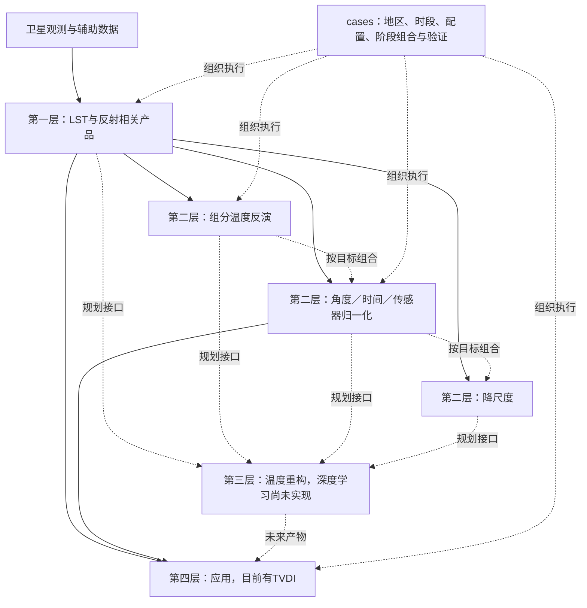

# LS4T 反演与优化方法手册：函数级盘点

盘点日期：2026-10-24。对象为 **`C:/work/ls4t` 当前工作树，包括未提交代码**；不是仅依据 Git HEAD，也不代表外部生产目录或已发布产品版本。HEAD 为 `9c17aa2ada8e5da7ca902b02ae6f3fc66cb34d90`，每个被扫描 Python 文件的 SHA-256 另存于函数索引 JSON。

同日功能补充：新增15个可组合核项、12个预设、固定形状WLS/有界形状参数minimize、单/双谐波ATC和留出比较案例。完整新接口见[核组合与ATC](C:/work/ls4t/docs/KERNELS_ATC.md)及本手册第五部分；函数索引已刷新。前四份分册描述原方法的具体数值行为，新接口不替换旧公式。

后续补充[TsHARP降尺度](C:/work/ls4t/docs/TSHARP.md)：数组/GeoTIFF入口用`method="tsharp"`选择，配套独立JSON和多源离线示例；详细说明见第六部分。

**组织原则：`base/` 承载可复用方法原版，`cases/` 保存针对传感器、地区、时段和实验目的的独立源码组合。** 组合允许把函数直接复制到案例执行脚本，不要求只调用 base。四层描述的是功能关系；初始盘点没有移动目录或修改科学算法，后续核组合/ATC增量见第五部分。新增三份[自包含参考组装](C:/work/ls4t/base/templates/references/README.md)，可复制到仓库外运行；旧案例和 base 批次兼容入口尚未整体迁移。

## 阅读入口

本手册随后合并四份详细清单及新增核组合/ATC接口；可以从这里直接打开分册或函数索引。

| 文档 | 主要内容 |
|---|---|
| [卫星产品层](C:/work/ls4t/docs/method_inventory/satellite.md) | 分裂窗公式、发射率、七类传感器入口、读写/几何、反射因子、NDVI及实际能力边界 |
| [组分反演与核优化](C:/work/ls4t/docs/method_inventory/components.md) | OLS/ridge、空间窗口、SLSQP、二次曲面、MAP、辐射物理、各角度核及逐项目标函数 |
| [归一化与合成](C:/work/ls4t/docs/method_inventory/normalization_and_compositing.md) | 角度、时间、传感器、空间归一化、降尺度、融合、合成、QA与产品契约 |
| [案例方法与缺口](C:/work/ls4t/docs/method_inventory/cases_and_gaps.md) | MSG/SLSTR/AATSR案例专有算法、组合流程、重复实现、LAI/建筑辅助方法与应用层 |
| [新增核组合与ATC](C:/work/ls4t/docs/KERNELS_ATC.md) | 核注册、自由组合、线性/形状参数拟合、单/双谐波ATC、日期与留出比较 |
| [新增TsHARP](C:/work/ls4t/docs/TSHARP.md) | NDVI聚合与覆盖率转换顺序、温度均值闭合、配置及离线案例 |
| [全量函数索引](C:/work/ls4t/docs/method_inventory/function_catalog.md) | 每个函数/方法的源文件行号、签名、说明、静态调用名及测试中的同名引用 |
| [机器可读索引](C:/work/ls4t/docs/method_inventory/function_catalog.json) | 文件哈希、完整定义信息、重复函数体分组；可用于后续迁移核对 |

每项核心方法尽可能写明：**函数 → 输入及单位/形状 → 输出 → 公式/目标函数 → 求解方法 → 参数与约束 → 失败处理 → 实际调用位置 → 测试证据和限制**。一般下载、绘图、路径处理、文档生成等工程助手保留在全量索引，不按独立反演方法计数。

## 一、四层如何承接现有代码



这些箭头表达允许的组合关系，不代表所有函数已用同一数据契约打通。组分反演通常依赖原观测几何及与之对应的有效权重；若先把温度归一到参考角度，权重仍沿用原角度，会改变反演问题。具体案例必须明确产品变量、时间、角度、空间支持、单位和质量标志，再决定顺序。

| 概念层 | 当前主要位置 | 当前实现状态 |
|---|---|---|
| 第一层：卫星产品 | `base/lst.py`、`base/{aatsr,slstr,msg,modis,viirs,ahi,aster}`及案例提取脚本 | 有双通道分裂窗LST及读写/预处理；反射相关功能包括读取、反射因子换算、NDVI，尚未确认完整公共地表反射率大气校正链 |
| 第二层：反演、归一化与尺度处理 | `base/lsct.py`、`base/lsct_window.py`、`base/fitting.py`、`base/kernel.py`、`base/rt/`、`base/normalization/`、`base/composite/`、案例内求解函数 | 方法最丰富，但公共核心、历史兼容函数和案例专有实现并存 |
| 第三层：温度重构 | 尚无独立公共模块 | 有DTC曲线拟合；未发现深度学习温度重构的训练/推断实现。SLSTR reconstruct为几何对齐，北京LAI reconstruction为LAI补全 |
| 第四层：应用 | `base/applications/tvdi.py` | TVDI计算和批处理已存在；干湿边需输入。未发现火点、FRP、燃烧面积或火险模型实现 |
| 案例组合 | `cases/`、少量`tests/examples/` | 真实案例、实验、方法比较和工程脚本共存；9个登记案例不等于只有9种流程或9种方法 |

## 二、真正的反演与优化方法族

以下按计算问题分组，不把传感器包装、窗口大小、并行版本和复制函数分别算作新算法。精确默认值、公式及参数顺序见后续函数条目。

| 方法族 | 关键函数/对象 | 实际计算 | 主要位置与边界 |
|---|---|---|---|
| 双通道LST反演 | `SplitWindowModel.retrieve`、`retrieve_dual_channel_lst` | 八特征广义分裂窗；按水汽分箱、按观测角插值系数 | `base/lst.py`；七传感器共享核心，不是七套独立物理算法 |
| LAI到方向覆盖率、混合发射率 | `vegetation_fraction_from_lai`、`effective_emissivity` | 指数间隙概率、土壤/植被及散射混合 | 属反演输入构造；公共默认与部分旧案例不同 |
| 单像元多角多组分 | `retrieve_components` | 辐射域按观测标准差加权OLS，或固定λ的ridge | 先检查条件数，后求解；正值/温区为事后过滤，不是有界LS |
| 局部常数空间窗口 | `retrieve_components_window` | 窗口内多像元多方向共享组分辐射 | 增加方程数；仍依赖局部同组分温度假设 |
| 向量化二/三元窗口LS | `solve_3x3_least_squares`、`solve_5x5_three_components`、`solve_2x2_system_5x5`等 | 窗口累计正规方程、解析式或批量线性求解 | MSG案例内多份；大小、计数、行列式阈值、共同掩膜存在差异 |
| 正则线性回归 | `fitting_unknown_linear_sklearn` | RidgeCV、Lasso、BayesianRidge分支 | 模型选择与返回形式见函数；不能统一称为三组分Bayes反演 |
| 物理约束窗口优化 | `fitting_Nangle_Mcomponent_window` | 距离加权残差平方和，SLSQP；辐射上下界和差值/包络约束 | `base/lsct_window.py`；部分温差用辐射差近似；未检查优化success |
| 二次空间曲面 | `fitting_Nangle_Mcomponent_window_quadratic` | 每组分6个二维二次辐射系数，中心常数项转温度 | 旧公共函数存在SciPy `lstsq(rcond=...)`兼容风险；对照示例的NumPy版本应分开看 |
| 分阶段组分分解 | MSG `retrieve`、`msg_lsct_iter`及约束实验 | 阳照与合并项、残差阴影/植被、先验联合调整等组合 | 生产三变体核心相同；不同实验不能只凭two_stage命名视作等价 |
| 外部先验Tikhonov | `solve_joint_vectorized_with_prior` | `||Ax-y||² + λ||x-x_prior||²` | MSG案例；求解后阴影裁剪不等于联合约束最优解 |
| 高斯MAP与顺序约束 | SLSTR `slstr_lsct3_bayes_scene.scene`及其辅助函数 | 辐射似然、相关温度先验、温差软先验、两步Gauss–Newton和局部约束投影 | 真实计算仍在case；无MCMC或完整后验样本；AATSR同名Bayes变体需单独核查 |
| 角度核与方向拟合 | `kernel_*`、`model_*`、`cost_*`、`fitting_kernel_R_min/RL_min` | LSF、TLSF/VLSF、Thapke、Vin、LiDense/Sparse、Ross、RL、Solar、RPV及组合 | 核、前向模型、目标函数、优化器是不同角色；报告逐项写出目标，不凭名称等同文献标准模型 |
| DTC与时角联合拟合 | `model_DTC/cost_DTC`、`model_DTCRL/cost_DTCRL`、`model_DTCLSFRL/cost_DTCLSFRL`、`cost_KDTC_*` | 日变化余弦与方向项联合估计 | 历史DTC周期参数化不同于新24h余弦归一化；也不是DL温度填洞 |
| 三参数角度归一化 | `angular_basis`、`fit_directional_coefficients`、`normalize_directional` | 匹配参考差值的加权标定，再按参考核减观测核修正 | 新公共实现；要求同地点同时刻的可比参考样本 |
| 可配置核组合 | `KernelTerm`、`KernelModel`、`fit_kernel_model` | 15个核项、12个预设及自由组合；固定形状WLS或外层形状参数minimize、内层WLS | `normalization/kernels.py`；沿用旧核公式，显式保存核/系数顺序，处理失秩和Li参数共同缩放不可辨识 |
| 年温度周期ATC | `annual_phase`、`fit_annual_cycle`、`ATCFit.predict/normalize` | 单/双谐波WLS，预测季节曲线或保留观测异常的季节归一化 | `normalization/annual.py`；支持公历闰年，检查季节覆盖，不代表天气过程或真实云下温度重构 |
| 日变化时间归一化 | `diurnal_anomaly`、`fit_diurnal_cycle`、`normalize_local_solar_time` | 24h谐波拟合，转到目标当地太阳时 | 一个拟合调用对应一组样本；不自动按像元分组、不自动补缺测 |
| 传感器一致化 | `SensorHarmonization.apply` | 仿射温度校正及误差传播 | 参数由调用者提供，没有自动交叉传感器标定器 |
| 协变量降尺度 | `downscale_temperature` | 粗尺度回归→细尺度预测→补粗尺度残差→父像元均值闭合 | 整数嵌套网格、细尺度共同有效域；闭合温度均值，不是Planck辐射守恒 |
| TsHARP降尺度 | `tsharp_cover_fraction`、`downscale_tsharp` | 聚合NDVI→覆盖率转换→粗尺度OLS→细预测→面积均值残差回补 | `method="tsharp"`，单NDVI，标准固定0/1端元和0.625指数；不含局部回归/场景端元估计 |
| 重网格/空间聚合 | `aggregate_to_grid`、`project_observation`、`mosaic_*` | 加权聚合、投影分箱、选优拼接 | 不因输出更细就成为物理降尺度；拼接选优不同于多源统计融合 |
| 多源融合 | `fuse_l3n` | 逆方差初值、创新阈值筛选、逆方差融合 | 需一致profile/网格；误差模型未显式处理来源间相关误差 |
| 时间/月合成 | `temporal_composite`、`monthly_paired`及案例月合成 | 逆方差合成、共同掩膜算术月均、逐日等权等不同实现 | 不能统一称为同一种“月合成”；逐文件、逐时次、逐日的权重语义不同 |
| 干旱指标 | `tvdi`、`tvdi_years` | `TVDI=(T-Twet)/(Tdry-Twet)`并裁剪 | 已有应用计算；干湿边系数不自动反演，不代表已完成干旱验证 |

物理支撑函数也已逐项列出：Planck/逆Planck、间隙与热点概率、散射角、有效发射率、`Hom`前向类、空间权重、初值和约束构造。它们是反演可复用组件，不单独冒充温度反演算法。

## 三、cases 应承载的组合及目前实际归属

| 案例/组合 | 当前可见的主要链条 | 仍在案例内的计算 |
|---|---|---|
| MSG双圆盘组分反演 | 同时双视角LST+LAI+几何→权重→窗口/分阶段组分解→QA→时次/月合成→参考配对 | 多种窗口解、约束、先验联合解与生产`retrieve`；compatible/declared/hybrid主要区别在几何策略 |
| SLSTR两组分场景 | 双视角LST与权重→5×5局部LS→组分温度 | `scene`直接选择窗口样本并调用`lstsq`，不是已完全委托统一公共入口 |
| SLSTR三组分Ridge | 热点权重→3×3窗口正则回归→组分温度 | 窗口构造、拟合和过滤 |
| SLSTR三组分MAP | 双视角→温度/辐射先验→两步MAP近似→顺序约束→物理筛选 | 先验、Gauss–Newton、约束投影等主要计算 |
| AATSR多种研究脚本 | 双角度→LS/Ridge/约束/二次曲面或先验变体→站点评价 | 部分算法分支、未完成函数和维度问题仍保留；不能整体标“成熟Bayes链” |
| 多源归一化示例 | 输入LST栅格→角度→时间→协变量降尺度（按case配置选择阶段） | 以公共函数为主，case负责参数、路径和输出；有离线合成示例，无新增真实区精度结论 |
| 温度时间/月合成 | LST/组分共同有效筛选→分时次/日/月统计 | SLSTR五温度月产品有特定逐日覆盖/等权规则；不同于统一逆方差合成 |
| MSG/AATSR受控方法比较 | 同一输入/有效域→多个求解器→约束消融/闭合/参考配对 | 为比较适配而写的数值实现和AST提取，不应作为生产公共库直接依赖 |
| 北京LAI/建筑 | EVI→经验LAI→谐波补全；建筑几何→覆盖率/结构统计 | 辅助地表变量计算；不归入温度DL重构或干旱/火灾应用 |

未来把case中的稳定计算下沉到公共库时，应保留具体方法标识、参数、组分顺序及回归证据；同名函数、相同函数体或相同输出波段数，都不足以证明整个案例数值等价。本轮只是定位这些边界，没有进行迁移。

## 四、盘点发现的具体缺口与使用限制

1. **地表反射率能力边界。** 反射波段读取、反射因子换算和NDVI已存在；完整地表反射率大气校正公共链尚未确认。第一层可以预留SR产品入口，但当前不能统一宣称LST/SR均已具备完整反演。
2. **温度重构与火灾仍是规划层。** 活动源码中未发现torch/tensorflow/keras训练推断链，也未发现火点/FRP/火险实现。DTC拟合、LAI补全、SLSTR几何重构各有用途，应按真实变量命名。
3. **算法副本与接口分散。** AST有170组相同函数体，包含为独立案例而有意保留的副本；人工核对的MSG生产三变体核心也相同。通用统计只比较函数体、保留体内文档字符串，忽略签名默认值；它是来源查对线索，不是全流程等价证明，也不要求删除案例副本。分册中的特定MSG对照另外去除了首层文档字符串。
4. **公共与旧案例默认参数不一致。** FVC、散射系数、热点、λ、窗口和有效掩膜都存在不同配置；整理时不能用公共默认参数静默替换生产设置。
5. **历史函数存在源码可见问题。** 旧二次曲面函数的SciPy关键字、`sample_hom_Emis2`调用缺失方法、`Hom.run`波长传递、`model_VinLiDense`系数下标、RPV实际公式、重名`cost_kernel_RLE_dif`覆盖、AATSR三组分Bayes维度等，均在对应条目指向代码。这些是静态审阅结论，本轮未逐项运行复现或修复。
6. **新归一化尚非完整统一产品链。** 角度/时间/降尺度栅格有阶段历史记录及网格检查，但不自动生成统一L3N误差产品；年目录包装与新栅格入口也不完全等价。融合profile回读对非默认参考条件的保留、空间聚合的误差语义，在分册中单列。
7. **评价统计需要审阅筛选规则。** 例如旧`cal_rmse_r2`先过滤绝对差≥9的样本，且R²返回形式有问题；不能把其数值直接当成未筛选全样本精度。内部辐射闭合、历史golden值和独立地面验证也必须分开。

## 五、范围与本轮验证记录

- 独立参考及存储边界补充后的AST解析：**297个Python文件、1,535个定义**；`base`539（含参考副本）、`cases`959、`tests/examples`37。按类型为普通函数1,355、类方法74、嵌套函数106；解析失败0。这个数字包含工具函数、包装器和复制定义，不是1,535种科学算法。初始盘点为291文件/1,431定义；核/ATC与TsHARP补充后为294文件/1,458定义。
- 扫描范围：`base/**/*.py`、`cases/**/*.py`、`tests/examples/**/*.py`。排除目录名`_archive`、`outputs`、`logs`、`runs`、`data`、`__pycache__`、`.case-state`、`.git`。排除历史归档有助于描述当前代码，不意味着归档内没有其它方法。
- 科学方法由分册逐段解释；全量索引补齐工程/数据处理定义。静态调用集合可能包含嵌套函数调用，测试同名引用可能只是字符串或其它同名对象；均不等于运行调用图、精确覆盖率或每个函数已逐行科学验证。
- **初始盘点全库测试：176 passed，3 skipped，用时14.24s。** `test_africa_download.py:14`因缺少shapely跳过；`test_beijing_building_structure.py:7`及`test_beijing_lai_8day.py:8`因缺少pyproj跳过。新增核组合/ATC的执行验证另见第五部分。
- **案例结构检查：9个登记案例通过。** 只验证登记结构，不执行科学处理，也不覆盖所有未登记的案例脚本。
- 没有下载原始产品、重跑区域反演、训练模型或重新计算独立地面精度；报告不新增RMSE/Bias优劣结论。

执行环境和命令（工作目录`C:/work/ls4t`）：

```powershell
& C:/work/miniconda/Scripts/conda.exe run -n python311 --no-capture-output python -B -m pytest -p no:cacheprovider -o addopts= -q -ra
& C:/work/miniconda/Scripts/conda.exe run -n python311 --no-capture-output python -B base/templates/audit_cases.py
```

索引可重建；详细分册是人工审阅记录，源码变更后须重新核对公式和参数，不会由AST自动更新：

```powershell
python docs/method_inventory/build_inventory.py
python docs/method_inventory/build_report.py
```

以下为四份分册与新增接口说明的完整内容。
